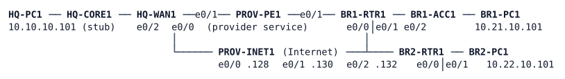

# LAB-049 — BR2 can't reach HQ

**Module:** 07 WAN and Tunnels · **Type:** T (Troubleshooting) · **Guidance tier:** G2 (site and service scope given, no cause) · **Estimated time:** 120 min · **Blueprint domains:** 2, 3, 5

## Scenario

On Saturday the network team ran a maintenance window called "Saturday WAN change window". The change log lists no devices. On Monday two tickets reach you, the on-call WAN engineer. Veridian's three sites (HQ, the BR1 stock depot and the BR2 depot) are meant to talk to each other over encrypted overlays that run across the Internet, with BR1's provider line as a less-specific standby. Find out what is wrong, fix it, and prove that the whole WAN is healthy again, not only the symptom you were sent.

## Objectives

- Turn two user-reported symptoms into a ranked list of suspects, using evidence from the devices and from the user's side.
- Repair the WAN without redesigning it: keep the tunnel, security, routing and access-control designs described below.
- Decide, from device evidence, which stage of tunnel bring-up is not completing and where on the path the evidence points, and prove it before you change anything.
- Prove the repaired WAN with a post-change test list, including failure behaviour.

## Available Information

HQ-WAN1 e0/0, BR1-RTR1 e0/0 and BR2-RTR1 e0/0 are the Internet-facing interfaces; BR1-RTR1 e0/1 is the provider-service interface.

| Link | Subnet | Addresses |
|---|---|---|
| HQ-CORE1 e1/0 -- HQ-WAN1 e0/2 | 10.10.255.96/31 | CORE1 .96, WAN1 .97 |
| HQ-WAN1 e0/0 -- PROV-INET1 e0/0 (Internet) | 203.0.113.128/31 | INET1 .128, WAN1 .129 |
| HQ-WAN1 e0/1 -- PROV-PE1 e0/0 (provider service) | 100.64.10.0/31 | PE1 .0, WAN1 .1 |
| BR1-RTR1 e0/0 -- PROV-INET1 e0/1 (Internet) | 203.0.113.130/31 | INET1 .130, BR1 .131 |
| BR1-RTR1 e0/1 -- PROV-PE1 e0/1 (provider service) | 100.64.21.0/31 | PE1 .0, BR1 .1 |
| BR2-RTR1 e0/0 -- PROV-INET1 e0/2 (Internet) | 203.0.113.132/31 | INET1 .132, BR2 .133 |
| LANs | HQ 10.10.10.0/24, BR1 10.21.10.0/24, BR2 10.22.10.0/24 | gateways .1, hosts .101 |

Router loopbacks (router IDs): HQ-CORE1 10.255.10.1, HQ-WAN1 10.255.10.41, BR1-RTR1 10.255.21.1, BR2-RTR1 10.255.22.1.

Design reference (the intended design; the running network may differ from it):

| Item | Design |
|---|---|
| Overlays | Tunnel21 (HQ-WAN1 .1, BR1-RTR1 .21) and Tunnel22 (HQ-WAN1 .1, BR2-RTR1 .22), 10.250.<id>.0/24, endpoints are the Internet-facing interfaces |
| Overlay routing | OSPF process 1; HQ area 0, BR1 area 21, BR2 area 22; overlay hello 5 s / dead 20 s, cost 100 |
| Provider service | static, less-specific (/16) backup for BR1 only; the overlay wins while it is up |
| Internet underlay | static default route to PROV-INET1 on every WAN router; no Internet address or default route is ever installed from OSPF |
| Overlay protection | IKEv2 with one pre-shared key per branch overlay, configured on the headend and on that branch only; IPsec with one profile on both overlays, identical parameters on both ends of each overlay |
| Headend circuit policy | HQ-WAN1's Internet interface has an inbound list that admits only what the branches' VPN, time and ping tests need, and logs the rest. PROV-INET1 must not be able to ping HQ-WAN1's Internet address; HQ-WAN1 must be able to ping PROV-INET1's side of its link |
| Time | HQ-WAN1 is the authenticated time source; the branches synchronise to it |
| Branch Internet | local breakout with address translation at the branch router |

Credentials: every console is privileged. Routers: `admin` / `Cisco123!`, enable secret `Cisco123!`. Hosts (Alpine Linux): `cisco` / `cisco`, `sudo` works without a password.

Platform notes and test tools:
- PROV-PE1 and PROV-INET1 belong to the providers: do not configure them. Use PROV-INET1 as an outside observer, and its Loopback0 (198.51.100.200) as "the Internet".
- The routers are IOL images. Console output is off by default (`no logging console`); read events with `show logging`. Debugs print into the logging buffer only when its level allows (`logging buffered 64000 debugging`), and verbose debug classes flood the buffer, so choose the narrowest one (error-level debugs are usually enough).
- Failure method for the tests below: a **cable pull** means `shutdown` on **both** ends of the link (BR1-RTR1 e0/0 and PROV-INET1 e0/1; BR2-RTR1 e0/0 and PROV-INET1 e0/2). Stopping a CML link leaves IOL interfaces up/up and is not a cable pull.
- Packet captures are done in the CML UI on the link of your choice.

## Starting State

The lab boots in the state the network was in on Monday morning: consoles open, hosts configured, tunnels and routing configured as the change window left them. The branch LANs and the provider service are up. Allow about two minutes after the nodes show BOOTED before judging the state, and about 20 minutes before judging clocks.

## Requirements / Change Requests

**R1** Restore connectivity from BR2 to HQ and to BR1 so that BR2 users can open HQ and BR1 applications; BR2's Internet browsing must keep working.

**R2** Stop BR1's traffic to HQ using the provider line while the Internet overlay is available.

**R3** Keep the design reference above: do not add a permit-all to the headend list, do not replace dynamic routing by statics to hide a problem, and do not change the provider routers.

**R4** Finish with every device in the state the design reference describes and no device logging recurring faults, whatever the tickets mention.

**R5** Write a post-change test list (at most ten lines) that you would run after any WAN change.

## Reported Problems

- **T1 (BR2 depot manager):** "Since the weekend nobody at BR2 can open the HQ applications or the BR1 stock system. Internet browsing from BR2 works fine."
- **T2 (NOC, weekly WAN report):** "BR1 traffic to HQ has been going over the provider line since Saturday. Nothing is down, but the provider line is meant to be the backup."

## Verification Criteria

**V1** From each LAN host, a traceroute to HQ-PC1 and to the other branch's host shows the overlay hop (10.250.x.x) and never the provider-service addresses (100.64.x.x), and HQ-PC1 reaches both branch hosts.

**V2** With the Internet link of BR1 cut (cable pull), BR1's host still reaches HQ-PC1 over the provider line, and after the link is restored the traffic returns to the overlay, each within 45 seconds of the trigger (the first successful end-to-end test after the cut or the restore, including the time the interface takes to come up). (BR2 has no backup transport: cutting its link must isolate it, and it must recover within 45 seconds of restoring the link.)

**V3** The WAN is stable for 5 minutes (state what you checked).

**V4** The design reference holds on every device: HQ-WAN1 pings 203.0.113.128, pings from PROV-INET1 (default source and Loopback0) to 203.0.113.129 get no reply, and the overlay protection row matches the configuration of each overlay (state the evidence).

**V5** Each branch's routes to HQ and to the other branch are learned from the overlay routing, and the route to every tunnel endpoint matches the Internet underlay row of the design reference (state the evidence).

**V6** Last, about 20 minutes after boot: both branch routers show HQ-WAN1 as `sys.peer` in `show ntp associations`.

**V7** The toolkit check: `show crypto session`, `show ip ospf neighbor` and the headend list counters agree with V1 to V5.

## Analysis Questions

**Q1** For each ticket, what was the first piece of evidence that told you where to look?

**Q2** How did you decide which stage of tunnel bring-up was failing on each device? Which output showed it, and what did you rule out first?

**Q3** After each fix, what did you re-test, and what did it show?

**Q4** How did you confirm that both tickets stayed closed, including after a failure test?

**Q5** Which items belong on a post-change test list for any WAN change, and why does each one matter?
