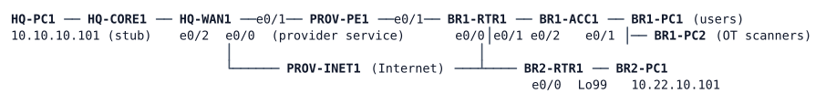

# LAB-050 — Multi-tenant WAN

**Module:** 07 WAN and Tunnels · **Type:** X/N (Expansion/Integration) · **Guidance tier:** G2 (behaviour stated, technology not named) · **Estimated time:** 150 min · **Blueprint objectives:** 2.2.a:R (VRF), 2.2.b:R (tunnel configuration and verification), 3.2.b:R (OSPF areas and route types)

## Scenario

Two findings from the security review of Veridian's WAN. First, the NOC manages the branch routers and the BR1 access switch over the same network the branch users sit on: every user can reach every management address. Second, BR1's new warehouse scanners (the OT segment) share the corporate routing table: they can reach everything, and everything can reach them. Veridian wants management and OT separated from the corporate network end to end across the WAN, over the same Internet underlay and the same encrypted-tunnel design as the corporate WAN of LAB-048, with HQ's management network as the only place branch devices are managed from.

## Objectives

- Give management and OT their own routing tables on every device on their path, and carry them across the WAN without letting them share a tunnel with each other or with corporate traffic.
- Keep the tenants' routing dynamic: a new subnet in a tenant needs no static route.
- Keep the Internet underlay unaware of the tenants and every tenant tunnel encrypted.
- Make management of the branch devices (including SSH access control) work through the management routing table only.
- Prove the separation with a reachability matrix and document it.

## Available Information

HQ-CORE1 is a stub that stands in for the HQ campus. HQ-WAN1, BR1-RTR1 and BR2-RTR1 each connect to PROV-INET1 on e0/0; HQ-WAN1 and BR1-RTR1 also connect to PROV-PE1 (provider service). BR1-PC1 is on BR1-ACC1 e0/1 (VLAN 10) and BR1-PC2 on e0/2 (VLAN 40).

| Item | Address |
|---|---|
| HQ-WAN1 e0/0 / BR1-RTR1 e0/0 / BR2-RTR1 e0/0 (Internet) | 203.0.113.129 / .131 / .133 (/31 to PROV-INET1) |
| HQ-WAN1 e0/1 / BR1-RTR1 e0/1 (provider service) | 100.64.10.1 / 100.64.21.1 (/31 to PROV-PE1) |
| HQ-CORE1 e1/0 -- HQ-WAN1 e0/2 (global OSPF) | 10.10.255.96/31 (.96 / .97) |
| Provider-assigned public blocks (loopbacks 201-203) | HQ-WAN1 203.0.113.144/29, BR1-RTR1 203.0.113.152/29, BR2-RTR1 203.0.113.160/29 (WAN1 Lo201 .145 and Lo202 .146; BR1 Lo201 .153 and Lo202 .154; BR2 Lo201 .161) |
| Corporate tunnels (global, protected, already built) | Tunnel21 10.250.21.0/24 (HQ-WAN1 .1, BR1 .21); Tunnel22 10.250.22.0/24 (HQ-WAN1 .1, BR2 .22) |
| LANs | HQ 10.10.10.0/24; BR1 users 10.21.10.0/24 (VLAN 10); BR2 10.22.10.0/24; gateways .1, hosts .101 |
| BR1 management (VLAN 99) | 10.21.99.0/24: BR1-RTR1 e0/2.99 .1, BR1-ACC1 .11 |
| BR1 OT (VLAN 40) | 10.21.40.0/24: BR1-RTR1 e0/2.40 .1, BR1-PC2 .102 |
| BR2 management | BR2-RTR1 Loopback99 10.22.99.1/32 |
| HQ management | HQ-CORE1 Loopback99 10.10.99.2/24 (the HQ management network and the only management source), a new VLAN 99 (dot1q) subinterface on the existing HQ-CORE1 e1/0 to HQ-WAN1 e0/2 link: use 10.10.254.10/31 (HQ-CORE1) and 10.10.254.11/31 (HQ-WAN1) |
| HQ OT servers (stand-in) | HQ-WAN1 Loopback40 10.10.40.1/24 |
| Tunnel numbering to use (site naming standard) | MGMT: Tunnel91 (HQ-WAN1 to BR1) 10.250.91.0/24, Tunnel92 (HQ-WAN1 to BR2) 10.250.92.0/24; OT: Tunnel41 (HQ-WAN1 to BR1) 10.250.41.0/24; hub .1, BR1 .21, BR2 .22 |
| Tenant names, route distinguishers, routing processes (site naming standard) | MGMT: VRF MGMT, rd 65010:99, OSPF process 99 area 0; OT: VRF OT, rd 65010:40, OSPF process 40 area 0. Tunnel values as in LAB-048 (`ip mtu 1400`, `ip tcp adjust-mss 1360`, point-to-point, hello 5, dead 20, cost 100) |
| Router IDs | as in LAB-048; use the same ID for a router's tenant OSPF processes (HQ-CORE1 10.255.10.1, HQ-WAN1 10.255.10.41, BR1-RTR1 10.255.21.1, BR2-RTR1 10.255.22.1) |

Credentials: every console is privileged. Routers and BR1-ACC1: `admin` / `Cisco123!`, enable secret `Cisco123!`. Hosts (Alpine Linux): `cisco` / `cisco`, `sudo` works without a password. Provider routers (PROV-PE1, PROV-INET1) are read-only for you.

Tools: the CML packet-capture function on a link (use it on the BR1-RTR1 to PROV-INET1 link) and `ping` with a source address.

Note: the tunnel numbers, tenant names, route distinguishers and process numbers above are the site's naming convention, fixed so that later labs and the checker find the same names. They are reference values, not configuration steps: how the tenants are separated, carried and routed is your design.

## Starting State

The corporate WAN of LAB-048 is running: HQ-WAN1 has OSPF neighbours on Tunnel21, Tunnel22 and toward HQ-CORE1, two IKEv2 sessions are up, BR1 and BR2 reach HQ and the provider's Internet host 198.51.100.200 as in LAB-048. In addition:

- BR1 has an OT segment: VLAN 40 on BR1-ACC1 (trunked to BR1-RTR1, which routes it on e0/2.40, 10.21.40.1/24) with BR1-PC2 (10.21.40.102) in it. Everything lives in the global routing table, so BR1-PC2 reaches every site and the Internet, and corporate users reach the OT segment.
- HQ-WAN1 carries Loopback40 (10.10.40.1/24, the OT servers stand-in) in the global table and in OSPF area 0.
- BR2-RTR1 has a management Loopback99 (10.22.99.1/32) and HQ-CORE1 a management Loopback99 (10.10.99.2/24), both in the global table; BR1-RTR1 e0/2.99 (10.21.99.1/24) is global too. Any user can ping any of them.
- The provider-assigned /29 loopbacks exist on all three WAN routers (Loopback201 and Loopback202 on HQ-WAN1 and BR1-RTR1, Loopback201 on BR2-RTR1) but are not used by any tunnel. HQ-WAN1's Internet-facing filter permits VPN traffic from the two existing tunnel endpoints only.
- Management sessions to the routers use SSH only, restricted by the existing management access list (HQ management 10.10.99.0/24 and the NMS 10.50.50.0/24). There is no HQ-CORE1 to HQ-WAN1 management link yet.

## Requirements / Change Requests

R1. Management separation: the branch routers' and BR1-ACC1's management addresses (BR1 VLAN 99 and BR2 Loopback99) are reachable only from HQ's management network (10.10.99.0/24 on HQ-CORE1), through a routing table that is separate from the users'. HQ-CORE1's management network must be attached to the WAN through the new link between HQ-CORE1 and HQ-WAN1. Branch users (BR1-PC1, BR2-PC1) and HQ users can no longer reach any management address. SSH to every branch router and BR1-ACC1 works from HQ management and is refused from every other source, including the HQ-CORE1 to HQ-WAN1 link address.

R2. OT separation: BR1-PC2 reaches the OT servers at HQ (10.10.40.1) and nothing else; corporate users at BR1, BR2 and HQ cannot reach the OT segment or the OT servers; the OT segment has no Internet breakout.

R3. Each tenant has its own tunnel(s): no tenant shares a tunnel with another tenant or with the corporate traffic, and no tenant's tunnels depend on another tenant's tunnels staying up. The tunnels use the provider-assigned loopbacks as their endpoints, so no two tunnels of different tenants share a pair of public addresses. Tenant routing is dynamic.

R4. The corporate (global) WAN of LAB-048 is unchanged: same tunnels, same routing, same backup behaviour. BR1 users still reach HQ, BR2 and the Internet as before.

R5. Tenant tunnels are encrypted exactly like the corporate ones (same IKE profile, keyring and protection profile), through HQ-WAN1's Internet-facing filter, which must be opened only for the new endpoint pairs and only for what the tunnels need (IKE, NAT-T, ESP, and ICMP between the loopbacks for testing).

R6. Document per tenant (corporate, MGMT, OT): interfaces, tunnels, routing process, and a reachability matrix (rows: BR1-PC1, BR1-PC2, BR2-PC1, HQ-PC1, HQ management; columns: management addresses, OT addresses, corporate hosts, the Internet host) with the test that proves each cell.

## Verification Criteria

After a tunnel or routing change, adjacencies and ARP need a few seconds to settle: repeat a failed first ping before concluding anything.

V1. Every tenant tunnel and its routing adjacency is up, and each tenant's routes are present in its own routing table on every router of the path and absent from the corporate table.
V2. BR1-PC2 reaches 10.10.40.1 and 10.21.40.1; it reaches none of the management addresses, none of the corporate hosts and not the Internet host.
V3. BR1-PC1, BR2-PC1 and HQ-PC1 reach none of the management addresses and none of the OT addresses; they keep the LAB-048 reachability for corporate hosts (BR1-PC1 and BR2-PC1 also reach the Internet host).
V4. From HQ management (source 10.10.99.2), all three branch management addresses answer, and SSH is accepted from there; SSH from a source outside 10.10.99.0/24 and 10.50.50.0/24 is refused.
V5. A capture on the BR1 Internet link shows, for the three tunnels, only encrypted traffic between three distinct public address pairs (and the key exchange), no tenant addresses and no tenant identifiers.
V6. A do-not-fragment ping of 1400 bytes through a tenant tunnel passes and 1401 does not.
V7. Toolkit: `show ip route vrf <tenant>` on every router of each tenant's path shows the expected routes (state the commands you used per router in your documentation).
V8. Corporate behaviour of LAB-048 is unchanged: HQ-WAN1 still has its two global tunnel adjacencies and its two original IKE sessions, and BR1 still learns HQ prefixes through Tunnel21.
V9. Failure test: after a cable pull of BR1's Internet link (both ends shut down), corporate traffic between BR1 and HQ continues; the tenant tunnels to BR1 go down; after restore all three BR1 tunnels return. Record the times of each event over at least three runs.

## Analysis Questions

Q1. Which commands showed you, for a given packet, which routing table it used and why?
Q2. Why do the MGMT and OT tunnels between the same two routers use different public loopbacks? What would be needed if two tunnels shared both endpoints?
Q3. What can the provider tell about the tenants from a capture on its link?
Q4. Why does a ping or traceroute without a VRF mislead during verification of this design?
Q5. How does this design map to segmentation in an SD-WAN fabric (a preview of labs 071 and 072)?
Q6. Which of the three tenants has no backup path when BR1's Internet link is cut, and what does the corporate tenant's failover rely on that the others do not have?
Q7. Which management services of BR1-ACC1 changed when its gateway moved into MGMT, and how would you restore them?
