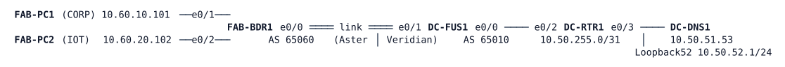

# LAB-051 — The Fusion Handoff

**Module:** 07 WAN and Tunnels · **Type:** I (Implementation) · **Guidance tier:** G2 (behaviour stated, technology not named) · **Estimated time:** 120 min · **Blueprint objectives:** 1.3.b:I (handoff part), 2.2.a:R, 3.2.c:R

## Scenario

Veridian has acquired Aster Warehousing. Aster keeps running its own network, with its own routing, and its two virtual networks, CORP (staff) and IOT (devices), until the fabric project later this year. For now Aster's border router, FAB-BDR1, hands both networks to Veridian over one physical link. Aster's staff and devices need Veridian's name service and nothing else of Veridian's, and the two Aster networks must never be able to reach each other.

Aster's side is finished and belongs to Aster's engineers: you may look at FAB-BDR1, but you change only DC-FUS1, Veridian's router on the other end of the link.

## Objectives

- Receive two separately routed customer networks on one link and keep their routing tables apart.
- Let a deliberately chosen part of Veridian's network (one service subnet) be reachable from both customer networks, and nothing else.
- Predict, for every prefix, which routing table it sits in on each router, and why return traffic finds its way back.
- Make the design extensible: a second shared service must be a one-place change.

## Available Information

| Device | Interface | Address | Connects to |
|---|---|---|---|
| FAB-BDR1 | Ethernet0/0.3001 (dot1q 3001) | 10.200.60.3/31 | DC-FUS1 Ethernet0/1, CORP |
| FAB-BDR1 | Ethernet0/0.3002 (dot1q 3002) | 10.200.60.5/31 | DC-FUS1 Ethernet0/1, IOT |
| FAB-BDR1 | Ethernet0/1 | 10.60.10.1/24 | FAB-PC1 (CORP LAN) |
| FAB-BDR1 | Ethernet0/2 | 10.60.20.1/24 | FAB-PC2 (IOT LAN) |
| FAB-BDR1 | Loopback0 | 10.255.60.21/32 | router ID |
| DC-FUS1 | Ethernet0/1 | no address yet | FAB-BDR1 Ethernet0/0 |
| DC-FUS1 | Ethernet0/0 | 10.50.255.1/31 | DC-RTR1 Ethernet0/2 |
| DC-FUS1 | Loopback0 | 10.255.50.5/32 | router ID |
| DC-RTR1 | Ethernet0/2 | 10.50.255.0/31 | DC-FUS1 Ethernet0/0 |
| DC-RTR1 | Ethernet0/3 | 10.50.51.1/24 | DC-DNS1 (shared services segment) |
| DC-RTR1 | Loopback0 / Loopback52 | 10.255.50.1/32 / 10.50.52.1/24 | router ID / a future second shared service |
| DC-DNS1 | eth0 | 10.50.51.53/24 | DC-RTR1 Ethernet0/3 |
| FAB-PC1 / FAB-PC2 | eth0 | 10.60.10.101/24 / 10.60.20.102/24 | gateway .1 of the LAN |

Aster's documented handoff, which you must follow exactly:

| Network | VLAN ID on the link | Aster side | Veridian side | Aster prefix | Aster AS |
|---|---|---|---|---|---|
| CORP | 3001 | 10.200.60.3/31 | 10.200.60.2/31 | 10.60.10.0/24 | 65060 |
| IOT | 3002 | 10.200.60.5/31 | 10.200.60.4/31 | 10.60.20.0/24 | 65060 |

Aster's router already announces its user subnet to a BGP neighbour at the Veridian address of each network. Veridian's AS is 65010. Route distinguisher and tag values are yours to choose, but keep them in the 65010 number space and write them in your answer to R5. The 10.200.60.0/31 prefix is reserved for the later fabric project: do not use it.

Veridian's data centre runs OSPF in area 50; DC-RTR1 already announces the shared services segment (10.50.51.0/24) and its other prefixes into it. Name service: `erp.veridian.example` and `dns1.veridian.example` resolve on DC-DNS1. The two PCs are preset to use it as resolver. DC-DNS1 is a service node with no CLI.

Credentials: `admin` / `Cisco123!` (console sessions are already privileged). BGP sessions are unauthenticated in this lab. Allow about 90 seconds after boot or after a change for BGP to settle.

## Starting State

All six nodes are powered and cabled. FAB-BDR1 is complete. DC-RTR1 and DC-DNS1 are complete. DC-FUS1 has addressing on Ethernet0/0 (towards DC-RTR1) and an up, unaddressed Ethernet0/1; it has no routing configuration of any kind. Each PC reaches its own gateway; nothing beyond that works.

## VRFs, route targets and leaking in brief

Concepts only; the values are yours to choose.

- **VRF.** A VRF is a separate routing table (and forwarding table) on one router. An interface belongs to one VRF; a prefix learned in a VRF is in that VRF's table only. You know VRF-lite with static routes and per-VRF OSPF; here the routing protocol toward the customer is BGP, run once per VRF (a BGP address family per VRF).
- **Route distinguisher (RD).** A value prepended to a prefix inside BGP so that identical prefixes from different VRFs stay distinct.
- **Route target (RT).** A BGP extended community on a route. A VRF *exports* its routes with its export RT(s) and *imports* the routes that carry one of its import RT(s).
- **Leaking on one router.** Routes can be exported from one VRF and imported by another VRF on the same router through BGP, with no VPNv4 neighbour. An *export map* is a route-map applied to a VRF's export.
- **Redistribution.** `redistribute` (with a route-map) moves routes between routing protocols, as you did in module 03.
- **Entry `show` commands.** `show ip vrf`, `show ip vrf interfaces`, `show ip route vrf <name>`, `show ip bgp vpnv4 vrf <name>`, `show ip bgp vpnv4 vrf <name> summary` (on this image `show bgp vrf <name>` is not valid).

## Requirements / Change Requests

**R1.** Hand both Aster networks over to Veridian on the one physical link as the handoff table above describes, with each network in its own routing table on DC-FUS1 and its own BGP session with FAB-BDR1 (Veridian AS 65010).

**R2.** FAB-PC1 (CORP) and FAB-PC2 (IOT) resolve `erp.veridian.example` using DC-DNS1 and reach the shared services segment, 10.50.51.0/24.
**R3.** Neither Aster network reaches the other, Veridian's loopbacks, Veridian's management network (10.50.50.0/24) or any other Veridian prefix. Veridian (DC-RTR1) learns only Aster's two user subnets. Aster (FAB-BDR1) learns only the shared services subnet.

**R4.** Adding a second shared service later must need one change on DC-FUS1 only. State where that change is and show it with the test prefix 10.50.52.0/24 (DC-RTR1 Loopback52), then remove it again so the final state matches R3.
**R5.** Draw the handoff: for every Aster and Veridian prefix, name the routing table it is in on FAB-BDR1, DC-FUS1 and DC-RTR1, and say why return traffic from the shared services finds its way back to the right Aster network.

## Verification Criteria

**V1.** From each PC, a lookup of `erp.veridian.example` against 10.50.51.53 returns 10.50.51.53, and a ping to 10.50.51.53 and to 10.50.51.1 succeeds.

**V2.** From each PC, pings to the other PC, to 10.255.50.1, to 10.50.50.1 and (before R4) to 10.50.52.1 all fail.
**V3.** A traceroute from FAB-PC1 to 10.50.51.53 shows the path FAB-BDR1, DC-FUS1, DC-RTR1, DC-DNS1, and the same from FAB-PC2 (different Aster-side hops).

**V4.** FAB-BDR1 has exactly one BGP-learned prefix in each of its two routing tables (10.50.51.0/24); DC-RTR1 has exactly two routes towards Aster (10.60.10.0/24 and 10.60.20.0/24) and none for the Aster handoff /31s.
**V5.** On DC-FUS1 both BGP sessions are established and the routing tables of CORP and IOT each contain the shared service subnet and their own Aster subnet, and no other Veridian prefix.

**V6.** With the test prefix of R4 added, FAB-PC2 reaches 10.50.52.1 within a few seconds and FAB-PC1 does as well; with it removed, both fail again.
**V7.** After you reset the BGP session of one Aster network, that network recovers on its own and the other network's session never drops.

**V8.** When the link between FAB-BDR1 and DC-FUS1 is cut (cable pull: `shutdown` on both ends, Ethernet0/1 on DC-FUS1 and Ethernet0/0 on FAB-BDR1), both PCs lose the name service while still reaching their gateway; after restoring both ends service returns. Record the time to the first successful PC ping.

## Analysis Questions

**Q1.** Why does Veridian need a router like DC-FUS1 between two separately routed networks and the data centre, instead of connecting each network to DC-RTR1 directly?

**Q2.** Both Aster networks reach the shared segment, yet they cannot reach each other. Which mechanism of your design prevents it, and what would break that guarantee?
**Q3.** What does each tag (route target) you configured do in your design: what is exported with it, what imports it, and which prefixes are held back and by what?

**Q4.** Compare reaching the shared service by BGP-based leaking with a design of static routes between the tables. What would R4 have cost with static routes?
**Q5.** Which parts of this handoff would a Software-Defined Access border node and an external fusion router reuse?

**Q6.** DC-RTR1 learns the Aster prefixes as OSPF external routes. Why must DC-FUS1 re-advertise them into OSPF at all, and why are the Veridian loopbacks not visible from Aster although OSPF in the shared table has them?
