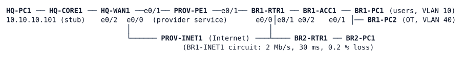

# LAB-052 — WAN Operations

**Module:** 07 WAN and Tunnels · **Type:** N (Integration) · **Guidance tier:** G1 (business outcomes) · **Estimated time:** 150 min · **Blueprint objectives:** 1.4:R, 3.2.d:P, 4.4:R, 6.6:R

## Scenario

Veridian's WAN (the multi-tenant design of LAB-050) is running. BR1 is moving its telephony to HQ's call servers, and Operations receives three requests for one change window. There is no step list: you decide how to deliver each request, prove it with measurements, and leave the three tenants and the existing backup behaviour as they are.

- **BR-1, calls survive a saturated Internet line.** When BR1 uploads a large amount of data to HQ over its Internet circuit, voice from BR1 (marked EF by the phones; BR1-PC1 simulates it with `iperf -u -S 0xB8`) must lose no packets and keep its jitter low. Warehouse OT traffic from BR1 (VLAN 40) keeps a guaranteed share of the circuit. Everything else takes what is left. The circuit's contracted rate is 2 Mb/s upstream.
- **BR-2, voice takes the provider line while it really works.** Voice between BR1 and HQ (EF-marked, in both directions) uses the provider service (PROV-PE1, lower latency) as long as the provider path actually delivers packets, not merely while the interface is up. When it does not, voice moves to the encrypted Internet path within 20 seconds. Everything else keeps its W3 routing.
- **BR-3, evidence when a WAN tunnel drops.** When any WAN tunnel at BR1 goes down, BR1 records the time, which tunnel, and its routing and crypto state at that moment in a file on the router, and sends a syslog message the NOC can alarm on.

Constraints: no reboot of any device, management only through the MGMT tenant, and the tenant separation and backup behaviour of LAB-050 stay unchanged.

## Objectives

- Protect voice and guarantee OT bandwidth on a real, congested WAN circuit, and measure that you did.
- Choose the transport per traffic class from what the path actually delivers, at both ends of the path.
- Capture failure evidence automatically, and know what the automation can and cannot see.
- Prove each outcome with counters, captures or timed tests rather than by inspection.

## Available Information

The topology, addressing, tunnels, tenant names and credentials are those of LAB-050 (the stage called W3), with these additions:

| Item | Value |
|---|---|
| BR1 Internet circuit (BR1-RTR1 e0/0 to PROV-INET1 e0/1) | contracted 2 Mb/s upstream; in CML the link is conditioned with 2000 kb/s bandwidth, 30 ms latency in each direction (about 60 ms added round trip) and 0.2 % loss, in both directions |
| Provider service addresses (/31s to PROV-PE1) | HQ-WAN1 e0/1 100.64.10.1, BR1-RTR1 e0/1 100.64.21.1; PROV-PE1 is read-only |
| Voice traffic | EF (DSCP 46, ToS 0xB8) from BR1 users, 10.21.10.0/24 (VLAN 10), to HQ 10.10.0.0/16, and the return direction from HQ to 10.21.10.0/24 |
| OT traffic | BR1 VLAN 40, 10.21.40.0/24 |
| Test tools on the Alpine hosts | `iperf` (v2; a server takes one session at a time: restart it between runs), `traceroute -t <ToS>` (busybox; `-t 184` is EF), `ping`. A bulk datagram larger than about 1300 bytes is refused on the 1400-byte tunnels: use `-l 1200` for bulk and `-l 200` for voice-like streams |
| CML tools | `link stop`/`link start` on a link (a silent failure: both interfaces stay up/up), the packet capture on a link, and the node consoles |

Credentials as in LAB-050: every console is privileged; routers `admin` / `Cisco123!`, enable secret `Cisco123!`; hosts `cisco` / `cisco`. PROV-PE1 and PROV-INET1 are read-only for you.

Notes:
- Router files you create live in RAM (`unix:`) and are lost at a reload; this lab has no flash.
- A traceroute shows the forward hop addresses reliably; the replies of the routers themselves may return through a tunnel, so judge the path by hop addresses, not by times.
- `clear policy-map interface` is not accepted here: compare counters before and after a test.

## Starting State

The WAN W3 stage (the finished LAB-050 WAN) runs with the three tenants and the three BR1 tunnels (Tunnel21 corporate, Tunnel41 OT, Tunnel91 MGMT) up. The only differences are the conditioned BR1 Internet circuit above and the hosts' tools. Nothing treats voice differently from other traffic, all traffic between BR1 and HQ uses the tunnels, and no router keeps any record of tunnel failures.

## Concept note

ESP numbers its packets, and the receiver discards a packet that arrives too far behind the highest number it has seen (anti-replay). Queueing that reorders packets inside one IPsec SA can therefore cause discards at the far end; the receiver's log is where this shows. (This is background for the load test: how you handle it is part of your measurements.)

## Requirements / Change Requests

R1. Under the load of V1, voice from BR1 to HQ is delivered with no loss attributable to congestion and bounded jitter, OT data keeps at least a quarter of the circuit under congestion, and best effort is limited to the remainder. The Internet circuit is the bottleneck you protect, and the result must come from your own policy on BR1-RTR1, not from the circuit's drops (the conditioned link is the circuit you are protecting, not a substitute for your policy).

R2. The voice class in R1 is recognised from its marking, including inside the tunnels. The OT segment's traffic is marked AF31 on entry from VLAN 40, and the marking of voice from the phones is trusted. Your documentation says how the marking appears on the Internet circuit.

R3. EF-marked traffic between BR1 users and HQ (both directions) uses the provider service while it delivers packets to the far end, and the Internet tunnel otherwise. The decision follows whether the provider path delivers packets end to end, not the local interface state. It fails over in at most 20 seconds from the failure (a detector that works from periodic tests needs a few test periods, so budget your timers accordingly), and it returns only after the provider path has stayed good for 30 seconds. All other traffic keeps its LAB-050 path.

R4. When any of the three BR1 tunnels goes down, BR1 writes a file on the router for that tunnel containing the time, the tunnel's interface state, the routing table, the crypto sessions and the OSPF neighbours at that moment, and logs one alert-level syslog message per tunnel that names the tunnel and the file. A second failure does not overwrite the first tunnel's file.

R5. No reboot, no change to MGMT access, no change to the three tenants' separation (a sample of the LAB-050 reachability matrix still holds), and every change survives both WAN routers' tunnels re-establishing.

R6. Document each request: the design, the measurements, and the commands you used.

## Verification Criteria

V1. Load test from BR1-PC1 to HQ-PC1 for 30 seconds, started together: EF 300 kb/s (`-S 0xB8 -l 200`), AF31 400 kb/s (`-S 0x68 -l 1200`) and best effort 3 Mb/s (`-l 1200`), each to its own server port. Run the load test with the BR1 provider link stopped in CML (`link stop` BR1-RTR1 e0/1 to PROV-PE1), so that EF uses the Internet circuit, and restart the link afterwards. EF loses no packets other than the circuit's 0.2 % random loss (at most 2 per 1000); best effort receives what is left of 2 Mb/s after EF and OT. Record the same test with nothing configured.

V2. Per-class counters on the router show the EF and AF31 packets in their own classes, with no drops in either, and the drops in the default class (before/after values).

V3. A capture on the BR1 Internet link shows the ToS values of the encrypted packets: state the values you see for EF, AF31 and tunnel control traffic.

V4. With the provider path healthy, `traceroute -t 184` from BR1-PC1 to HQ-PC1 shows 100.64.x provider hops, and the same trace without `-t` shows the tunnel. From HQ-PC1 the EF return path uses the provider service too.

V5. Silent failure of the BR1 provider link (CML `link stop` BR1-RTR1 e0/1 to PROV-PE1): a voice-like EF stream in each direction recovers on the Internet path within 20 seconds of the `link stop`, and returns to the provider path after the link is restored plus the 30 s hold-down. Three runs, raw values.

V6. Cable pull of BR1's Internet link (shut down BR1-RTR1 e0/0 and PROV-INET1 e0/1): within 30 seconds each tunnel at BR1 has its file with the required content and its syslog message. Repeat with a silent failure of the same link (`link stop`). Three runs each, raw values.

V7. The sample of the LAB-050 matrix still holds: BR1-PC1 reaches HQ-PC1 but not 10.21.99.1 or 10.10.99.2 or 10.10.40.1; BR1-PC2 reaches 10.10.40.1 but not 10.10.10.101; SSH to BR1-RTR1's management address works from HQ management only.

## Analysis Questions

Q1. The router's Internet interface is faster than the circuit. Why does your treatment of the circuit not work without something that makes the router act as the bottleneck, and what did the CML link rate make you do differently from a real circuit?

Q2. Does the ToS byte of a packet survive GRE and IPsec encapsulation, and what did you use to prove it? What would you have to do if it did not?

Q3. Why is a probe of the provider path better than following the interface state for deciding between the two transports here? What does each choice do to a voice call when the provider fails silently?

Q4. Why does the policy at BR1 alone not move the return voice from HQ to BR1?

Q5. What did your evidence file capture on a silent failure compared with a cable pull, and what can a file written by the router on the failing side not tell you?

Q6. During the load test, which counters or log messages would have told you that something besides congestion was dropping best effort traffic?
