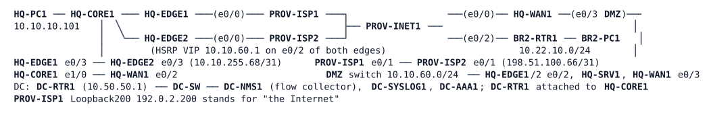

# LAB-053 — A Backup Path Through the Edge

**Module:** 07 WAN and Tunnels · **Type:** X (Expansion) · **Guidance tier:** G2 (behaviour only) · **Estimated time:** 150 min · **Blueprint objectives:** 2.2.b:R, 3.3.b:R, 4.2:R, 5.2.a:R, 5.2.b:R

## Scenario

Veridian's branch BR2 has no provider line: its only way to HQ is the encrypted tunnel (Tunnel22) that ends on HQ-WAN1's own Internet circuit. When that circuit fails, BR2 is cut off from HQ. The design review approved a second headend path: the same HQ-WAN1 router, reached over the Internet through HQ's protected edge (two providers, two edge routers) at the DMZ address reserved for it. The security team has one condition: the edge protection policy of the previous project stays intact, every new exception is the narrowest the protocols allow, and the new path is visible in the flow records the NOC already collects.

You build the path, prove it under failure, and update the documentation.

## Objectives

- Publish a VPN headend that lives in a DMZ behind a filtered, address-translating Internet edge, and bring up a tunnel to it across that edge.
- Open the edge for the new tunnel with the smallest possible exceptions, on both edge routers, without weakening anything else.
- Decide from counters (not from assumption) whether the edge's control-plane protection has to change.
- Prove from packet captures and flow records which path carries the traffic, and with which addresses.
- Measure what each failure costs: the primary circuit, either provider, and the headend router itself.

## Available Information

| Item | Value |
|---|---|
| HQ-WAN1 | e0/0 Internet 203.0.113.129/31 (PROV-INET1 .128); e0/2 to HQ-CORE1 10.10.255.97/31 (OSPF area 0); e0/3 DMZ 10.10.60.41/24 (reserved for the backup path; no routing protocol on it) |
| BR2-RTR1 | e0/0 Internet 203.0.113.133/31; e0/1 LAN 10.22.10.1/24; Loopback201 203.0.113.161/32 and Loopback203 203.0.113.163/32 (both from BR2's provider block 203.0.113.160/29); OSPF area 22 |
| Existing primary tunnel | Tunnel22 HQ-WAN1 (10.250.22.1) to BR2-RTR1 (10.250.22.22), GRE protected by IPsec, OSPF cost 100 |
| Tunnel numbering | tunnel subnets are 10.250.`<tunnel-id>`.0/24, hub .1, BR2 .22; the backup tunnel is number 122 (10.250.122.0/24). Every tunnel in this WAN: `ip mtu 1400`, `ip tcp adjust-mss 1360`, OSPF point-to-point, hello 5 s / dead 20 s, explicit cost (primary 100, backup 500) |
| IPsec in this WAN | IKEv2 only, one wildcard keyring (PSK `VERIDIAN-VPN-KEY`), one IKEv2 profile `IKEV2-PROF`, transform set `esp-aes 256 esp-sha256-hmac`, IPsec profile `VPN-PROF` |
| Edge routers | HQ-EDGE1 (HSRP active, priority 110, BGP to PROV-ISP1 AS 64601, address 198.51.100.65) and HQ-EDGE2 (standby, BGP to PROV-ISP2 AS 64602, 203.0.113.65); HSRP group 60 VIP 10.10.60.1 on the DMZ (e0/2); iBGP between them; Veridian's public block is 192.0.2.0/26 (users, PAT) and 192.0.2.128/26 (servers). 192.0.2.140 is **unused** and reserved for HQ-WAN1 |
| Edge policy of the previous project | inbound IPv4 list `EDGE-IN-V4` on e0/0 (26 entries, sequence 10-260, ending `260 deny ip any any log`), `EDGE-IN-V6`, control-plane policy `PM-COPP`, flow monitor `FM-EDGE` (exports to DC-NMS1) on e0/0, e0/1 and e0/2 |
| Flow collector | DC-NMS1 10.50.50.60 (Ubuntu with `tshark`; collector on UDP 2055, decode with `-d udp.port==2055,cflow`) |
| DC | DC-RTR1 10.50.50.1 serves NTP (authenticated, key 1) to the edges; HQ-WAN1 is `ntp master 3` for BR2 |
| Credentials | every console is privileged; routers `admin` / `Cisco123!`, enable secret `Cisco123!`; hosts `cisco` / `cisco` |

Notes:
- Cable pull in this lab means `shutdown` on **both** ends of the link; a silent failure means the CML `link stop` on the link (both interfaces stay up/up, traffic is dropped); a node stop is a silent failure for every neighbour. These three are different tests: say which you used.
- `clear policy-map interface` is not accepted: compare counters before and after a test. `debug crypto ikev2` output is stored at logging level debugging: raise `logging buffered` to `debugging` while you use it (and set it back).
- An IOS `traceroute <ip> source <loopback> numeric probe <n> timeout 1 ttl 30 30 port 
` sends `<n>` UDP probes from the chosen source to the chosen port; use it when you need to generate UDP towards a published address. The CML packet capture is available on every link.
- A flow that is still running is not exported by the flow monitor until it ends (inactive 15 s, active 1800 s); bounce a tunnel to see its records. The flow only ends after it has been idle for the inactive timeout, so start the capture first, keep the tunnel shut for at least 30 s (twice the inactive timeout), and let the capture run at least 60 s in total.
- The first ping from BR2-PC1 after a boot may be lost.

## Starting State

The edge of the previous project runs as built (`EDGE-IN-V4`/`V6`, `PM-COPP`, `FM-EDGE`, the static NAT for the web server 192.0.2.130, PAT for users, HSRP, BGP to both providers). HQ-WAN1 is attached to the stub core and to PROV-INET1, with Tunnel22 to BR2 up (IKEv2 on UDP 500, OSPF full, BR2 reaches HQ through it). HQ-WAN1's DMZ interface is cabled and addressed but unused. BR2-RTR1 already has Loopback203. There is no second tunnel, no NAT for 10.10.60.41, and no exception for it on either edge. Each router keeps its own saved configuration; BR2-PC1 reaches the Internet host 192.0.2.200 and HQ-PC1.

## IPsec and NAT: concepts

An IPsec SA protects a *traffic selector*: the pair of addresses (or the ACL) it was negotiated for, and each peer checks that the other end's selector matches its own. IPsec has tunnel mode (a new outer IP header around the whole original packet) and transport mode (the original IP header kept, only the payload protected); LAB-047's primer describes both.

## Requirements / Change Requests

R1. BR2 keeps reaching HQ (HQ-PC1, 10.10.10.101) when HQ-WAN1's Internet circuit is down, over a second GRE-over-IPsec tunnel (Tunnel122) that crosses Veridian's Internet edge and ends on HQ-WAN1's DMZ address, which the Internet knows as **192.0.2.140**. BR2 sources it from Loopback203. When the circuit is back, BR2 returns to the primary path. Both tunnels stay up and routed at all times, with the primary preferred. The tunnel must carry a full-size 1400-byte IP packet with the DF bit set, in line with the other tunnels of this WAN.

R2. Each edge accepts for the backup path only the key exchange and the encrypted traffic that BR2's backup source (203.0.113.163) sends to the published address, in the narrowest form the protocols allow, on **both** edges. Nothing else of the previous project's policy changes, and its protection matrix (a sample of what is permitted and what is denied) still holds.

R3. Decide, with evidence from counters, whether the edge's control-plane protection has to change for the backup path, and change it only if the evidence says so. The same counters must show how traffic that the edge refuses is treated.

R4. Show from the DC's flow collector that the backup path is in use, and which addresses appear on which side of the edge (inside and outside) in the records.

R5. The backup path survives the loss of either provider (the tunnel is kept or re-established; some loss is acceptable). Establish, from evidence, which of the two happens.

R6. Update the edge protection matrix and the WAN documentation (a short written record) with the backup path, including what the design does not protect against.

## Verification Criteria

V1. With the primary circuit down (cable pull of the HQ-WAN1 to PROV-INET1 link) BR2-PC1 reaches HQ-PC1 within 30 seconds of the pull, the traceroute from BR2-PC1 to HQ-PC1 shows the backup tunnel's address as the first HQ hop, and the IKEv2 session of the backup tunnel shows the published address and UDP 4500. After the link is restored, BR2 uses the primary path again within 90 seconds, and HQ-PC1 stays reachable throughout the failback.

V2. A 1400-byte packet with DF set passes through the backup tunnel and a 1401-byte one does not; both tunnels show `ip mtu 1400`. State the transport MTU the router reports.

V3. A UDP 500 or 4500 probe to 192.0.2.140 from 203.0.113.163 is accepted by the edge; probes to 192.0.2.140 that the backup path does not need, from any source including 203.0.113.163, are refused and logged (try 203.0.113.161, the Internet host 192.0.2.200, and a different port or source port from 203.0.113.163). The refusals appear as log messages and as counters on the final deny entry; the permitted traffic does not.

V4. Counter deltas of the control-plane policy on the active edge, over a window of at least 60 seconds each, are compared for: idle, a renegotiation of the backup tunnel, and 100 refused UDP probes. You state which classes moved beyond idle drift in each case and what that means for the policy.

V5. On DC-NMS1, flow records show the backup pair on UDP 4500 with the input-interface field telling the outside view (the BR2 source and the published address) from the inside view (HQ-WAN1's DMZ address and the BR2 source).

V6. With the backup path carrying traffic, a cable pull of the active edge's provider link (HQ-EDGE1 to PROV-ISP1) leaves BR2-PC1 able to reach HQ-PC1 again within 20 seconds, with at most a handful of lost pings; the evidence says whether the IKEv2 and IPsec sessions were kept. Loss of the other provider (HQ-EDGE2) while HQ-EDGE1 is active is recorded as well. Restoring the link returns the edge to its normal role.

V7. A silent failure (`link stop`) of the HQ-WAN1 to PROV-INET1 link while both tunnels are up is detected and BR2 reaches HQ again within 30 seconds; the time is recorded.

V8. A stop of HQ-WAN1 itself is recorded: how long until BR2 loses its HQ routes, and what BR2 can still reach. Your documentation says what this proves about the design.

V9. Toolkit: a CML packet capture on the link between PROV-INET1 and BR2-RTR1 shows the primary pair as protocol 50 (ESP) and the backup pair on UDP only (port 4500 for everything after the first two messages).

V10. NTP is checked last: after about 15 minutes of uptime BR2 and the active edge report a synchronised clock with a stratum.

## Analysis Questions

Q1. How did the two IKEv2 peers discover that a NAT sits between them, what changed in the packets as a result (use your capture), and how does the router show it?

Q2. Which protocols and ports did your exception permit, and why not fewer?

Q3. Why must HQ-WAN1's DMZ interface stay out of OSPF? What would happen if it were in area 0?

Q4. Why is no NAT exemption needed anywhere in this design, unlike a crypto-map tunnel that has to bypass a NAT rule?

Q5. Predict which edge carries the backup path in each failure case, and whether the IKEv2 and IPsec sessions survive a provider failover. Then show from your evidence whether they did, and why. What would change for a peer whose public address came from a single device's dynamic translation?

Q6. Both tunnels end on HQ-WAN1. Name the failures this design survives and the one it does not, and say what it would take to remove that dependency.
