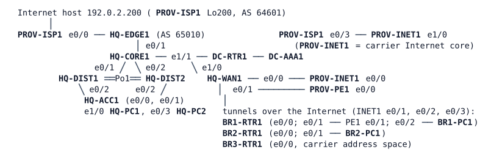

# MS-3 — Campus and Branches

**Module:** 07 WAN and tunnels (closes modules 01–07) · **Type:** M (Milestone) · **Guidance tier:** G1 (business outcomes) · **Estimated time:** 300 min (includes the 3-minute settle after boot and up to 45 minutes of waiting for time to synchronise) · **Blueprint domains:** 1, 2, 3, 4, 5

> Run this lab alone: it uses 18 of the server's 20 running nodes. Wait about 3 minutes after "all nodes booted" before you start (tunnels, OSPF and the server nodes settle). BR1's branch backup job (see Starting State) loads the BR1 circuit while it runs; know its windows, because tests during them run under that load.

## Scenario

Veridian Logistics' headquarters campus, its data-centre services and three branch offices are in your hands for the shift. The change manager has queued three change requests and three tickets are open: one from HQ, one from the manager of BR1 and one from the NOC. Work the queues inside the 240-minute maintenance window, record what you do, and prove the network is healthy at the end. Nothing in the queues says how to do the work: the constraints and acceptance criteria below are the contract.

## Objectives

- Close tickets on a campus, WAN and management network, with evidence from before and after each fix, and prove them under failure.
- Onboard a branch whose provider hides it behind carrier address translation, with an encrypted tunnel, dynamic routing and its own management path.
- Move the management plane (central authentication, time) to the data centre through the management network, and replace static provider routing with BGP without disturbing the branch backup path.
- Prove with failure drills what survives the loss of an access uplink and of the provider path.

## Available Information

### Documentation pack

**Topology** (all cables patched; dot1q trunks, native VLAN 999, `nonegotiate`, explicit allowed lists on the campus switches):

| Link | A | B | Carries / addressing |
|---|---|---|---|
| CORE1–DIST1 | HQ-CORE1 e0/1 | HQ-DIST1 e1/0 | VLANs 901 (10.10.255.2/31), 20, 50, 99 |
| CORE1–DIST2 | HQ-CORE1 e0/2 | HQ-DIST2 e1/0 | VLAN 902 (10.10.255.4/31) |
| DIST interconnect | HQ-DIST1 e0/0-e0/1 | HQ-DIST2 e0/0-e0/1 | Po1 (LACP): VLANs 10, 20, 50, 99 |
| ACC1 uplinks | HQ-DIST1 e0/2, HQ-DIST2 e0/2 | HQ-ACC1 e0/0, e0/1 | user VLANs 10, 20 and 99 |
| Hosts | HQ-ACC1 e1/0 | HQ-PC1 | VLAN 10 |
| | HQ-ACC1 e0/3 | HQ-PC2 | VLAN 20 |
| Core to edge | HQ-CORE1 e0/3 | HQ-EDGE1 e0/1 | 10.10.255.64/31, OSPF area 0, point-to-point, cost 10, hello 1 / dead 4; MGMT sub-interface e0/3.99 10.10.254.4/31 |
| Edge to ISP-A | HQ-EDGE1 e0/0 | PROV-ISP1 e0/0 | 198.51.100.64/31 (BGP AS 65010 to AS 64601) |
| Core to data centre | HQ-CORE1 e1/1 | DC-RTR1 e0/0 | 10.10.255.130/31, OSPF area 50; MGMT sub-interface e1/1.99 10.10.254.6/31 |
| Data centre | DC-RTR1 e0/1 | DC-AAA1 | 10.50.50.0/24 (DC-RTR1 .1, DC-AAA1 .52) |
| Core to WAN | HQ-CORE1 e1/0 | HQ-WAN1 e0/2 | 10.10.255.96/31 (CORE1 .96, WAN1 .97), OSPF area 0, point-to-point, cost 10, hello 1 / dead 4; MGMT sub-interface .99 10.10.254.10/31 (CORE1 .10, WAN1 .11), OSPF 99 |
| HQ Internet | HQ-WAN1 e0/0 | PROV-INET1 e0/0 | 203.0.113.128/31 (INET1 .128, WAN1 .129) |
| HQ provider service | HQ-WAN1 e0/1 | PROV-PE1 e0/0 | 100.64.10.0/31 (PE1 .0, WAN1 .1) |
| BR1 Internet | BR1-RTR1 e0/0 | PROV-INET1 e0/1 | 203.0.113.130/31 (INET1 .130, BR1 .131); conditioned circuit, 2 Mb/s, 30 ms, about 0.2 % loss (provider-side, do not try to change it) |
| BR1 provider service | BR1-RTR1 e0/1 | PROV-PE1 e0/1 | 100.64.21.0/31 (PE1 .0, BR1 .1) |
| BR1 users | BR1-RTR1 e0/2 | BR1-PC1 | sub-interface e0/2.10 (native), 10.21.10.0/24, BR1-PC1 .101 |
| BR2 Internet | BR2-RTR1 e0/0 | PROV-INET1 e0/2 | 203.0.113.132/31 (INET1 .132, BR2 .133) |
| BR2 users | BR2-RTR1 e0/1 | BR2-PC1 | 10.22.10.0/24, BR2-PC1 .101 |
| BR3 Internet | BR3-RTR1 e0/0 | PROV-INET1 e0/3 | 100.64.23.0/31 (INET1 .0, BR3 .1), carrier address space |
| Carrier to ISP-A | PROV-INET1 e1/0 | PROV-ISP1 e0/3 | 198.51.100.128/31 |

BR1 is a lab-scale branch: one router, one user host (BR1-PC1) and two stand-in networks (Loopback40 10.21.40.1/24 in VRF OT, Loopback99 10.21.99.1/24 in VRF MGMT). BR3-RTR1 has its users network on Loopback10 (10.23.10.1/24, stand-in for the LAN) and a management loopback to be created. The DMZ server of the edge design is not part of this lab (HQ-EDGE1 e0/2 is configured but uncabled).

**VLANs and first-hop gateways (HQ).**

| VLAN | Subnet | Gateway (VIP .1) | Hosts |
|---|---|---|---|
| 10 (users) | 10.10.10.0/24 | HQ-DIST1 .2 / HQ-DIST2 .3, GLBP | HQ-PC1 .101 |
| 20 (OPS) | 10.10.20.0/24 | HQ-CORE1 .2, VRRP | HQ-PC2 .102 |
| 50 (servers) | 10.10.50.0/24 | HQ-CORE1 .2, VRRP | none in this lab |
| 99 (management) | 10.10.99.0/24, in VRF MGMT | HQ-CORE1 .2, VRRP | HQ-DIST1 .11, HQ-DIST2 .12, HQ-ACC1 .21 |
| 999 | native VLAN, unused | | |

VLAN spanning-tree roots follow the campus standard (HQ-DIST2 is the root for VLAN 20 at 24576, HQ-DIST1 for VLANs 10, 50 and 99).

**WAN design.** All branch traffic to HQ rides GRE tunnels protected by IPsec between the Internet-side addresses (IKEv2, pre-shared key `VERIDIAN-VPN-KEY`, DPD 10 s retry 2 on demand). Routing over the tunnels is OSPF process 1 (areas: HQ-WAN1 is the ABR; BR1 area 21, BR2 area 22, BR3 area 23; HQ-CORE1 side area 0), tunnel hello 5 / dead 20, cost 100. Management and OT run in their own VRFs (MGMT, OT) with their own tunnels and OSPF processes (99 and 40). The campus carries no static routes in the path between users and the WAN.

| Tunnel | HQ end | Branch end | Network | VRF / OSPF | Tunnel source (HQ / branch) |
|---|---|---|---|---|---|
| Tunnel21 | HQ-WAN1 | BR1-RTR1 | 10.250.21.0/24 (.1 / .21) | global, OSPF 1 area 21 | e0/0 / e0/0 |
| Tunnel22 | HQ-WAN1 | BR2-RTR1 | 10.250.22.0/24 (.1 / .22) | global, OSPF 1 area 22 | e0/0 / e0/0 |
| Tunnel23 (to build) | HQ-WAN1 | BR3-RTR1 | 10.250.23.0/24 (.1 / .23) | global, OSPF 1 area 23 | e0/0 / e0/0 |
| Tunnel91 | HQ-WAN1 | BR1-RTR1 | 10.250.91.0/24 (.1 / .21) | MGMT, OSPF 99 area 0 | Loopback201 203.0.113.145 / 203.0.113.153 |
| Tunnel92 | HQ-WAN1 | BR2-RTR1 | 10.250.92.0/24 (.1 / .22) | MGMT, OSPF 99 area 0 | 203.0.113.145 / Loopback201 203.0.113.161 |
| Tunnel93 (to build) | HQ-WAN1 | BR3-RTR1 | 10.250.93.0/24 (.1 / .23) | MGMT, OSPF 99 area 0 | 203.0.113.145 / BR3 e0/0 |
| Tunnel41 | HQ-WAN1 | BR1-RTR1 | 10.250.41.0/24 (.1 / .21) | OT, OSPF 40 area 0 | Loopback202 203.0.113.146 / 203.0.113.154 |

HQ-WAN1 Internet side is 203.0.113.129 (e0/0) with the loopbacks 203.0.113.145 and .146; its inbound circuit policy on e0/0 lists exactly the branch addresses it accepts IKE, NAT-T, ESP, NTP and ICMP from. Router IDs: Loopback0 10.255.10.41 (HQ-WAN1), 10.255.21.1 (BR1), 10.255.22.1 (BR2), 10.255.23.1 (BR3). BR2's management address is Loopback99 10.22.99.1 in VRF MGMT, BR1's 10.21.99.1; BR3's management address will be 10.23.99.1/32. The management network (VRF MGMT) is the HQ VLAN 99 (10.10.99.0/24), the data-centre services (10.50.50.0/24) and the branch management loopbacks.

**Provider letters.**
- *Carrier (BR3):* "BR3 is served from carrier address space (100.64.23.0/31, your router .1, gateway .0). Our edge translates it to 203.0.113.136 when it goes to the Internet; the router has no public address. We do not open ports or change the NAT."
- *Provider service (PE1, AS 64700):* "Your HQ-to-BR1 provider service is 100.64.10.0/31 and 100.64.21.0/31. When you move to BGP: HQ is AS 65010 (we accept 10.10.0.0/16 and 10.50.0.0/16 from it), BR1 is AS 65021 (we accept 10.21.0.0/16 from it), we are AS 64700, no session password. Our side is already configured and waits for you. Do not renumber the links."
- *Branch voice:* BR1's calls to HQ (DSCP EF) use the provider service while it works and fall back to the Internet path (the tunnels) when it does not. The Internet circuit is shaped to its 2 Mb/s with voice priority.

**Management design.** Every network device follows the management standard: local emergency account `admin`; central accounts through DC-AAA1 (RADIUS, UDP 1812/1813, reached through the management network) with fallback to the local account if the server is gone; SNMPv3 user `nmsuser` answering only the management hosts; authenticated NTP; SSH only, accepted only from 10.10.99.0/24 and 10.50.50.0/24 (the console does not count). The HQ campus devices, HQ-EDGE1 and DC-RTR1 already follow it (DC-RTR1 is the time source). The four WAN routers (HQ-WAN1, BR1-RTR1, BR2-RTR1, BR3-RTR1) predate the data-centre services: HQ-WAN1 serves time to the branches itself and all authenticate locally.

**Credentials.**

| Item | Value |
|---|---|
| Local account / enable | `admin` / `Cisco123!` (privilege 15); enable secret `Cisco123!` |
| RADIUS (DC-AAA1) | shared key `RADKEY123`; users `netadmin` / `netpass` (privilege 15), `netops` / `opspass` (privilege 1, read-only) |
| SNMPv3 | user `nmsuser`, SHA `AUTHPASS123`, AES-128 `PRIVPASS123`; group `NMSGROUP` |
| NTP | key 1, `hmac-sha2-256`, `NTPKEY123` |
| IKEv2 | pre-shared key `VERIDIAN-VPN-KEY` |
| BGP to ISP-A | AS 65010 to AS 64601, MD5 password `ISPA-64601` |
| Hosts | Alpine PCs: `cisco` / `cisco` (BR1-PC1, BR2-PC1 and HQ-PC1 have `iperf`; HQ-PC1 already listens on UDP 5002) |

**Change log (neutral entries from the change manager).**

| Change | When | Note |
|---|---|---|
| CHG-3301 | two weeks ago | Routing clean-up on the HQ routers, details not recorded |
| CHG-3302 | two weeks ago | HQ access closet uplink tidy-up |
| CHG-3303 | last month | BR1 branch refresh, details not recorded |
| CHG-3304 | last month | BR2 staging for the planned OT rollout |
| CHG-3305 | last week | BR3 cabled to the carrier, address and default route only |

**Monitoring excerpt (Monday 08:00).** Every device is green except what the tickets describe. BR1-RTR1 records evidence in its RAM file system (`unix:`) whenever a WAN tunnel goes down (its tunnel-down evidence files).

## Starting State

- The 18 nodes are running with the configurations above applied at boot; nothing has been saved or changed by you yet.
- BR3-RTR1 has only its addresses, default route and the local account; the HQ-WAN1 policy does not yet admit it.
- BR1-PC1 runs the branch backup job: from about 2 minutes after boot, and then every 10 minutes, it uploads about 3 Mb/s of UDP to HQ-PC1 port 5002 for 2 minutes. This load is normal and expected; the circuit was sized for it. You cannot stop it as user `cisco` without `sudo`; a node stop and start re-arms it. You may repeat the upload by hand (user `cisco`, `iperf -u -b 3M` to a UDP port other than 5002, which the call uses) to cover a whole test.
- Time (NTP) can take up to about 45 minutes to synchronise on the routers after a change of source; check time-dependent items last.
- Failure drills: a **cable pull** means `shutdown` on both ends of the link. A **silent failure** means `link stop` in CML on the named link (the interfaces stay up and drop traffic); restore it with `link start`. A **node stop** is a silent failure for the neighbours. A one-ended `shutdown` is a third case: the peer port stays up.
- Voice test recipe: voice is simulated with `iperf -u -S 0xB8 -b 300k -l 200` (DSCP EF); put the server end on a host with `iperf -s -u -p <port> -i 1`.

## Requirements / Change Requests

R1. **Constraints (all work).** No reloads or wipes of nodes; management reachability to every device through the management network is kept at all times (the console does not count); no change on the provider devices (PROV-PE1, PROV-INET1, PROV-ISP1) or on the circuit conditioning; no static routes between the campus and the WAN or between the sites for user traffic (routing is dynamic; the existing documented statics and defaults stay as they are unless a requirement replaces them); the work happens inside the 240-minute window; every change is recorded with its evidence; configurations are saved at the end.

R2. **Tickets.** Close TK1, TK2 and TK3 (see Reported Problems), each with before-and-after evidence.

R3. **CR1: onboard BR3.** (a) BR3-RTR1 reaches HQ and the other branches over an encrypted tunnel with dynamic routing in area 23 on Tunnel23 (10.250.23.0/24), although its provider puts it behind a carrier address translation: it has no public address. (b) HQ-WAN1's circuit policy admits BR3 narrowly: only its translated source address and only the traffic the tunnel needs. (c) BR3's users network 10.23.10.0/24 is reachable from every other site's users and back. (d) BR3 joins the management network through its own per-VRF tunnel (Tunnel93, 10.250.93.0/24) with management address 10.23.99.1/32 in VRF MGMT. (e) BR3 gets the management standard of the Management design, in the form the other WAN routers have before CR2 (local authentication; central AAA and time through MGMT come with CR2).

R4. **CR2: AAA and time through MGMT.** (a) The four WAN routers authenticate administrators against DC-AAA1 through the management network, with fallback to the local account when the server is unreachable. (b) They take time from DC-RTR1 through the management network; HQ-WAN1 stops being the time master. (c) Branch time continuity is kept: no branch router is ever left without a valid time source (order of the changes matters).

R5. **CR3: eBGP on the provider service.** The static customer-to-provider routing on HQ-WAN1 and BR1-RTR1 is replaced by eBGP to PROV-PE1 (HQ AS 65010, BR1 AS 65021, provider AS 64700, per the provider letter), the links are not renumbered, BR1's provider path remains its backup path to HQ and the voice steering of the Reported Problems keeps working.

## Reported Problems

- **TK1 (HQ OPS team):** "Since the routing clean-up two weeks ago, OPS staff cannot open the branches' systems. HQ servers and the Internet work, and the other HQ departments have no problem with the branches."
- **TK2 (BR1 manager and the NOC):** "Calls to HQ break up several times an hour, and the NOC says calls are not on the provider line although it is up."
- **TK3 (NOC):** "We cannot SSH to BR2's router from the management network any more; BR1 is fine. BR2's users have no complaints."

## Verification Criteria

V1. every site's users reach every other site's users and HQ's servers (HQ VLANs 10 and 20, BR1, BR2 and BR3 users, the Internet host 192.0.2.200 for the hosts that reach it at the start: HQ-PC1, HQ-PC2 and BR1-PC1; BR2-PC1 is not required to) with routing learned dynamically, and the OPS VLAN is no exception (the data-centre services are in the management network, VRF MGMT, and are reached under V4, not from user hosts).

V2. BR3 is a full branch: its tunnel and its management tunnel are up and carry OSPF through the carrier translation, its users network is reachable from every other site and back, HQ-WAN1's policy for it is narrow, and a failure of the carrier path is detected and recovered within the limits of V9.

V3. BR1's calls (DSCP EF) to HQ take the provider line while it really delivers and the Internet path otherwise, with no loss for calls during a saturating upload from BR1. Drill: a silent failure of the HQ provider link (HQ-WAN1 e0/1 to PROV-PE1 e0/0) while the call and the upload run. Allowance: the calls are on the Internet path within 25 seconds of the failure; after that, loss for calls stays at or below 5 % per second with the upload running. After the link returns, the calls go back to the provider line within 90 seconds.

V4. every network device (the four WAN routers included) is reachable by SSH from the management hosts only (10.10.99.0/24, 10.50.50.0/24, through VRF MGMT), refuses sessions from user networks and from other sources, authenticates against DC-AAA1 with the local fallback working, and answers SNMPv3 only to the management hosts.

V5. the provider-service routing is dynamic (eBGP up on both customer routers), no static customer-to-provider routes remain, and BR1's backup behaviour is unchanged: when the BR1 tunnel path to HQ is down (a cable pull of BR1 Ethernet0/0, or a silent failure of its Internet link, takes all three BR1 tunnels), BR1 and HQ still reach each other over the provider service; with the tunnels up, users' traffic uses the tunnels.

V6. the edge protection and HQ users' Internet access are unchanged (HQ users reach 192.0.2.200; the edge still refuses what it refused).

V7. every HQ user VLAN survives the loss of either access uplink of HQ-ACC1 (cable pull, one at a time): at most 3 lost pings (1 per second) for a host on VLANs 10 and 20 reaching a branch host, in each case.

V8. clocks of the four WAN routers are synchronised from DC-RTR1 through the management network (check last).

V9. failure limits for the BR3 path (cable pull of BR3 e0/0 and PROV-INET1 e0/3, and the silent failure of the same link): HQ-WAN1 drops the BR3 OSPF neighbours within 30 seconds of the failure; after the path returns, both BR3 adjacencies are FULL again within 60 seconds.

V10. each ticket is closed with toolkit evidence from before and after; each change has a change-log entry with its measured impact; every constraint above held.

## Analysis Questions

Q1. In which order did you work the queue, and why?
Q2. For each ticket, what did you re-test after each fix, and what did it show?
Q3. What did the carrier translation do to the tunnel traffic between BR3 and HQ (which addresses and ports did each side see), what did you change compared with the other branches, and how did you prove it?
Q4. How did you decide what the branch's calls needed to be tested against, what did the call and the upload see before and after your fixes, and what did the drill show about the call path?
Q5. Why does the order of the time and authentication changes on the four WAN routers matter, and how did you check the result last?
Q6. What did you announce into BGP and into OSPF on each side, and how did you prove that BR1's backup path and the voice steering were unchanged?
Q7. Which of the verification criteria depend on timers or on the backup job, and when did you check them?
