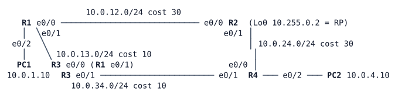

# LAB-054 — Multicast Fundamentals

**Module:** 08 Multicast · **Type:** F (Foundation) · **Guidance tier:** G3 for the first router (R1: command skeleton in the primer), G2 for the rest (behaviour stated, you choose the commands) · **Estimated time:** 120 min · **Blueprint objectives:** 3.3.d:I (multicast protocols: IGMP, PIM-SM)

## Scenario

Before Veridian streams the OPS camera wall to the operations room and the depots, the network team builds a bench to see how routers decide where multicast goes. A four-router core already runs OSPF; two hosts sit on its edge. PC1 is the encoder, PC2 the viewer. You will turn multicast routing on, watch the trees form, break them in controlled ways and read the evidence in router state and in packet captures.

## Objectives

- Enable multicast routing with sparse-mode PIM and a statically configured rendezvous point.
- Read (*,G) and (S,G) state, flags and incoming interfaces on every router, and follow a stream from the shared tree to the source tree.
- Capture the PIM register exchange between the first-hop router and the RP.
- Control the SPT switchover on the last-hop router, and see its effect on the RP.
- Compare IGMPv2 and IGMPv3 membership messages on the receiver LAN.
- Explain RPF decisions, and measure a stream across a link failure.

## Multicast in brief

First contact with multicast: read this before the tasks. Nothing here gives a value for this bench.

- **Group addresses.** A multicast stream is sent to a class D group address, not to a host. Any host may send to a group; only hosts that have joined receive it. Routers copy the packet only onto interfaces that lead to a member.
- **IGMP (host to router).** A host tells the router on its LAN that it wants a group with an IGMP report and withdraws with a leave. One router per LAN, the querier, asks periodically who is still a member. IGMP has versions (v2, v3); the version is a per-interface router setting, and v3 reports can name sources. `show ip igmp groups` and `show ip igmp interface` show what the router has learned.
- **PIM sparse mode (router to router).** Routers build distribution trees by sending joins hop by hop. PIM neighbours form on interfaces with `ip pim sparse-mode` (`show ip pim neighbor`). Joins travel towards a root; the packets travel back down the tree.
- **Rendezvous point (RP).** In sparse mode the first tree is rooted at a router every router knows about, the RP. Here it is configured statically: `ip pim rp-address <rp-address> [<standard-acl>]`, where the optional ACL names the groups it serves. `show ip pim rp mapping` shows which RP serves which group range.
- **Two kinds of tree.** The *shared tree* is rooted at the RP and carries state written (*,G) (any source, group G). A *source tree* is rooted at the source's first-hop router and carries state written (S,G). A source's first-hop router reaches the RP with Register messages (the RP can answer with Register-Stop); a last-hop router can later join the source tree directly. The `ip pim spt-threshold` command controls when the last-hop router does this (`infinity` means never, optionally for a `group-list` ACL).
- **RPF (reverse path forwarding).** A router accepts a multicast packet only if it arrives on the interface the router itself would use to reach the packet's source (for joins: to reach the source or the RP). The check uses the unicast routing table unless a static multicast route (`ip mroute`, administrative distance 0) or MBGP overrides it. `show ip rpf <address>` names the interface, the neighbour and the type of the decision.
- **Reading state.** `show ip mroute [<group>]` lists entries with flags (for example S sparse, C connected member, F register, T SPT-bit, J joined SPT, P pruned), the incoming interface (RPF interface) and the outgoing interface list. `show ip mfib count` shows per-group packet counters on this platform. The IGMP and PIM debugs are noisy: limit them to one group and run them on an idle bench.

Command skeleton for the first router (placeholders; repeat the interface lines wherever the requirement needs them, and decide which interfaces and routers):

```
ip multicast-routing
ip access-list standard <acl-name>
 permit <group-network> <wildcard-mask>
ip pim rp-address <rp-address> <acl-name>
interface <interface>
 ip pim sparse-mode
```

Other commands you will need later: `ip pim spt-threshold infinity [group-list <acl>]` (global), `ip igmp version <n>` (interface).

Platform notes for this bench: after you change the IGMP version a host keeps the older version until its compatibility timer expires (about 4 minutes) unless it is restarted. Do not use `clear ip mroute *` while a stream runs (the stream stalls for a minute or more); use a new group instead.

## Available Information



R1-R3 and R3-R4 are the cheap path (cost 10 each), R1-R2 and R2-R4 the expensive one (cost 30 each).

| Device | Interface | Address | Connects to |
|---|---|---|---|
| R1 | Ethernet0/0 | 10.0.12.1/24 | R2 Ethernet0/0 |
| R1 | Ethernet0/1 | 10.0.13.1/24 | R3 Ethernet0/0 |
| R1 | Ethernet0/2 | 10.0.1.1/24 | PC1 (source LAN) |
| R2 | Ethernet0/0 | 10.0.12.2/24 | R1 Ethernet0/0 |
| R2 | Ethernet0/1 | 10.0.24.1/24 | R4 Ethernet0/0 |
| R3 | Ethernet0/0 | 10.0.13.2/24 | R1 Ethernet0/1 |
| R3 | Ethernet0/1 | 10.0.34.1/24 | R4 Ethernet0/1 |
| R4 | Ethernet0/0 | 10.0.24.2/24 | R2 Ethernet0/1 |
| R4 | Ethernet0/1 | 10.0.34.2/24 | R3 Ethernet0/1 |
| R4 | Ethernet0/2 | 10.0.4.1/24 | PC2 (receiver LAN) |
| R1-R4 | Loopback0 | 10.255.0.1 to 10.255.0.4 /32 | router IDs; R2's is the rendezvous point |
| PC1 / PC2 | eth0 | 10.0.1.10/24 / 10.0.4.10/24 | gateway R1 .1 / R4 .1 |

- Routers: user `admin`, password `Cisco123!` (console and SSH). Hosts: Alpine Linux with `iperf` (version 2), `tcpdump` and `sudo`; user `cisco`, password `cisco`.
- Multicast group range for the bench: **239.1.0.0/16**. The stream group in the requirements is 239.1.1.1.
- The encoder: `iperf -c <group> -u -T <ttl> -b 256k -l 1316 -S 0x88 -t <seconds>` on PC1 (`-t 0` runs until stopped). The viewer: `iperf -s -u -B <group> -i 5` on PC2 (the kernel sends the IGMP report; interval lines show datagram loss). For a source-specific join add `-H <source>` to the viewer command (iperf 2.2.0 `--ssm-host`). Start long-running commands in the background, for example `(nohup iperf ... > /tmp/x.log 2>&1 &)`, and stop them with `pkill -f iperf`.
- Packet capture: CML packet capture on a link (any router link), or `sudo tcpdump -ni eth0` on a host.
- Link failure method in this lab: a **cable pull** means `shutdown` on **both** ends of the link.

## Starting State

OSPF area 0 is up on all four routers with the costs above; every router has two OSPF neighbours (R1 and R4 also face their LANs, which are advertised but passive). PC1 and PC2 are addressed and reach each other over R1-R3-R4. No multicast configuration exists anywhere: multicast routing is off and IGMP is disabled on R4's receiver LAN.

## Requirements / Change Requests

R1: Enable multicast routing and PIM sparse mode on every router interface that can carry multicast. R2's loopback is the static RP, for groups 239.1.0.0/16 only.

R2: PC2 views a stream from PC1 to group 239.1.1.1. Record the multicast routing state for the group on all four routers (shared-tree and source-tree entries, flags, incoming interface), the path the packets take once the stream is running (R4's incoming interface for the source and for the group), and the prune towards R2.

R3: On R4 keep the stream on the shared tree, show the path and the RP's load, then restore the default behaviour. Use a fresh group (for example 239.1.1.3) so older state does not interfere.

R4: Compare IGMPv2 and IGMPv3 on R4's receiver LAN: the report types sent, what a leave looks like, and the membership detail the router shows. At the end of the lab R4's receiver LAN is left on IGMPv3.

R5: For the source host 10.0.1.10 and for the RP address 10.255.0.2, explain the RPF decision on each router.

R6: Pull the cable between R3 and R4 while the viewer runs, then restore it. Do this three times.

R7: Send the stream from PC1 with a source address that fails the RPF check on R1 (for example a secondary address outside 10.0.1.0/24 on eth0 with `iperf -B`, to a fresh group), and record what R1 does with the packets.

## Verification Criteria

V1: Every router has PIM neighbours on every core link, and the RP mapping shows 10.255.0.2 for the 239.1.0.0/16 range on all four.

V2: With the viewer running and no source: R4 holds a shared-tree entry for 239.1.1.1 towards the RP and the RP lists R4's side in its outgoing list; R1 and R3 hold nothing for the group.

V3: With the source running, the viewer reports at most 1 % loss over 60 s, and R4's source-tree entry for 239.1.1.1 arrives on the interface facing R3.

V4: A capture on the R1-R2 link shows PIM Register messages from R1 to the RP that stop after a Register-Stop, and the stream no longer crosses R1-R2.

V5: With R4 held on the shared tree, R4 has no source-tree entry for the group and the stream arrives from the RP's side of the network; after the change is removed a source-tree entry appears within seconds.

V6: Captures on R4's receiver LAN show the IGMPv2 report and leave messages, and the IGMPv3 report records for a group join and for a source-specific join.

V7: During each cable pull the viewer resumes without operator action; the incoming interface of R4's source-tree entry changes and returns after restoration. Record the times.

V8: Toolkit: summarise one capture file (message types and counts per second) from the registration or IGMP captures.

## Analysis Questions

Q1: What creates the shared-tree entry on R4, and what creates the source-tree entry on R1?

Q2: Why does R2 send a Register-Stop, and when?

Q3: Why does the last-hop router switch to the source tree, and what does it cost (or save) the RP?

Q4: What does an RPF failure do to arriving multicast packets (R7)? Name the counters that make it visible on this platform.

Q5: Which IGMPv2 and IGMPv3 messages did you see, and why does IGMPv3 matter for source-specific multicast (LAB-055)?

Q6: What TTL does the encoder need for the stream to reach PC2, and what happens to the stream with `-T 1`?

Q7: Does R2's prune of the source from the shared tree interrupt the stream? Explain what you measured.
