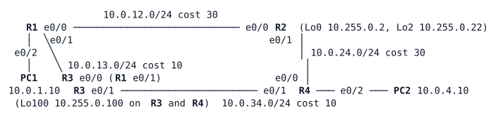

# LAB-055 — Finding the RP

**Module:** 08 Multicast · **Type:** F (Foundation) · **Guidance tier:** G2 (behaviour stated, you choose the commands) · **Estimated time:** 150 min · **Blueprint objectives:** 3.3.d:P (PIM sparse mode, RP discovery: Auto-RP and BSR; SSM, bidirectional PIM and MSDP observed), X-AutoRPBSR:I (Auto-RP and BSR)

## Scenario

LAB-054's bench works, but its rendezvous point is typed by hand on every router, and that fails with the first router that is forgotten or the first RP that dies. The network team now tests the two ways IOS learns the RP by itself (Auto-RP and BSR), measures how long each takes to replace a failed RP, and then tries source-specific multicast (SSM), which needs no RP at all. A colleague has also left two more group ranges configured on the bench, to show bidirectional PIM and anycast RP with MSDP. Those two are pre-built: you observe them, you do not change them.

## Objectives

- Replace a static RP with Auto-RP, then with BSR, and predict which candidate wins each time.
- Measure how long each method takes to replace a failed RP, and what limits that time.
- Deliver a stream with SSM, with no RP, and show that an unwanted source on the same host is not forwarded.
- Read the DF election and the (*,G) state of a bidirectional range.
- Read the MSDP source-active cache of an anycast RP pair and see what a member failure does.

## Available Information

R1-R3 and R3-R4 are the cheap path (cost 10 each), R1-R2 and R2-R4 the expensive one (cost 30 each).

| Device | Interface | Address | Connects to |
|---|---|---|---|
| R1 | Ethernet0/0 | 10.0.12.1/24 | R2 Ethernet0/0 |
| R1 | Ethernet0/1 | 10.0.13.1/24 | R3 Ethernet0/0 |
| R1 | Ethernet0/2 | 10.0.1.1/24 | PC1 (source LAN) |
| R2 | Ethernet0/0 | 10.0.12.2/24 | R1 Ethernet0/0 |
| R2 | Ethernet0/1 | 10.0.24.1/24 | R4 Ethernet0/0 |
| R3 | Ethernet0/0 | 10.0.13.2/24 | R1 Ethernet0/1 |
| R3 | Ethernet0/1 | 10.0.34.1/24 | R4 Ethernet0/1 |
| R4 | Ethernet0/0 | 10.0.24.2/24 | R2 Ethernet0/1 |
| R4 | Ethernet0/1 | 10.0.34.2/24 | R3 Ethernet0/1 |
| R4 | Ethernet0/2 | 10.0.4.1/24 | PC2 (receiver LAN) |
| R1-R4 | Loopback0 | 10.255.0.1 to 10.255.0.4 /32 | router IDs |
| R2 | Loopback2 | 10.255.0.22/32 | RP of the bidirectional range |
| R3, R4 | Loopback100 | 10.255.0.100/32 (same address on both) | anycast RP address |
| PC1 / PC2 | eth0 | 10.0.1.10/24 / 10.0.4.10/24 | gateway R1 .1 / R4 .1 |

Group ranges on the bench:

| Range | Purpose | RP / mode |
|---|---|---|
| 239.1.0.0/16 | the ranges you work on (stream group 239.1.1.1) | static RP R2 Loopback0 today; you replace it |
| 239.2.0.0/16 | bidirectional PIM (pre-built) | R2 Loopback2 10.255.0.22, bidir |
| 239.3.0.0/16 | anycast RP with MSDP (pre-built) | 10.255.0.100 on R3 and R4; MSDP between R3 and R4 Loopback0 |
| 232.0.0.0/8 | SSM | none (you enable it; stream group 232.1.1.1) |

- Routers: user `admin`, password `Cisco123!` (console and SSH). Hosts: Alpine Linux with `iperf` (version 2), `tcpdump` and `sudo`; user `cisco`, password `cisco`.
- The encoder: `iperf -c <group> -u -T 16 -b 256k -l 1316 -S 0x88 -t 0` on PC1 (`-t 0` runs until stopped; `-B <address>` binds the sender to one of PC1's addresses). The viewer: `iperf -s -u -B <group> -i 5` on PC2 (the kernel sends the IGMP report; interval lines show datagram loss; use `-i 1` when you time a gap). For a source-specific join add `-H <source>` to the viewer command (iperf 2.2.0 `--ssm-host`). Start long-running commands in the background, for example `(nohup iperf ... > /tmp/x.log 2>&1 &)`, and stop them with `pkill -f iperf`.
- A second source address on PC1: `sudo ip addr add 10.0.1.11/24 dev eth0`.
- Packet capture: CML packet capture on a link, or `sudo tcpdump -ni eth0` on a host.
- Timing: read the time on a router with `show clock` (routers and hosts share UTC) and note the wall-clock time at which you stop a node; the end condition is a show output you poll.
- Node-stop method in this lab: a **node stop** (CML stops the router) is a *silent failure* for its neighbours: no goodbye is sent, so they find out only through their own timers. Run `write memory` on a router before stopping it, and start it again afterwards (`node start`); it comes back in about 15 s with its saved configuration.

## Starting State

OSPF area 0 is up on all four routers with the costs above. PIM sparse mode is enabled on every interface, including loopbacks, and the rendezvous point of 239.1.0.0/16 is R2's Loopback0, configured statically on every router (the end state of LAB-054). The bidirectional range (239.2.0.0/16, static RP on R2 Loopback2) and the anycast range (239.3.0.0/16, R3 and R4 both on 10.255.0.100, advertised in OSPF, MSDP peering R3-R4) are already configured on all routers. R1 and R3 are nearest to the anycast member R3, R2 and R4 to R4. R4's receiver LAN runs IGMPv3. SSM is not enabled and neither Auto-RP nor BSR is configured.

## Requirements / Change Requests

R1: Replace the static RP of 239.1.0.0/16 with Auto-RP. R2 and R3 are candidate RPs for 239.1.0.0/16 only (the pre-built ranges must keep their static RPs), R1 is the mapping agent, and no router keeps a static entry for 239.1.0.0/16. Before you configure it, predict which candidate the mapping agent elects, then confirm it on every router.

R2: Stop the elected RP and measure how long it takes until the mapping on R4 lists the other candidate for 239.1.0.0/16. Run a stream (group 239.1.1.1) with a viewer at `-i 1` meanwhile and note what the viewer sees. Measure again after you shorten the announcement and discovery intervals. Restart the router afterwards.

R3: Replace Auto-RP with BSR, leaving no Auto-RP configuration. R2 and R3 are candidate RPs for 239.1.0.0/16 only, with R2 preferred; R1 and R3 are candidate BSRs. Choose the values so that R2 is the RP and R3 the bootstrap router, and confirm it. Repeat R2's measurement by stopping R2, with the stream running, and note what the viewer sees. Restart R2 afterwards.

R4: Enable SSM on all four routers for its default range. PC2 receives 232.1.1.1 from PC1's address 10.0.1.10 and not from a second source address of PC1 (10.0.1.11), with no RP involved. Prove on the receiver LAN that only the wanted source arrives.

R5: Observe the pre-built ranges. Send to 239.2.2.2 from PC1 with PC2 as receiver and record the DF on each link and the (*,G) entries; send to 239.3.3.3 and record the MSDP source-active cache of both anycast members and which member each router uses for 10.255.0.100. Stop R3 while the 239.3.3.3 stream runs and record what happens to the stream and to the routers' choice of member. Restart R3 afterwards.

## Verification Criteria

V1: With Auto-RP running, R4 (and every router) lists 239.1.0.0/16 with an RP learned by Auto-RP and no static entry for that range; the 239.2 and 239.3 ranges still show their static RPs.

V2: Your prediction for R1 was written down before configuring, and the elected candidate on R1's mapping list matches it or you can explain the difference.

V3: Failover is recorded for both Auto-RP settings (default and shortened intervals) as the time from the node stop until R4's mapping lists only the other candidate, with at least one run each, and the shortened setting is at least twice as fast.

V4: With BSR running, R4 lists R2 as RP for 239.1.0.0/16 learned by bootstrap, R3 as the elected BSR is shown on every router, and no router lists an Auto-RP-learned entry for the range (allow the old entry's remaining lifetime to run out).

V5: The BSR failover (R2 stopped) is recorded as the time until R4's mapping lists R3 as RP for 239.1.0.0/16, with at least one run.

V6: For both failovers you recorded whether the viewer lost datagrams and for how long (at `-i 1`), and you can tell whether the loss came from the missing RP or from the stopped router being on the stream's path.

V7: With SSM, R4 holds an (S,G) entry for 232.1.1.1 with source 10.0.1.10, learned from an IGMPv3 INCLUDE report, and no entry with source 10.0.1.11; Toolkit: a capture on R4's receiver LAN shows packets from 10.0.1.10 only; no router holds a (*,G) entry for 232.1.1.1.

V8: For 239.2.2.2, the routers on the path hold (*,G) entries marked bidirectional with no (S,G) entry anywhere, and you recorded the DF of every link on the path.

V9: For 239.3.3.3, R4's MSDP cache lists the source learned from R3, and after R3 stops, record whether and how the stream resumes, which member serves it and the gap at the viewer (`-i 1`).

V10: At the end the pre-built ranges are unchanged (static RPs, MSDP up) and 239.1.0.0/16 is served by BSR.

## Analysis Questions

Q1: Why does Auto-RP need either dense mode or an explicit listener for its two groups (224.0.1.39 and 224.0.1.40), while BSR does not?

Q2: What does each method's failover time depend on? Use your measured values and name the timers. Why did the Auto-RP and BSR elections differ (or not)? When the viewer lost datagrams during a failover, was the missing RP the cause? Compare the Auto-RP run with the BSR run using the positions of the stopped routers relative to the path R1-R3-R4, and say when an already-built source tree needs the RP at all.

Q3: Why does SSM need no RP, and what must the receiver know that an ASM receiver does not? Why was no state created for 10.0.1.11 on any router?

Q4: When is bidirectional PIM the right choice, and why does it have no (S,G) state and no register messages?

Q5: What does MSDP add to anycast RP (how does R4 learn of a source that registered to R3)? What would it do between two separate PIM domains? Why can R4's cache also list groups outside 239.3.0.0/16?

Q6: Which RP discovery method would you use at Veridian, and why? (LAB-056 builds anycast RP on the HQ cores.)
