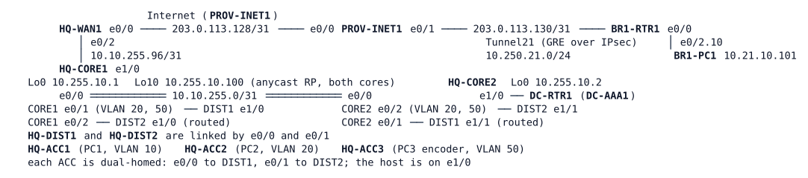

# LAB-056 — Video for HQ and BR1

**Module:** 08 Multicast · **Type:** X (Expansion) · **Guidance tier:** G2 (behaviour stated, you choose the commands) · **Estimated time:** 180 min · **Blueprint objectives:** 3.3.d:R (multicast: PIM sparse mode, RP, IGMP, MSDP), X-IGMPSnoop:I (IGMP snooping), 3.1.a:R (802.1Q trunks carrying the video VLANs), 2.2.b:R (GRE and IPsec tunnels)

## Scenario

Veridian is giving the HQ operations (OPS) room a camera wall. An encoder (HQ-PC3, server VLAN 50) already streams the yard cameras to the group 239.10.20.1 at 512 kb/s, but the network carries no multicast routing yet, so nobody receives it. OPS staff (VLAN 20) and the BR1 depot, over the WAN tunnel, must watch it. Nothing else may receive it: office users (VLAN 10) must not see it, and it must never cross the Internet unencrypted. The two HQ core routers share the gateway duty, and the stream must survive the loss of either one while viewers keep a path. You build the multicast service, then measure what a failure costs.

## Objectives

- Enable core-routed multicast at HQ with an anycast rendezvous point shared by both cores.
- Align the PIM designated router (DR) on each video VLAN with the VRRP master and make a failed DR be replaced in seconds.
- Carry the stream through the GRE-over-IPsec tunnel to BR1 and prove from the Internet side that it travels only inside ESP.
- Read the IGMP snooping tables and router (mrouter) ports of the access switches.
- Measure the media gap when a core router stops and when it returns.

## IGMP snooping in brief

- A switch floods multicast like broadcast unless it listens. With IGMP snooping the switch listens to the IGMP reports and leaves that pass through it and records, per VLAN, which ports lead to members of a group (`show ip igmp snooping groups`).
- It forwards the group only to those member ports and to the *mrouter* ports, the ports that lead to a multicast router. It learns mrouter ports from IGMP queries and PIM hellos it sees (`show ip igmp snooping mrouter`), or from static configuration.
- A switch only restricts a stream on ports where it has seen the reports of a member behind that port; with no member on a port, the group is not sent there.
- Snooping is configured per VLAN and is on by default on a switch that supports it; `show ip igmp snooping vlan <id>` shows the state.

## Available Information

| Device | Interface | Address | Role |
|---|---|---|---|
| HQ-CORE1 | Ethernet0/1.20 / .50 | 10.10.20.2/24, 10.10.50.2/24 (VRRP VIP .1) | gateway VLAN 20 (backup), VLAN 50 (master) |
| HQ-CORE2 | Ethernet0/2.20 / .50 | 10.10.20.3/24, 10.10.50.3/24 | gateway VLAN 20 (master), VLAN 50 (backup) |
| HQ-CORE1 / HQ-CORE2 | Loopback0 / Loopback10 | 10.255.10.1, 10.255.10.2 / planned RP address 10.255.10.100/32 on both | router IDs / anycast RP |
| HQ-CORE1 - HQ-WAN1 | Ethernet1/0 - Ethernet0/2 | 10.10.255.96/31 (.96 / .97) | OSPF 1 area 0 |
| HQ-WAN1 | Tunnel21 | 10.250.21.1 (BR1 .21) | GRE over IPsec to BR1, `ip mtu 1400` |
| BR1-RTR1 | Ethernet0/2.10 | 10.21.10.1/24 | BR1 LAN (untagged on BR1-PC1) |

Hosts (Alpine, `iperf` version 2, `tcpdump`, `sudo`; user `cisco`, password `cisco`): HQ-PC1 10.10.10.101 (VLAN 10, on HQ-ACC1), HQ-PC2 10.10.20.102 (VLAN 20, HQ-ACC2), HQ-PC3 10.10.50.103 (VLAN 50, HQ-ACC3, the encoder), BR1-PC1 10.21.10.101. Routers and switches: user `admin`, password `Cisco123!` (console and SSH). "The encoder" is the background `iperf -c 239.10.20.1 -u -T 16 -b 512k -l 1316 -S 0x88` already running on HQ-PC3 (DSCP AF41, TTL 16, 1344-byte packets). "A viewer" is `iperf -s -u -B 239.10.20.1 -i 5` on a host: the host's kernel joins the group, and the interval lines show the loss. The first interval of a freshly started viewer can show a high loss figure because the encoder's datagram counter is already running; judge the following intervals. On this platform IGMP snooping and routed multicast arriving over trunks do not work together on the switches (see Starting State).

## Starting State

- The H3 campus (hardened, management VRF) with DC-RTR1 and DC-AAA1 only; HQ-WAN1 is attached to HQ-CORE1 e1/0 (OSPF area 0); Tunnel21 to BR1 is up with OSPF area 21; BR1-PC1 and HQ hosts reach each other.
- The encoder on HQ-PC3 starts at boot. Nobody receives it. No viewer runs at boot.
- No multicast routing, PIM or RP is configured anywhere. The switches only snoop; there is no SVI multicast routing and none is wanted (the switches forward routed multicast to hosts twice on this platform).
- IGMP snooping is disabled for VLANs 20 and 50 on HQ-DIST1, HQ-DIST2, HQ-ACC2 and HQ-ACC3 and left at its default on HQ-ACC1. This is a platform setting of the lab: do not change it.
- HQ-WAN1 and BR1-RTR1 are managed from their console (no management VRF on the WAN).

## Requirements / Change Requests

R1: OPS viewers (VLAN 20: HQ-PC2) receive the camera stream; office users (VLAN 10: HQ-PC1) never do.
R2: The BR1 depot viewer (BR1-PC1) receives it through the WAN tunnel, which keeps its IPsec protection. A capture or counters on the Internet links show the stream only inside ESP: no GRE and no multicast in clear (IKE and the underlay NTP are expected).
R3: No single router brings sources and viewers together: the group is served through the shared anycast RP address 10.255.10.100 held by both cores, and the cores exchange the sources they know about. If either core stops, viewers that still have a path keep or regain the stream.
R4: On the viewer VLAN (20) the VRRP master forwards the video; on the source VLAN (50) the VRRP master registers the source. The IGMP querier stays the router with the lowest address. A stopped forwarder is replaced within 10 s.
R5: For HQ-ACC1 (which carries VLAN 20 on both uplinks but has no VLAN 20 host), first predict which ports its IGMP snooping tables will associate with the group and with multicast routers in VLAN 20, then record from those tables which ports it associates with the group and with multicast routers in VLAN 20.
R6: Multicast routing exists only on routers: HQ-CORE1, HQ-CORE2, HQ-WAN1 and BR1-RTR1.
R7: Only OPS addresses in 239.10.20.0/24 may be joined on the VLAN 20 gateway interfaces (a join policy).
R8: Measure the viewer's media gap when HQ-CORE2 stops, when it returns, and when HQ-CORE1 stops (BR1 too).

## Verification Criteria

V1: HQ-PC2 and BR1-PC1 each show at most 1 % loss over 60 s of viewer output.
V2: `show ip mroute 239.10.20.1` on HQ-CORE1, HQ-CORE2, HQ-WAN1 and BR1-RTR1 shows an (S,G) entry for 10.10.50.103 whose incoming and outgoing interfaces match the path you described in Q2.
V3: HQ-WAN1 and BR1-RTR1 are PIM neighbours over Tunnel21.
V4: Both cores list each other as an MSDP peer in state Up, and one of them shows the encoder's source in its SA cache.
V5: HQ-PC1, running the same viewer, receives nothing.
V6: The Internet link counters (or a CML capture on the HQ-WAN1 or BR1-RTR1 link to PROV-INET1) show ESP, IKE and NTP only. State the packet count of ESP next to the count of GRE and of multicast groups.
V7: HQ-ACC1's `show ip igmp snooping groups` and `mrouter` output is recorded for VLAN 20 (R5).
V8: Failure tests: with a viewer on HQ-PC2 and on BR1-PC1, stop HQ-CORE2 (node stop, after `write memory`), then HQ-CORE1; report the media gap for each viewer, the DR on VLAN 20 before and after, and the time BR1 needs to recover after HQ-CORE1 starts again. Three runs for the HQ-CORE2 stop and the HQ-CORE2 return.
V9: Toolkit: a summary of the underlay capture or ACL counters (V6) is part of your notes.

A node stop is a silent failure for the neighbours (no resign message, no link-down); wait until the router has finished booting between runs. To take away only one side of a link, use `shutdown` on both ends (a cable pull).

## Analysis Questions

Q1: Which router is the IGMP querier and which is the DR on VLAN 20, and why do they differ?
Q2: Explain the RPF decision for 10.10.50.103 on BR1-RTR1, HQ-WAN1 and HQ-CORE2.
Q3: Why does the stream cross the protected tunnel but would not cross a crypto map on the same tunnel (lab 047)?
Q4: What does MSDP carry between the cores, and what happens to a new source while one core is stopped?
Q5: HQ-ACC1 carries VLAN 20 on both uplinks, yet no viewer sits behind it. What do its snooping tables name for VLAN 20, and what does it mean for the stream on its host port?
Q6: What happens to BR1's video when HQ-CORE1 stops, and what design change would remove that dependency (this design has one WAN attachment)?
Q7: When the stopped core returns, which role (DR, VRRP master) moves back first, and did the OPS video stop? Explain with the measured gap.
Q8: A 1470-byte UDP payload is sent to a group across Tunnel21. What happens to it, and why do the encoder's 1344-byte packets not suffer?
