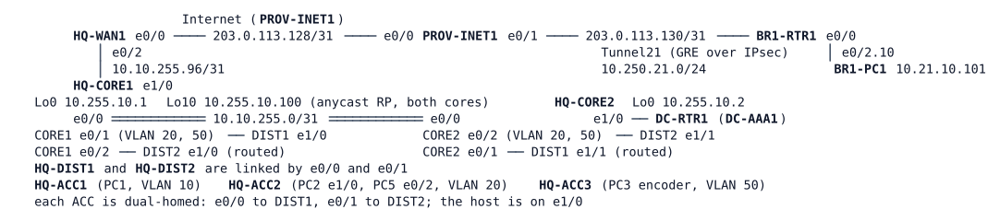

# LAB-057 — No video in the OPS room

**Module:** 08 Multicast · **Type:** T (Troubleshooting) · **Guidance tier:** G1 (business outcomes and tickets) · **Estimated time:** 120 min · **Blueprint domains:** 3, 4

## Scenario

Veridian's HQ operations (OPS) room has a camera wall, and the BR1 depot has a video screen, both fed by the yard-camera encoder in the HQ server VLAN. After Sunday's change window (change log: "configuration compare and clean-up on several devices"; no device list) two tickets arrived:

- **T1, OPS shift lead:** "Since this morning the camera wall in the OPS room is black. Our PCs work normally: mail and the HQ applications are fine."
- **T2, BR1 depot manager:** "The depot's video screen has been black since the weekend too. Our HQ applications work."

Shift rules: no reboots, and keep the documented design (the design pack below). You are expected to restore service, show with evidence that the design still holds, and leave the ticket notes a colleague can follow.

## Objectives

- Find, from the viewer's host to the source, where each stream stops, and which device should have carried it further.
- Restore both viewers without breaking the documented design.
- Prove the result with viewer output, router state and a switch-side capture.

## Available Information

| Device | Interface | Address | Role |
|---|---|---|---|
| HQ-CORE1 | Ethernet0/1.20 / .50 | 10.10.20.2/24, 10.10.50.2/24 (VRRP VIP .1) | gateway VLAN 20 (backup), VLAN 50 (master) |
| HQ-CORE2 | Ethernet0/2.20 / .50 | 10.10.20.3/24, 10.10.50.3/24 | gateway VLAN 20 (master), VLAN 50 (backup) |
| HQ-CORE1 / HQ-CORE2 | Loopback10 | 10.255.10.100/32 on both | anycast rendezvous point |
| HQ-WAN1 | Tunnel21 | 10.250.21.1 (BR1 .21) | GRE over IPsec to BR1, `ip mtu 1400` |
| BR1-RTR1 | Ethernet0/2.10 | 10.21.10.1/24 | BR1 LAN (BR1-PC1) |

Hosts (Alpine, `iperf` version 2, `tcpdump`, `sudo`; user `cisco`, password `cisco`): HQ-PC1 10.10.10.101 (VLAN 10, HQ-ACC1), HQ-PC2 10.10.20.102 (VLAN 20, the OPS camera wall PC, HQ-ACC2 e1/0), HQ-PC3 10.10.50.103 (VLAN 50, HQ-ACC3, the encoder), BR1-PC1 10.21.10.101 (the depot screen), **HQ-PC5** (HQ-ACC2 e0/2, VLAN 20, no IP address: the capture host). Routers and switches: user `admin`, password `Cisco123!` (console and SSH). The HQ application check is a ping or login from a host to HQ-PC3 (server VLAN). The Internet, the syslog and the NMS collectors are outside this environment.

"The encoder" is the background `iperf -c 239.10.20.1 -u -T 16 -b 512k -l 1316 -S 0x88` running on HQ-PC3 (DSCP AF41, TTL 16, 1344-byte packets). "A viewer" is `iperf -s -u -B 239.10.20.1 -i 5` on a host: the host's kernel sends the IGMP report and the interval lines show the loss. The first interval of a freshly started viewer shows a high loss figure because the encoder's datagram counter is already running: judge the following intervals.

**Design pack (what the network is documented to be):**

- *OPS join policy:* the OPS VLAN (20) may join only groups in 239.10.20.0/24, enforced on the VLAN 20 gateway interfaces of both cores.
- *Forwarder design:* in each video VLAN (20, 50) the PIM designated router is the VRRP master, set by explicit priority; PIM hellos are 1 s on those interfaces. The IGMP querier is the router with the lowest address (HQ-CORE1) and is not expected to be the DR.
- *Switch design:* IGMP snooping is disabled for VLANs 20 and 50 on HQ-DIST1, HQ-DIST2, HQ-ACC2 and HQ-ACC3 and left at its default on HQ-ACC1 (a platform setting: routed multicast arriving over trunks is not forwarded by snooping switches on this platform). Multicast routing exists only on routers.
- *Port templates:* an OPS access port is VLAN 20 access, portfast, BPDU guard, nothing else applied. Other access-port types have their own templates. Rule: a shared template or ACL is never changed to fix one port.
- *Time and access:* H4 profile as in LAB-056 (hardened campus, DC-RTR1 as time master, HQ-WAN1 as time master for BR1).

## Starting State

- The HQ campus (VLANs 10, 20, 50, 99, VRRP, OSPF area 0), DC-RTR1 and DC-AAA1, HQ-WAN1 with Tunnel21 up to BR1-RTR1 (OSPF area 21), HQ-PC5 on HQ-ACC2; routers and switches are configured as documented in the design pack and LAB-056.
- The encoder runs on HQ-PC3 from boot. No viewer runs at boot: start one on the host you are testing.
- Nodes are in their saved configurations. Do not reload or wipe nodes during the shift.

## Requirements / Change Requests

R1: Restore the stream to the OPS camera wall PC (HQ-PC2) without changing the documented join policy, forwarder design or port templates.
R2: Restore the stream to the depot screen (BR1-PC1), over the protected tunnel, also for a second encoder address in the HQ server VLAN.
R3: Do not reload devices (the node stops of R5 are the only exception). Keep every change small and explain it in the ticket note.
R4: Attach to the ticket one capture taken with the switch's mirroring feature (HQ-ACC2 to HQ-PC5) that is evidence in your T1 diagnosis, and say in the ticket what it ruled in or out. Remove the mirroring session afterwards.
R5: Measure the OPS media gap when the router currently forwarding the stream into OPS is stopped, and when it returns (node stop after `write memory`, then start).

## Reported Problems

- T1: the OPS camera wall is black; mail and HQ applications work.
- T2: the depot screen is black; HQ applications work.

## Verification Criteria

V1: Viewers in OPS (HQ-PC2) show at most 1 % loss over 60 s of viewer output (read from the second interval on).
V2: The depot viewer (BR1-PC1) shows at most 1 % loss over 60 s, also while HQ-PC3 sends from a second address in the server VLAN (`sudo ip addr add 10.10.50.113/24 dev eth0`, then `iperf -c 239.10.20.1 -u -T 16 -b 512k -l 1316 -S 0x88 -B 10.10.50.113 -t 40`). Remove the address afterwards. The viewer starts a new session when the source changes: judge that new session over 60 s, read from its second interval (as in V1).
V3: The documented OPS join policy still holds: a viewer in OPS for a group outside 239.10.20.0/24 leaves no entry for it in `show ip igmp groups` on either core.
V4: The switch design in the design pack holds (state what you checked on which switches). A viewer in the office VLAN (HQ-PC1) stays silent.
V5: The forwarder design holds: in each video VLAN the PIM DR is the VRRP master.
V6: OPS video recovers within the documented allowance of 4 s when the router currently forwarding it into OPS is stopped (node stop, silent failure for the neighbours), and the return of that router costs the viewer no gap longer than 0.5 s. One run is not enough: take three, with the media gap measured on the viewer host (`sudo tcpdump -tt -n -i eth0 dst 239.10.20.1`).
V7: The capture of R4 is attached to the ticket.

A node stop is a silent failure for the neighbours (no resign message, no link-down); wait until the router has booted between runs. To take away only one side of a link, use `shutdown` on both ends (a cable pull). Video playing is not the end of the ticket: check V3 to V6 after your change.

## Analysis Questions

Q1: For each ticket, which first piece of evidence told you which layer was failing (host, switch, router, path)?
Q2: How did you prove that the viewer's host did its part?
Q3: After each change, what did you re-test, and what did it show?
Q4: How does a router choose the interface multicast must arrive on, and how do you prove it for any source?
Q5: For each ticket, which output showed where the stream stopped, and which router should have carried it further?
