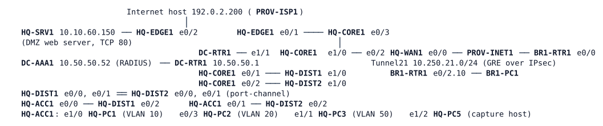

# LAB-058 — Operations shift 2

**Module:** 08 Multicast · **Type:** T/N (Troubleshooting/Integration, mixed operations) · **Guidance tier:** G1 (business outcomes and tickets) · **Estimated time:** 190 min · **Blueprint domains:** 1, 2, 3, 4, 5

## Scenario

You take Wednesday's shift at Veridian's network operations desk. The queue holds five tickets, one of them (TK4) opened last Thursday and the others since the weekend. The hand-over pack describes the design (below) and a neutral change log: "weekend maintenance: configuration compare and clean-up on several devices, one hardware swap in the campus". No device list came with it.

Shift rules:

- Use the central account (`netadmin`) first. The local `admin` account is break-glass only.
- No reboots and no wipes. Every fix keeps the documented design.
- Attach **one packet capture** to a ticket, taken with the access switch's mirroring feature to the capture host HQ-PC5. Remove the mirroring session afterwards.
- An AI change proposal must be tested before it is approved. Test it in this lab, on the device it names, and leave the device in the state your verdict calls for.

## Objectives

- Find, for each ticket, the first piece of evidence that separates the plausible causes, and fix the real one without changing the documented design.
- Decide whether the assistant's proposal CHG-AI-03 is safe, with measurements, and give a corrected change if it is not.
- Leave ticket notes a colleague could follow.

## Available Information

| Device | Interface | Address | Role |
|---|---|---|---|
| HQ-CORE1 | Loopback0 / Loopback10 | 10.255.10.1 / 10.255.10.100 | router ID / rendezvous point |
| HQ-CORE1 | Ethernet0/1.20, .50, .99 | 10.10.20.2, 10.10.50.2, 10.10.99.2 (VRRP VIP .1) | gateways VLAN 20, 50, 99 |
| HQ-CORE1 | Ethernet1/0 | 10.10.255.96/31 | to HQ-WAN1 |
| HQ-CORE1 | Ethernet0/3 / Ethernet0/3.99 | 10.10.255.64/31 / 10.10.254.4/31 | to HQ-EDGE1 (global / MGMT) |
| HQ-CORE1 | Ethernet1/1 / Ethernet1/1.99 | 10.10.255.130/31 / 10.10.254.6/31 | to DC-RTR1 (global / MGMT) |
| HQ-DIST1 / HQ-DIST2 | Vlan10 (GLBP) | 10.10.10.2 / 10.10.10.3, virtual gateway 10.10.10.1 | gateway VLAN 10 |
| HQ-DIST1 / HQ-DIST2 / HQ-ACC1 | Vlan99 (MGMT VRF) | 10.10.99.11 / 10.10.99.12 / 10.10.99.21 | management |
| HQ-EDGE1 | Ethernet0/1.99 (MGMT), Ethernet0/2 | 10.10.254.5/31, 10.10.60.2/24 | Internet edge, DMZ gateway |
| HQ-WAN1 | Ethernet0/0, Ethernet0/2, Tunnel21 | 203.0.113.129/31, 10.10.255.97/31, 10.250.21.1 | WAN edge; tunnel to BR1 |
| BR1-RTR1 | Ethernet0/0, Ethernet0/2.10, Tunnel21 | 203.0.113.131/31, 10.21.10.1/24, 10.250.21.21 | BR1 router |

Hosts (Alpine; user `cisco`, password `cisco`; `sudo`, `iperf` v2, `tcpdump`, `wget`, `nc` available): HQ-PC1 10.10.10.101 (VLAN 10, office floor), HQ-PC2 10.10.20.102 (VLAN 20, OPS room), HQ-PC3 10.10.50.103 (VLAN 50, the yard-camera encoder and the sync-job source), **HQ-PC5** (capture host, no IP address, HQ-ACC1 e1/2), BR1-PC1 10.21.10.101 (the depot screen). HQ-SRV1 10.10.60.150 serves the HQ application on TCP 80 (a small page at `/` and the 300 KB stock file `/stock.dat`).

Network devices: user `netadmin` / password `netpass` (central, RADIUS on DC-AAA1 10.50.50.52, reached through the management VRF `MGMT`), break-glass `admin` / `Cisco123!`. Consoles are exempt from central authentication.

**Design pack (what the network is documented to be):**

- *Campus switching:* HQ-DIST1 is the spanning-tree root for VLANs 1, 10, 50 and 99, HQ-DIST2 for VLAN 20. HQ-ACC1 is dual-homed to both and is never a root. Root protection is configured on the DIST ports toward the access switch. VLAN 10 gateway: GLBP on the DISTs; VLANs 20, 50, 99: VRRP on HQ-CORE1.
- *Management plane:* switches and routers authenticate `netadmin` centrally over the management VRF and fall back to the local account. Time comes from DC-RTR1 for HQ.
- *Internet edge:* HQ-EDGE1 carries a control-plane policy; management SSH to it is allowed only from 10.10.99.0/24 and 10.50.50.0/24.
- *Video:* the encoder (HQ-PC3) sends 239.10.20.1; the OPS room and the depot are the viewers. The rendezvous point is 10.255.10.100 (HQ-CORE1 Loopback10, an anycast address that a second core will share later). IGMP snooping is off in VLANs 20 and 50 on every campus switch (a platform setting). The BR1 circuit between HQ-WAN1 and BR1-RTR1 is a 2 Mb/s provider circuit with about 30 ms delay and 0.2 % loss; the tunnel over it runs OSPF area 21 and PIM.

"The encoder" is `iperf -c 239.10.20.1 -u -T 16 -b 512k -l 1316 -S 0x88` running on HQ-PC3 from boot (DSCP AF41). "A viewer" is `iperf -s -u -B 239.10.20.1 -i 5` on a host; the first interval line is not meaningful, read loss from the second line on.

"The sync job" is the nightly stock download, reproduced as `iperf -c 10.21.10.101 -u -p 5002 -b 3M -l 1316 -t <seconds>` on HQ-PC3 towards `iperf -s -u -p 5002` on BR1-PC1. "The depot's HQ application check" is `wget -T 20 -O /dev/null http://10.10.60.150/stock.dat` on BR1-PC1 (done = the 300 KB file arrives).

## Starting State

- The HQ campus, DC, Internet edge, WAN edge and BR1 are configured and running as one network; the encoder runs from boot; no viewer and no sync job runs at boot.
- Nodes are in their saved configurations. Do not wipe or reload nodes (a `clear crypto session` is allowed during the QoS work: it gives no confirmation prompt and the tunnel flaps only briefly, about 1 second on this bench, so allow a few seconds for OSPF and PIM to recover).

## Requirements / Change Requests

R1: Work the five tickets below. Fix what is wrong without changing the documented design, and write a ticket note per ticket: first evidence, cause, change, check.
R2: Attach to one ticket a capture taken with HQ-ACC1's mirroring feature towards HQ-PC5 that shows what you needed to see for that ticket. Remove the mirroring session afterwards.
R3: Test the assistant's proposal CHG-AI-03 (TK4) against the documented sync job and the depot viewer. If you reject it, put a corrected change on the device and test it the same way. Leave the device in the state your verdict calls for.
R4: Pull a cable (`shutdown` on both ends of the link) between HQ-DIST2 and HQ-ACC1 while a ping from HQ-PC2 to its gateway (10.10.20.1) runs, once the OPS room works. Count the lost pings, three times, and restore each time (a one-ended `shutdown` is a different test: the peer port stays up).
R5: Leave every device in a state that satisfies V1 to V8 and the design pack.

## Reported Problems

- **TK1 (OPS shift lead):** "Since this morning nobody in the OPS room can open anything: no mail, no apps, no Internet, and the camera wall is black. Colleagues on the office floor next door are fine."
- **TK2 (NOC):** "Our central logins to one distribution switch are rejected since the weekend; the emergency account gets in after a long wait. Other devices accept our logins."
- **TK3 (NOC):** "We cannot open an SSH session to the Internet edge router from the management network any more; it times out. The edge routes traffic normally and answers pings."
- **TK4 (BR1 depot manager):** "Every night when the stock download from HQ runs, the depot's video screen freezes and the HQ apps crawl. IT says the assistant has a fix ready." The assistant's proposal, attached verbatim:

  > **CHG-AI-03** On HQ-WAN1, interface Ethernet0/0, outbound: `shape average 2000000`, with a child policy: `class VIDEO` (`match dscp af41`) `priority 1000`, and `class class-default` `police 300000 conform-action transmit exceed-action drop`. Reason: limit everything else to 300 kb/s so the download cannot hurt the video.
- **TK5 (BR1 depot manager, opened Monday):** "Since the weekend the depot's video screen stays black all day, not only at night. Our HQ applications work."

## Verification Criteria

V1: Every HQ user group reaches its applications, the Internet host 192.0.2.200 and, for OPS, the video: from HQ-PC1 and from HQ-PC2 their gateway, HQ-SRV1 TCP 80 and 192.0.2.200 answer; HQ-PC2 shows at most 1 % loss over 60 s of viewer output.
V2: The campus switching section of the design pack holds (state your evidence per VLAN).
V3: Central logins work on every device without the break-glass account (a `test aaa` against the central group succeeds on each switch), and every device's clock is synchronised to its documented source (check last: the switches need up to about 35 minutes).
V4: The Internet edge section of the design pack holds, including management access (state your evidence).
V5: Under the documented sync job (run it for at least 4 minutes) the depot video loses at most 1 % (read from the second viewer interval on), the OSPF and PIM neighbours over Tunnel21 stay up, and the depot's HQ application check completes (each fetch of the 300 KB file in at most 20 s).
V6: The capture of R2 is attached to a ticket and was taken with the switch's mirroring feature.
V7: The cable pull of R4 costs at most 3 pings, and restoring costs at most 1.
V8: The video section of the design pack holds for both viewer sites (state your evidence per site); the depot viewer loses at most 1 % over 60 s, read from the second interval on.

## Analysis Questions

Q1: For each ticket, which piece of evidence ruled out the most obvious subsystem first?
Q2: For each ticket, what did you check after connectivity came back?
Q3: Pick one ticket. Which commands proved the cause, and why would the first plausible fix not have worked?
Q4: What is your verdict on CHG-AI-03, which measurements support it, and what corrected change did you apply and why there?
Q5: What would you add to the change-review checklist so that a proposal like CHG-AI-03 is caught before production?
Q6: Did the order in which you worked the tickets matter? Say what you observed that decided it.
