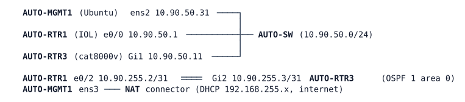

# LAB-060 — RESTCONF and NETCONF

**Module:** 09 Programmability and Automation · **Type:** F/I (Foundation / Implementation) · **Guidance tier:** G2 (behaviour stated; R1 and R2 name the first-contact commands, R3-R6 leave the commands to you) · **Estimated time:** 150 min · **Blueprint objectives:** 4.6:I, 6.3:P, 6.5:I

## Scenario

The first virtual router of the automation pod, AUTO-RTR3, has just been racked. The automation team needs its APIs switched on. You, the network team, enable them, prove what each API offers from the automation host, and write the team's "response code card": which HTTP status code and which `error-tag` the router returns for each kind of call and each kind of mistake. A script is only as reliable as the reader's knowledge of these answers.

## Objectives

- Enable NETCONF and RESTCONF over HTTPS on a Cisco IOS XE router with local authentication.
- Open a NETCONF session by hand, read the server's capabilities, and use `<get-config>`, `<get>` and `<get-schema>`.
- Discover the RESTCONF root, read data in JSON and XML with query parameters, and run a full create-read-update-delete cycle.
- Record the status code and error payload for success and for four induced errors.
- Inspect the HTTPS certificate and explain what `curl -k` skips.

## Available Information



| Device | Interface | Address | Notes |
|---|---|---|---|
| AUTO-MGMT1 | ens2 | 10.90.50.31/24 | static routes via 10.90.50.1 (AUTO-RTR1) to 10.90.0.0/16, 10.255.90.0/24 and 10.50.0.0/16; the 10.50.0.0/16 route is a spare toward the lab's other address space and carries no traffic in this lab |
| AUTO-MGMT1 | ens3 | DHCP 192.168.255.x | NAT, default route |
| AUTO-RTR1 | Loopback0 / e0/0 / e0/2 | 10.255.90.1/32, 10.90.50.1/24, 10.90.255.2/31 | NTP master |
| AUTO-RTR3 | Loopback0 / Gi1 / Gi2 | 10.255.90.11/32, 10.90.50.11/24, 10.90.255.3/31 | API target; Gi3, Gi4 unused |

Credentials: routers `admin` / `Cisco123!` (priv 15); AUTO-MGMT1 `cisco` / `cisco`. AUTO-MGMT1 has `curl`, `jq`, `openssl` and `ssh`; `ncclient` is not installed yet and there is no `sshpass`. LAB-059's files are in `/home/cisco/yang`, `/home/cisco/json` and `/home/cisco/trees`. The RESTCONF body used for Loopback100 is not stored on AUTO-MGMT1; if you do not have it from LAB-059, use this one-line JSON (save it with `echo '<json>' > loopback100.json`):

```
{"ietf-interfaces:interface":{"name":"Loopback100","description":"API test","type":"iana-if-type:softwareLoopback","enabled":true,"ietf-ip:ipv4":{"address":[{"ip":"10.255.90.100","netmask":"255.255.255.255"}]}}}
```

Two behaviours to expect from a Catalyst 8000V (they are not faults): after any configuration change the router's model-driven process (DMI) synchronises its database, and during that window a write through NETCONF or RESTCONF can be refused; and a freshly enabled API needs a couple of minutes before it answers. A command-line session also rewrites the console lines, which triggers the same synchronisation.

## Starting State

The pod runs: OSPF between AUTO-RTR1 and AUTO-RTR3, the loopbacks reach each other, AUTO-RTR1 is the NTP master (do not wait for it to report synchronised). AUTO-RTR3 already has `aaa new-model` with local login and local exec authorisation (the console keeps working without a password); the AAA lines are given background, not a task. AUTO-RTR3 offers SSH only: ports 80, 443 and 830 are closed and no NETCONF, RESTCONF or HTTP server is configured. Loopback100 does not exist. There are no faults.

## NETCONF, RESTCONF and certificates in brief

Both protocols read and write the same YANG-modelled data on the router; they differ in transport and style.

- **NETCONF** is a long-lived session over SSH (subsystem `netconf`, port 830). Each side starts with a `<hello>` that lists its capabilities. After that the client sends `<rpc>` messages (`get-config`, `get`, `get-schema`, `edit-config`, `close-session`), each with a `message-id`, and the server answers with an `<rpc-reply>`. With base 1.0 every message ends with the marker `]]>]]>`; base 1.1 uses chunked framing instead. A `<filter type="subtree">` selects part of the tree by naming the nodes you want, with their namespace.
- **RESTCONF** is stateless HTTPS: one URL, one HTTP verb, one media type per call (`application/yang-data+json` or `+xml`). The root is found at the well-known URI `/.well-known/host-meta`; data lives below `<root>/data`. The result is carried in the HTTP status code and, on an error, in an `errors` body with an `error-tag`. Query parameters such as `content`, `depth` and `fields` shape the answer.
- **Enabling on IOS XE:** `netconf-yang` starts the NETCONF server and the model-driven process behind both APIs; `restconf` adds the RESTCONF server on the HTTP(S) service; `ip http secure-server` opens HTTPS; `ip http authentication local` makes the web service check the local user database; `no ip http server` closes plain HTTP. Entry `show` commands: `show ip http server status`, `show platform software yang-management process`, `show running-config | include netconf|restconf|http`, `show logging | include DMI`.

**Certificates in brief (R6, Q7).** HTTPS proves the server's identity with an X.509 certificate. It carries a subject (who the certificate is for), an issuer (who signed it), a validity period, a public key (with its size) and optional subject alternative names (SANs), the names or IP addresses the certificate is valid for. A client checks, in order: that the signature chain leads to a certificate authority (CA) it trusts, that the name or address it connected to matches the subject or a SAN, and that the dates are valid. A self-signed certificate is its own issuer, so its chain has length 1 and no CA vouches for it; a client then either trusts that one certificate explicitly (trust on first use: fetch it once, compare it afterwards) or turns verification off. Entry commands: `openssl s_client -connect <ip>:443 -showcerts`, `openssl x509 -noout -text`, `curl -v`.

Commands for a first NETCONF session, with placeholders (R2 asks you to record what comes back):

```
ssh -p 830 -s <user>@<router-ip> netconf
<hello xmlns="urn:ietf:params:xml:ns:netconf:base:1.0"><capabilities><capability>CAPABILITY-URI</capability></capabilities></hello>]]>]]>
```

## Requirements / Change Requests

R1: Enable NETCONF and RESTCONF over HTTPS on AUTO-RTR3, authenticated against the local user database, with the plain HTTP server off. From AUTO-MGMT1 prove that ports 830 and 443 answer and port 80 does not.
R2: Open a NETCONF session from AUTO-MGMT1 over SSH port 830 with the `netconf` subsystem. Send a hello that offers only `base:1.0`. Record: the number of capabilities the server announces, whether it offers `base:1.1`, whether `ietf-interfaces`, `Cisco-IOS-XE-native`, `writable-running` and `candidate` are announced, and which framing the session uses.
R3: With `<get-config>` and a subtree filter read the router's hostname and its interface list. With `<get>` read the operational state and counters of one interface. With `<get-schema>` retrieve `ietf-interfaces` and compare its revision (and content) with LAB-059's file on AUTO-MGMT1.
R4: Discover the RESTCONF root by the well-known URI. GET `ietf-interfaces:interfaces` as JSON and as XML, then the same path with `depth=2` and with `fields=interface(name;enabled)`, and describe how each result differs. GET the operational state of one interface (for example its oper-status and counters) with `content=nonconfig` or with the Cisco operational model.
R5: Create Loopback100 (10.255.90.100/32, description "API test") with POST, read it, change its description with PATCH, replace it with PUT, delete it with DELETE and read it again. Fill the response code card with the status code and the `error-tag` (where there is an error payload) for every step, and for four induced errors: malformed JSON, a wrong password, a path that does not exist, and the same POST sent twice. Finish with Loopback100 deleted.
R6: From AUTO-MGMT1 inspect AUTO-RTR3's HTTPS certificate (issuer, subject, validity, key size, subject alternative names, chain length). Show that `curl` without `-k` refuses the connection and state exactly what `-k` skips.

## Verification Criteria

V1: From AUTO-MGMT1, ports 830 and 443 on 10.90.50.11 accept connections and port 80 does not; an authenticated RESTCONF GET of the root answers.
V2: Your NETCONF transcript shows the server hello, the capability count, and the `]]>]]>` end-of-message marker, and your capability table answers each R2 item with the observed value.
V3: Your transcript shows the hostname and the interface list from `<get-config>`, one interface's counters from `<get>`, and the `<get-schema>` revision compared with the 059 file.
V4: Your RESTCONF log shows the JSON and XML answers, the effect of `depth` and `fields`, and the operational data.
V5: The completed code card has a status code (and error-tag where one exists) for each of the ten CRUD/error steps and the router's configuration finally has no Loopback100.
V6: Toolkit: the router's log contains a `%DMI-5-CONFIG_I` line naming `NETCONF/RESTCONF` and user `admin` for your writes.
V7: Your certificate notes list the fields from R6 as read from the live certificate, and the `curl` result without `-k` is recorded.

## Analysis Questions

Q1: Why does NETCONF run over SSH and RESTCONF over HTTPS, and what does each give a script (sessions, message framing, transactions versus stateless calls)?
Q2: What is the difference between `<get>` and `<get-config>`, and how do the RESTCONF `content=` values map onto them? What did `content=nonconfig` return on the configuration tree, and why?
Q3: What do POST, PUT and PATCH do to the same resource, and why does a second POST return a 409 while a second PUT does not?
Q4: A script receives a 409. There are two kinds in this lab's family of errors (`data-exists` and `lock-denied`). How does the script tell them apart, and what should it do in each case? Which one will you see if you repeat a write immediately after another RESTCONF write, and for how long?
Q5: What does a 401 tell the caller, and what does it not tell it about the account?
Q6: Which capabilities would an automation tool check before using a feature (candidate, validate, rollback-on-error, with-defaults, xpath)? Why is the capability list not the same as the list of supported modules, and where else can a client discover a module?
Q7: Describe the chain of trust the client checks when it connects to the router. What would a certificate signed by a company CA change in R6, and what does an attacker gain from a script that always uses `-k`?
Q8: Disabling RESTCONF and disabling NETCONF are both single commands. Which one would you do in the working day and which one would you plan for a maintenance window? Explain from what the router restarts in each case.
