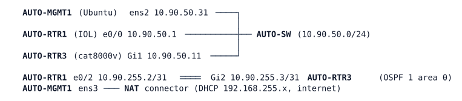

# LAB-061 — Model-driven change

**Module:** 09 Programmability and Automation · **Type:** I (Implementation) · **Guidance tier:** G2 (behaviour stated, you choose the commands) · **Estimated time:** 150 min · **Blueprint objectives:** 4.6:P, 5.3:I, 6.2:P, 6.5:P

## Scenario

The automation team wants its first real change made through the API instead of the CLI. AUTO-RTR3 must get its standard objects (a monitored loopback, time, a static route to the lab range, interface descriptions) written only through RESTCONF and NETCONF, and the team wants to see exactly what each write method does to data it was not told about. Once the changes are in, security asks for the API itself to be fit for production: one dedicated account, HTTPS only, only the automation host allowed to connect, and a certificate the automation host can verify without `curl -k`.

## Objectives

- Build RESTCONF payloads from YANG paths for an IETF model and for the Cisco native model, and decide which model fits each object.
- Use PATCH (merge), PUT (replace) and DELETE on list entries and leaves, and predict what each one removes.
- Read a 400 error path, map it onto the YANG tree and correct the payload.
- Change configuration with NETCONF `<edit-config>` using the `merge` and `delete` operations.
- Harden the router's API: dedicated account, HTTPS only, source restriction, connection limit, and a certificate with a subject alternative name that the client trusts.

## Available Information

| Device | Interface | Address | Notes |
|---|---|---|---|
| AUTO-MGMT1 | ens2 | 10.90.50.31/24 | routes via 10.90.50.1 to 10.90.0.0/16, 10.255.90.0/24 and 10.50.0.0/16 (the last is a spare and carries no traffic here) |
| AUTO-MGMT1 | ens3 | DHCP 192.168.255.x | NAT, default route |
| AUTO-RTR1 | Loopback0 / e0/0 / e0/2 | 10.255.90.1/32, 10.90.50.1/24, 10.90.255.2/31 | NTP master (stratum 3) |
| AUTO-RTR3 | Loopback0 / Gi1 / Gi2 | 10.255.90.11/32, 10.90.50.11/24, 10.90.255.3/31 | API target; Gi3, Gi4 unused |

Credentials: routers `admin` / `Cisco123!` (priv 15); AUTO-MGMT1 `cisco` / `cisco` (sudo). The account to create on AUTO-RTR3 is `apiuser` with the password `Api#Pass2026`. AUTO-MGMT1 has `curl`, `jq`, `openssl` and `ssh`; there is no `sshpass` and no `ncclient` (NETCONF is done by hand over `ssh -p 830 -s netconf`, as in LAB-060, or with any tool you installed). LAB-059's files are in `/home/cisco/yang`, `/home/cisco/json` and `/home/cisco/trees`.

YANG locations of the objects (the paths below give the module and top node; find the exact child names yourself. `/home/cisco/trees` holds only the `ietf-interfaces` and NTP trees from LAB-059, so for the OSPF and `ip route` nodes note that `/home/cisco/yang` has `Cisco-IOS-XE-ip` (the `ip route` nodes) but no OSPF module, and there is no venv: reinstall pyang 2.7.1 as in LAB-059 (the NAT step) to tree `ip`, and fetch the OSPF module with NETCONF `get-schema`, or configure the object once at the CLI and read it back with a RESTCONF GET using `?depth=` and `?fields=`):

| Object | Model and path |
|---|---|
| Interface, IPv4 address, description | `ietf-interfaces:interfaces/interface` with `ietf-ip:ipv4/address` (list key `ip`) |
| Same interface, native view | `Cisco-IOS-XE-native:native/interface/Loopback` (list key `name`) |
| OSPF network statement | `Cisco-IOS-XE-native:native/router/Cisco-IOS-XE-ospf:router-ospf/ospf/process-id` (key `id`), list `network` |
| NTP server | `Cisco-IOS-XE-native:native/ntp` |
| Static route | `Cisco-IOS-XE-native:native/ip/route` |

Behaviours to expect from the Catalyst 8000V (not faults). A RESTCONF or NETCONF write can occasionally be refused with HTTP 409 and `error-tag` `lock-denied` while the router's model-driven process (DMI) synchronises its database. It is transient: measured in the 2–3 s after a RESTCONF write and once right after CLI changes; not reproducible on demand; a NETCONF `<lock>` makes RESTCONF writes wait instead. Wait and retry (at most 6 times, 10 s apart); read the `error-tag` before you retry (`data-exists` is a different 409). The router console carries no syslog; read the log with `show logging`. A command-line session to AUTO-RTR3 over SSH from AUTO-MGMT1 is the normal way to inspect it; remember it may trigger the same synchronisation.

## Starting State

Stage AUTO A0 (end of LAB-060): AUTO-RTR1 and AUTO-RTR3 run OSPF 1 area 0 over the /31, AUTO-RTR1 is the NTP master (do not wait for AUTO-RTR3 to report `synchronized`; judge time by the NTP association, last). AUTO-RTR3 has local AAA (the console still works without a password), `netconf-yang`, `restconf`, `ip http secure-server` with its automatic self-signed certificate, `ip http authentication local` and no plain HTTP. Only the user `admin` exists. Loopback101, the NTP server, the static route and all interface descriptions do not exist. There are no faults.

## Requirements / Change Requests

R1: Through RESTCONF only, create Loopback101 with 10.255.90.101/32 using the IETF interface model, and advertise it in OSPF 1 area 0 using the native OSPF model. Verify by GET, by `show running-config` and by AUTO-RTR1's routing table.

R2: Through RESTCONF only, make AUTO-RTR3 take time from AUTO-RTR1's Loopback0 address (native model), and add a static route 10.99.0.0/16 to Null0 (native model). For the NTP change, record the first payload you try and the exact error the router returns if it refuses it, and correct the payload from the error path alone.

R3: Through NETCONF `<edit-config>` on the running datastore, set a description on Gi1 ("AUTO-SW API segment") and on Gi2 ("Link to AUTO-RTR1") in one RPC with the `merge` operation, then remove the Gi2 description with the `delete` operation. Verify with `<get-config>` and on the CLI.

R4: Show the difference between PATCH and PUT on Loopback101. (a) PATCH a description onto it: the address must remain. (b) PUT the IETF list entry with a body that carries `name`, `type`, `enabled` and a description but no `ietf-ip:ipv4` container, and record what happens to the address and to the route on AUTO-RTR1. (c) PUT the native `Loopback` entry (`Cisco-IOS-XE-native:native/interface/Loopback=101`) with only a name and a description, and record the same two facts. (d) Restore the address (and the OSPF route on AUTO-RTR1) and remove the description so Loopback101 matches R1.

R5: Harden the API on AUTO-RTR3.
  - A local account `apiuser` (secret `Api#Pass2026`, privilege 15) for automation.
  - HTTPS only (plain HTTP stays off), at most 5 simultaneous connections, and only AUTO-MGMT1 (10.90.50.31) may open the web server.
  - A certificate that AUTO-MGMT1 verifies for the name `rtr3.auto.veridian.example`: subject name and subject alternative name carry that name, it is the certificate the HTTPS server presents, and AUTO-MGMT1 resolves the name through `/etc/hosts` to 10.90.50.11 and trusts the certificate from the file `/home/cisco/trust/rtr3.pem`.
  - Prove each control from AUTO-MGMT1 (see V5). Note how you obtained the trusted copy of the certificate and what that step relies on.

R6 (optional stretch): Find out whether NETCONF on AUTO-RTR3 can offer a candidate datastore, enable it if so, and use it for one change with a validate/commit cycle. The feature change restarts the model-driven process; do it only when you have time, and expect the API to be unavailable for a couple of minutes.

## Verification Criteria

V1: `GET` of Loopback101 returns 10.255.90.101/32 and `show running-config` shows the network statement in `router ospf 1`; AUTO-RTR1 has 10.255.90.101/32 learned through OSPF 1.

V2: `show running-config` shows the NTP server and the static route to Null0 and RTR3's `show ip route 10.99.0.0` reports it; the NTP association to 10.255.90.1 is the system peer (check this last).

V3: `<get-config>` shows both descriptions after the merge, `show interfaces description` shows only the Gi1 description after the delete, and each RPC was answered `<ok/>`.

V4: Your notes record, for R4 (b) and (c), the status code, whether the address and the AUTO-RTR1 route survived, and the final state after (d) equals R1.

V5: From AUTO-MGMT1 and only from there: (1) `curl http://10.90.50.11/` gets no answer on port 80; (2) a request with a wrong password for `apiuser` is answered 401; (3) a request to `https://rtr3.auto.veridian.example/restconf/...` with `--cacert /home/cisco/trust/rtr3.pem` and `apiuser` succeeds without `-k`; (4) the same request without `--cacert`, and the one with `--cacert` to the address 10.90.50.11 instead of the name, both fail certificate verification; (5) a request sourced from a second AUTO-MGMT1 address that is not in the permitted list does not return the data (record exactly what it does return); (6) Toolkit: the router's log has `%DMI-5-AUTH_PASSED` lines naming `apiuser` for your calls; (7) `show running-config | include max-connections` on AUTO-RTR3 shows the connection limit set in R5 (five simultaneous connections; the limit under load is not exercised here).

V6: A request by a privilege-1 local user that you create for the test is refused; record the status code and `error-tag` for GET and for PATCH, then remove the test user.

V7 (with R6): the NETCONF hello lists the candidate capability, an `<edit-config>` to the candidate leaves the running configuration unchanged until `<commit/>`, and the change is in running afterwards.

## Analysis Questions

Q1: Which model did you use for each object, and what rule did you follow? What did the native Loopback view give you that the IETF one did not, and the other way round?

Q2: A PUT on a list entry replaces it. Compare the results of your two PUTs in R4 and explain what each one replaced and what that means operationally: when is PUT the right method, when is PATCH, and what does a script that "just sends the whole desired object with PUT" risk on the IETF model?

Q3: What did the 400 error path in R2 point at, and how did you map it onto the YANG tree? Why does the same container name exist in two modules?

Q4: What does basic authentication over HTTPS protect and what does it not (credentials in every request, no expiry, no per-call authorisation)? What does the privilege-1 result in V6 tell a script author about authorisation?

Q5: A token-based API (Catalyst Center: POST credentials once, then send `X-Auth-Token` on every call) changes the answer to Q4 how? Where does role-based access control fit?

Q6: Why are the access class and the certificate separate controls (who may connect versus whom the client trusts)? What did the denied source see, and what does that tell you about where the access class acts?

Q7: Why did `--cacert` fail when you called the IP address instead of the name? What did you trust when you fetched `rtr3.pem` for the first time, and how would you do it safely in production?

Q8 (answer only if you did R6): what does the candidate datastore with `<commit>` add over writing the running datastore directly, and what did enabling it cost?

