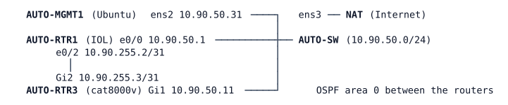

# LAB-062 — Python for network engineers

**Module:** 09 Programmability and Automation · **Type:** A/I (Analysis, Implementation) · **Guidance tier:** G2 (behaviour stated, you choose the commands) · **Estimated time:** 150 min · **Blueprint objectives:** 6.1:I, 6.5:R

## Scenario

The automation team has handed the network team its first Python scripts, and an AI assistant has proposed a compliance audit script for the pod. Before anything runs against production, the network team must be able to read each script, predict what it prints, run it, explain every difference, and decide whether the audit script can be trusted. You also install the tooling in a pinned virtual environment, make two changes to the scripts, and read a Catalyst Center response without a Catalyst Center to talk to.

## Objectives

- Read Python well enough to predict output: imports, variables and types, loops, conditionals, functions, f-strings, exceptions, `if __name__ == "__main__"`.
- Build a Python virtual environment with pinned library versions.
- Use `requests` (RESTCONF), `ncclient` (NETCONF) and `netmiko` (SSH) against the pod and say when each one fits.
- Make a script fail cleanly on an HTTP error, and explain how a script copes with a busy device.
- Interpret a Catalyst Center inventory and an asynchronous task response.
- Review an AI-proposed script against evidence and give a verdict.

## Available Information



| Item | Value |
|---|---|
| AUTO-MGMT1 login | `cisco` / `cisco` (console); scripts in `/home/cisco/auto/` |
| AUTO-RTR1 (SSH, console) | `admin` / `Cisco123!`, 10.90.50.1, Loopback0 10.255.90.1 |
| AUTO-RTR3 console / SSH | `admin` / `Cisco123!`, 10.90.50.11, Loopback0 10.255.90.11, Loopback101 10.255.90.101 |
| AUTO-RTR3 API account | `apiuser` / `Api#Pass2026` (RESTCONF 443, NETCONF 830); name `rtr3.auto.veridian.example` |
| Certificate | the certificate AUTO-RTR3 presents is stored on AUTO-MGMT1 as `/home/cisco/trust/rtr3.pem` about 4-6 minutes after the lab boots. RESTCONF (443) and NETCONF (830) answer only about 6 minutes after AUTO-RTR3 boots (5.5-7 minutes measured, and a loaded CML server can take much longer, up to 15 minutes once); an HTTP 502 or a refused port 830 before then is not a fault, so poll and retry rather than assume |
| Pod standard (audit) | SSH version 2; VTY `transport input ssh`; a time source configured; `logging buffered` of at least 64000 bytes |

Scripts in `/home/cisco/auto/`: `rc_get.py`, `nc_get.py`, `show_cmds.py`, `set_desc.py` (reads `descriptions.csv`), `audit.py`, `catc_inventory.py` (reads `fixtures/`). 

**Code card** (for R3): `requests` returns a response object with `.status_code`, `.text`, `.json()` and `.raise_for_status()`, which raises `requests.exceptions.HTTPError` for a 4xx or 5xx answer; `sys.exit(n)` ends a script with exit code `n`.

**Lock helper** (for R4, optional tool, save as `/home/cisco/hold.py`; it needs the R1 venv):

```python
import sys, time
from ncclient import manager
with manager.connect(host="rtr3.auto.veridian.example", port=830, username="apiuser",
                     password="Api#Pass2026", hostkey_verify=False,
                     device_params={"name": "iosxe"}) as m:
    with m.locked("running"):
        print("lock held", flush=True)
        time.sleep(int(sys.argv[1]))
    print("lock released", flush=True)
```

Link-failure convention in this lab: stopping a node is a silent failure for its neighbours.

## Starting State

Stage A1 (see `environments/AUTO/A1/README.md`: AUTO-RTR3 with the API account, HTTPS-only RESTCONF, the pinned certificate fetch) with these differences: AUTO-RTR1 has `logging buffered 8192`; AUTO-MGMT1 holds the scripts above, owned by `cisco`; there is no Python virtual environment, and the system Python has `requests` but not `ncclient` or `netmiko`. The pod has at least one compliance finding. The Internet path (NAT on AUTO-MGMT1 `ens3`) is available for package installs.

## Requirements / Change Requests

R1: Create a virtual environment `/home/cisco/venv` (a fresh Ubuntu 24.04 host may not have the venv package installed: find out what is missing and install it first) and install `requests==2.31.0`, `ncclient==0.7.1` and `netmiko==4.8.0` into it. All later runs use it. (If AUTO-MGMT1 has no Internet, only `rc_get.py`, `set_desc.py` and `catc_inventory.py` can run with the system Python: do R2 for `rc_get.py`, R3, R4 and R5, and read `nc_get.py`, `show_cmds.py` and `audit.py` without running them.)
R2: Before you run each of `rc_get.py`, `nc_get.py` and `show_cmds.py`, write down what it will print: types, number of loop passes, branches taken. Run it and explain every difference between your prediction and the output.
R3: Change `rc_get.py` (or a copy) so it prints a table of interface name, enabled state and IPv4 address for AUTO-RTR3, and so that any HTTP 4xx or 5xx answer produces a one-line error message that includes the status code and ends the script with a non-zero exit code. Show it working, and show it failing cleanly when the requested resource does not exist.
R4: Run `set_desc.py` with the supplied CSV and run it again. Then, with another session holding a NETCONF lock on AUTO-RTR3's running datastore for about 40 seconds (the lock helper: start it first and wait until it prints `lock held` before you run the script), run it a third time after removing the three descriptions on AUTO-RTR3 by CLI. Explain from the script's output which code path handled the delay, why the run still succeeded, and when the change reached the router.
R5: With `catc_inventory.py` and the supplied fixtures, report each device's platform, software version and reachability, and explain what the task response means for a script that changes something.
R6: Review `audit.py` as an AI-proposed script. Confirm each verdict it prints for AUTO-RTR1 and AUTO-RTR3 independently on the routers. Add a second non-compliance by hand on AUTO-RTR3 (remove its time-source configuration), confirm the script finds it, then restore it. Give a verdict (approve / approve with notes / amend / reject) with evidence. Fix AUTO-RTR1's finding with a netmiko call from a script of your own.

## Verification Criteria

V1: `/home/cisco/venv/bin/pip list` shows exactly the three pinned versions.
V2: For each R2 script your written prediction is compared with real output and every difference is explained.
V3: The changed `rc_get.py` prints the table, exits 0, and for a non-existent resource prints a one-line error with the status code and exits non-zero.
V4: After R4, AUTO-RTR3 shows the three descriptions from the CSV, and you can show on the router (log or configuration) the moment the changes were made.
V5: Your R5 report lists all five devices with platform, version and reachability, and names the devices a naive script would miss.
V6: With the second non-compliance in place the audit reports it; after your restore and your AUTO-RTR1 fix `audit.py` reports no findings and exits 0.
V7: Toolkit: the router logs show the scripted sessions: the RESTCONF/NETCONF logins on AUTO-RTR3 and the SSH logins of your netmiko runs on AUTO-RTR1.

## Analysis Questions

Q1: What does `requests.get(..., verify="/home/cisco/trust/rtr3.pem")` protect against compared with `verify=False`? What happens to such a script after AUTO-RTR3 reloads, and why?
Q2: Why does netmiko's `send_config_set` return text rather than a status, and how should a script decide that a change succeeded?
Q3: When should a script use RESTCONF, NETCONF or SSH screen-scraping?
Q4: In the AI review: what separates a correct script from an efficient one? Classify each issue you found in `audit.py` as a defect or a note, and say which assumption you would ask the author to state.
Q5: How does Catalyst Center's asynchronous 202 + task pattern differ from RESTCONF's synchronous 201/204 for a script that makes changes?
Q6: Where does each script keep its credentials, and what would you change before running it in production?
Q7: While a NETCONF session held the lock, what did RESTCONF do to the write, and how did the script's design turn that into a successful run?
