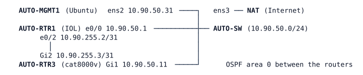

# LAB-063 — Agent vs agentless

**Module:** 09 Programmability and Automation · **Type:** A/I (Verification/Analysis, Implementation) · **Guidance tier:** G2 (behaviour stated, you choose the commands), with a G3 skeleton for the first Ansible run (R3) · **Estimated time:** 150 min · **Blueprint objectives:** 6.7:I, 6.6:R, 6.1:P, 4.6:R

## Scenario

The pod's standard gains two lines, identical on every router: `snmp-server location Veridian AUTO pod` and `snmp-server contact noc@veridian.example`. The team argues about how to deploy the standard and keep it in place: an agent on the device, a script, or an orchestration tool. The network team applies it all three ways on the pod, then writes the comparison that decides which method the pod will use.

## Objectives

- Build an on-box agent (an EEM applet) that checks a standard and repairs a deviation by itself.
- Extend a read-only netmiko script into an idempotent push script.
- Install Ansible in the pinned virtual environment and write an inventory, group variables and a playbook that applies the standard, with a dry run, a diff and an idempotence check.
- Reach the same device a second way (NETCONF) and compare the log evidence of both paths.
- Explain which method notices and corrects drift, when, and with what in the loop.

## Available Information



| Item | Value |
|---|---|
| AUTO-MGMT1 login | `cisco` / `cisco` (console); scripts in `/home/cisco/auto/`, virtual environment `/home/cisco/venv` |
| AUTO-RTR1 (SSH, console) | `admin` / `Cisco123!`, 10.90.50.1, Loopback0 10.255.90.1 |
| AUTO-RTR3 console / SSH | `admin` / `Cisco123!`, 10.90.50.11, Loopback0 10.255.90.11, Loopback101 10.255.90.101 (part of the stage baseline) |
| AUTO-RTR3 API account | `apiuser` / `Api#Pass2026` (RESTCONF 443, NETCONF 830); name `rtr3.auto.veridian.example` |
| Standard to deploy | `snmp-server location Veridian AUTO pod` and `snmp-server contact noc@veridian.example` |
| Pinned versions | `ansible==14.4.0` (ansible-core 2.21.5, `cisco.ios` 11.5.1, `ansible.netcommon` 8.6.2); the venv already holds `requests==2.31.0`, `ncclient==0.7.1`, `netmiko==4.8.0` |
| Readiness | RESTCONF (443) and NETCONF (830) on AUTO-RTR3 answer only some minutes after it boots; the first NETCONF call after that can fail once with `command timeout triggered`. Wait a minute and run it again: this is not a fault in your work |

Notes for the tasks:

- `show_cmds.py` in `/home/cisco/auto/` is the netmiko starting point for R2.
- A NETCONF write to AUTO-RTR3 shortly after another configuration change on it can be refused with `lock-denied` while the device synchronises its two configuration views (a retry fixes it; it did not occur often on this build). Give the NETCONF task a retry.
- The `netconf_config` module needs its XML content wrapped in a `<config>` element. The SNMP location sits in the native model `http://cisco.com/ns/yang/Cisco-IOS-XE-native`, container `snmp-server`, leaf `location` (its own namespace is `http://cisco.com/ns/yang/Cisco-IOS-XE-snmp`).
- Ansible may print a warning that `ansible-pylibssh` is not installed and that it falls back to paramiko: that is harmless here.
- Link-failure convention in this lab: stopping a node is a silent failure for its neighbours.

## Ansible in brief

Ansible runs on the control host only; nothing is installed on the router. A run needs these objects and they reference each other as follows:

- **Inventory** (`inventory.yml`, YAML): groups under `all > children`, each with `hosts`; a host name maps to its address with `ansible_host`. A host can be in several groups.
- **Group variables**: a file `group_vars/<group>.yml` holds the variables of every host in that group. Connection settings live here: `ansible_connection` (`ansible.netcommon.network_cli` for CLI over SSH, `ansible.netcommon.netconf` for NETCONF), `ansible_network_os` (`cisco.ios.ios`), `ansible_user`, `ansible_password`, and for NETCONF `ansible_port`. A file `group_vars/all.yml` applies to every host; you can keep the standard's lines there as a list variable and use it in the play.
- **Playbook** (`.yml`): a list of plays; each play names the `hosts` (a group), `gather_facts: false` for network devices, and `tasks`. A task calls a module by its full name, for example `cisco.ios.ios_config` with `lines:` (the configuration lines to ensure) or `ansible.netcommon.netconf_config` with `content:` (the XML to send).
- **Run**: `ansible-playbook <playbook>.yml`. Useful options: `--check` (dry run, changes nothing), `--diff` (show the difference a task makes, if the module can report one), `-i <inventory>`. The recap at the end gives `ok`, `changed`, `unreachable` and `failed` per host. A configuration module reports `changed` only when it had to send something.

Skeleton for R3, with placeholders:

```
group_vars/<group>.yml:   ansible_connection: <plugin>  /  ansible_network_os: <os>  /  ansible_user: <user>  /  ansible_password: <password>

- name: <play name>
  hosts: <group>
  gather_facts: false
  tasks:
    - name: <task name>
      <collection.module>:
        lines: "{{ <variable holding the standard> }}"
```

R4 (NETCONF) and the drift and failure tests (R5, R6) are yours to design.

## Starting State

Stage A2 (see `environments/AUTO/A2/README.md`; the routers are configured as in stage A1, `environments/AUTO/A1/README.md`): the two routers run OSPF area 0, AUTO-MGMT1 holds the Python venv and the scripts above. Neither router carries any `snmp-server` line, AUTO-RTR1 has no EEM applet, Ansible is not installed and `/home/cisco/ansible/` does not exist. The Internet path (NAT on AUTO-MGMT1 `ens3`) is available for package installs.

## Requirements / Change Requests

R1 (agent): On AUTO-RTR1 create an EEM applet named `STD-WATCH` that every 60 seconds checks whether the standard `snmp-server location` line is present and, if it is not, applies both standard lines and writes a syslog message saying it acted. When the line is present it must do nothing visible. Show that it installs the standard on its own the first time and that it repairs a manual removal within one period. Show the applet's activity in the event manager history.
R2 (script): Extend `show_cmds.py` into `/home/cisco/push_std.py`, which gives both routers the standard lines with netmiko and then verifies them with a show command. Run it twice and explain from the device log what the second run did to each router.
R3 (agentless orchestration): Install the pinned Ansible in the venv. Create `/home/cisco/ansible/` with an inventory of both routers, group variables for the connection and the standard lines, and a playbook that applies the standard to both routers. Remove the standard from both routers first, then run the playbook as a dry run, as a real run showing the configuration difference, and a third time. Record the `changed` count per host in each run. Note that the automation already running on RTR1 acts on a 60-second cycle: do the removals and the dry run together, within a few seconds, or expect `changed=0` for RTR1 and be ready to explain why.
R4 (second path): Using Ansible (or, as a fallback, a Python NETCONF call), set the same `snmp-server location` on AUTO-RTR3 over NETCONF after removing it. Compare the log line the router writes for this change with the one left by the SSH push in R2/R3, and show that a second run changes nothing.
R5 (drift): Remove the `snmp-server location` line from AUTO-RTR1 and from AUTO-RTR3 by hand and wait just over one minute. For each of the three methods say whether it noticed, whether it corrected the deviation, when, and what had to run for that to happen.
R6 (failure): Save the AUTO-RTR1 configuration, stop AUTO-RTR1 (silent failure for its neighbours) and run the playbook. Describe how Ansible reports the failed host and what happens to the other host. Start AUTO-RTR1 again, show what survived the restart, and re-run the playbook.

## Verification Criteria

V1: Toolkit: `show event manager policy registered` on AUTO-RTR1 lists `STD-WATCH` with a 60-second watchdog timer; `show event manager history events` shows it running about once a minute.
V2: After a manual removal on AUTO-RTR1, the standard `snmp-server location` and `contact` lines return without any other action, and the log shows a message from the applet; the time from removal to repair is at most one timer period plus a few seconds.
V3: `push_std.py` run 1 reports lines sent for each router that lacked them; run 2 reports 0 lines sent for both routers and the router log shows no new `%SYS-5-CONFIG_I` entry from the script's address.
V4: `pip list` in the venv shows `ansible 14.4.0`, and `ansible-galaxy collection list` shows `cisco.ios` 11.5.1.
V5: The dry run reports `changed=1` for each router without changing either; the real run shows a before/after difference containing exactly the two standard lines and `changed=1` per router; the third run shows `changed=0` for both.
V6: AUTO-RTR3 shows `snmp-server location Veridian AUTO pod` after the NETCONF run, its log has a `%DMI-5-CONFIG_I` entry naming `apiuser`, and a second run reports `changed=0`.
V7: The R5 table matches what you observed on this pod (not a textbook answer).
V8: With AUTO-RTR1 stopped, the playbook run finishes, reports the failed host in its recap with `failed=1`, and the other router is still processed. After the restart, AUTO-RTR1 still has both lines and the applet, and the next run is `changed=0` on both routers.

## Analysis Questions

Q1: Fill a comparison table for the three methods (applet, script, playbook): where the logic runs, what triggers it, transport and port, credentials used and where they are stored, how it scales to many devices, how it detects and handles drift, what must exist on the device, and how a failure becomes visible. Use your own runs as evidence.
Q2: Compare a pull-based agent (an agent that polls a server for its desired state), EEM's event-driven agent and Ansible's push. Which of them needs the device to reach the controller, and which needs the controller to reach the device?
Q3: Why does idempotence matter for a job that runs on a schedule? What made your R2 script idempotent (or not), and what would a naive "always send the two lines" script cost, using the log as evidence?
Q4: What happens to each method when AUTO-MGMT1 is down, and what happens to the applet when AUTO-RTR1's CPU is busy?
Q5: Which method would you choose for (a) a one-off audit of 500 devices, (b) a self-healing guard on one device, (c) a standard on every device kept for years? Justify each with a property you observed.
Q6: What did the dry run show, and what is needed to see the configuration difference?
Q7: The applet and the playbook both write the same two lines. Describe a race between them and why neither breaks the device. How does the NETCONF change differ from the SSH change in what the router logs, and why?
