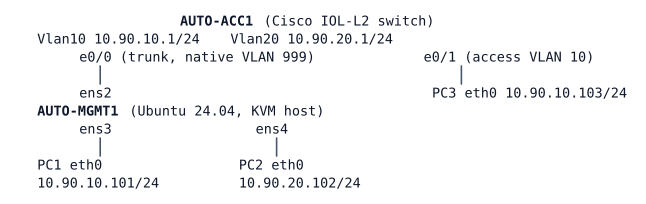

# LAB-064 — Under the Hypervisor

**Module:** 09 Programmability and Automation · **Type:** A/F (Analysis / Foundation) · **Guidance tier:** G2 (behaviour stated, you choose the commands) · **Estimated time:** 90 min · **Blueprint objectives:** 2.1.a:I, 2.1.b:I, 2.1.c:I, 3.1.c:R

## Scenario

The automation host (AUTO-MGMT1, an Ubuntu server) doubles as a small KVM host for two lab "VMs" (PC1 and PC2). Its uplink to the access switch AUTO-ACC1 is a trunk. Before the server team adds more VMs, the network team wants to understand what sits between the VMs and the wire, and what can go wrong for the rest of the campus. The server team will also try a "harmless tuning" change on the host's virtual switch; you must observe what it does and put things right.

## Objectives

- Classify each node of this lab as a virtual machine, a container or a process, and read each guest's virtual resources.
- Build a VLAN-aware Linux bridge as a virtual switch with a tagged uplink and two access ports.
- Compare what the virtual switch and the physical switch know about the same MAC addresses.
- Protect a campus switch port that faces a hypervisor, and observe what a virtual switch running STP does to it.
- Measure how long a hypervisor uplink takes to recover under two port templates.

## Available Information

| Device | Interface | Address / VLAN | Notes |
|---|---|---|---|
| AUTO-ACC1 | Ethernet0/0 | trunk, native VLAN 999, all VLANs carried | to AUTO-MGMT1 ens2 |
| AUTO-ACC1 | Ethernet0/1 | access VLAN 10 | to PC3 |
| AUTO-ACC1 | Vlan10 / Vlan20 | 10.90.10.1/24, 10.90.20.1/24 | gateways |
| AUTO-MGMT1 | ens2 / ens3 / ens4 | no addresses yet | uplink to ACC1 / to PC1 / to PC2 |
| AUTO-PC1 (VLAN 10), AUTO-PC2 (VLAN 20), AUTO-PC3 (VLAN 10) | eth0 | 10.90.10.101, 10.90.20.102, 10.90.10.103 | default gateway = the VLAN's SVI |

Credentials: AUTO-ACC1 `admin` / `Cisco123!` (console, no login prompt needed); AUTO-MGMT1 `cisco` / `cisco` (sudo without password); the PCs are Alpine Linux (use the CML console). Node-type facts for R1 come from the CML UI (node definitions) and from inside the guests.

## Starting State

AUTO-ACC1 has VLANs 10, 20 and 999, the two SVIs, a trunk on e0/0 and PC3 on e0/1; it has no spanning-tree interface commands on e0/0. AUTO-MGMT1's ens2, ens3 and ens4 are up with no addresses and there is no bridge. The three PCs are addressed. PC1 and PC2 cannot reach anything yet; PC3 reaches both gateways. There are no faults to find.

## Requirements / Change Requests

R1: Record, for AUTO-MGMT1 and AUTO-PC1: vCPU count, RAM, disk size and NIC driver (from the CML UI and from inside the guest), and classify every node type in this lab (Ubuntu, Alpine, IOL-L2 switch) as VM, container or process.
R2: On AUTO-MGMT1 build a VLAN-aware Linux bridge: ens2 is a tagged uplink for VLANs 10 and 20 only, ens3 is an access port in VLAN 10 (PC1), ens4 is an access port in VLAN 20 (PC2). PC1 reaches PC3 and 10.90.10.1, and PC2 reaches 10.90.20.1. (If a VLAN-aware bridge is not available, use one bridge per VLAN on ens2.10 and ens2.20 instead.)
R3: Show the learned MAC addresses on both sides: the bridge's forwarding database on AUTO-MGMT1 and the MAC address table on AUTO-ACC1. Identify which single ACC1 port carries several hosts' MACs.
R4: Apply the hypervisor-port template on AUTO-ACC1 e0/0 (PortFast for trunks plus BPDU guard). Then write down a prediction of what happens to each host, and switch STP on in the Linux bridge, as the server team's "tuning". Compare the prediction with the observed effect on every host and in ACC1's log, explain it, and restore service (bridge STP off and the port recovered).
R5: With BPDU guard removed from e0/0 for a controlled test, switch bridge STP on again. Record which VLANs' spanning-tree root on ACC1 changed and which did not, and why. Then restore the template (guard on, bridge STP off, port forwarding); allow up to the STP max age before you check the roots again.
R6: Measure the time for a host on the hypervisor (PC1) to regain connectivity after the uplink is pulled and restored, with the full template, and again with PortFast for trunks removed (BPDU guard still on, bridge STP off). "Pulled" means `shutdown` on ACC1 e0/0 and the interface down on ens2; "restored" means both back up. Predict both times first. Three runs each.

## Verification Criteria

V1: R1 table complete for both guests, with each value read from inside the guest as well as from the CML UI where the guest tool exists.
V2: PC1 pings 10.90.10.1 and PC3; PC2 pings 10.90.20.1; `bridge vlan show` lists ens2 with VLANs 10 and 20 tagged, ens3 with VLAN 10 as PVID untagged, ens4 with VLAN 20 as PVID untagged.
V3: Bridge FDB and ACC1 table both show PC1's, PC2's and PC3's MACs, with their ports.
V4: ACC1's log and port state show what the switch did after the bridge STP change, and you can say which hosts lost connectivity and why. After recovery the port is forwarding and PC1 reaches its gateway.
V5: `show spanning-tree root` on ACC1 during the R5 test shows which VLAN has a different root from ACC1 itself; after restoration all roots are ACC1 again (allow about 20 s, the STP max age, for the stale root to age out before you check).
V6: Recovery times recorded for both templates (three runs each) with the clock start and end condition stated.
V7: (toolkit) The ACC1 log lines for the R4 event are captured with their timestamps.

## Analysis Questions

Q1: Is the CML controller a type 1 or a type 2 hypervisor when it runs on bare metal? What changes if the same CML runs as a VM on a laptop hypervisor, and how does that affect node performance?
Q2: Using the node types in this lab, what is the difference between a VM, a container and a process (isolation, kernel, startup cost)?
Q3: What does the Linux bridge's FDB know that ACC1's MAC table does not, and the reverse? Why do several MACs appear on one ACC1 port?
Q4: Production virtual switches (vSphere standard switch, a Linux bridge by default) do not run STP. How do they still avoid loops, and what do they assume about their uplinks?
Q5: Why is BPDU guard the right campus control for a port that faces a hypervisor? What would bridge STP have done to a production VLAN if the guard were absent and ACC1's root were not engineered?
Q6: During R5, which VLAN's root changed and which did not? Which BPDUs does a Linux bridge send, and how does the switch map them to a VLAN?
Q7: What would happen to BPDU guard on e0/0 if the trunk were restricted to VLANs 10 and 20 only, with bridge STP on? Would that be a safe state for the port, and why?
Q8: Explain the difference between your two recovery times. What does the uplink failure do to every VM on the host, and what would you add to the host to remove that single point of failure?
Q9: What is a CML `unmanaged_switch` node, and why does it count against the server's node licence while this lab's Linux bridge does not?
