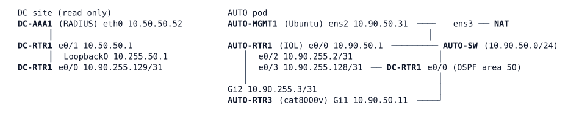

# LAB-065 — The automation job fails

**Module:** 09 Programmability and Automation · **Type:** T (Troubleshooting) · **Guidance tier:** G1 (tickets and business outcomes) · **Estimated time:** 150 min · **Blueprint domains:** 4, 5, 6

## Scenario

Last Friday the automation pod went through two changes, both in the change log:

1. "API service account `apijob` moved to the central AAA server; local accounts kept as break-glass only."
2. "Friday maintenance: automation pod housekeeping (routers and automation host)."

Nothing else is documented: no file, job or applet is named. Since then the automation team and the NOC have opened three tickets (below). You work the shift under these rules:

- No reboots of any device.
- The API stays hardened: HTTPS only, access class, certificate trust on the client. Do not weaken any of these to get a result.
- `apijob` stays the job's service account. Engineers work as `netadmin` (central account, privilege 15). The local `admin` and `apiuser` are break-glass accounts; the design intent is that they are accepted only when the central server does not answer.
- Do not touch the devices of the data-centre (DC) site except to read them.

## Objectives

- Restore the nightly RESTCONF job so that it runs unattended, under its own central service account, without weakening the pod's security.
- Make the job safe to run every night (no errors, no side effects on routing).
- Restore the NOC's link-flap evidence collection on AUTO-RTR1.
- Separate an account, central-server, device and client problem from one another with evidence, and tell a client error from a server error from a transient one.

## Available Information



OSPF process 1: area 0 between the pod routers, area 50 on the link to DC-RTR1 (AUTO-RTR1 is the ABR). AUTO-RTR1 is the pod's time source.

| Item | Value |
|---|---|
| AUTO-MGMT1 login | `cisco` / `cisco` (console); jobs in `/home/cisco/jobs/`, certificate trust file in `/home/cisco/trust/`, virtual environment `/home/cisco/venv` (Python with `requests`, `netmiko`) |
| AUTO-RTR1 (IOL) | SSH/console `admin` / `Cisco123!`, 10.90.50.1, Loopback0 10.255.90.1; local accounts only |
| AUTO-RTR3 (cat8000v) | API/SSH address 10.90.50.11, name `rtr3.auto.veridian.example`, Loopback0 10.255.90.11, Loopback101 (monitoring) 10.255.90.101; Gi1 API segment, Gi2 to AUTO-RTR1 |
| Job service account | `apijob` / `Job#Pass2026` (central account; in the RADIUS server's user list with privilege 15) |
| Engineer account | `netadmin` / `netpass` (central, privilege 15) |
| Break-glass accounts on AUTO-RTR3 | `admin` / `Cisco123!` and `apiuser` / `Api#Pass2026` (local) |
| Central AAA | DC-AAA1 (RADIUS), 10.50.50.52, group `RAD-GRP` on AUTO-RTR3 |
| Job | `/home/cisco/jobs/nightly.py` with its payload `/home/cisco/jobs/desc.json`; run with `cd /home/cisco/jobs; /home/cisco/venv/bin/python nightly.py` |
| Console | `line console 0` on every router stays open without AAA; use it when a remote login is refused |

Notes:

- A cat8000v needs about 2-3 minutes after the lab says BOOTED before RESTCONF answers (an anonymous request returning 401 means the service is up). After a node wipe allow 18-20 minutes.
- `lock-denied` is transient: measured in the 2–3 s after a RESTCONF write and once right after CLI changes; not reproducible on demand; a NETCONF `<lock>` makes RESTCONF writes wait instead.
- Cable pull in this lab = `shutdown` on both ends of the link (the peer port of a one-ended shutdown stays up). A node stop in CML is a silent failure for its neighbours.
- Access to the RESTCONF API from the command line works with `curl --cacert /home/cisco/trust/rtr3.pem -u USER:PASS -H 'Accept: application/yang-data+json' https://rtr3.auto.veridian.example/restconf/data/ietf-interfaces:interfaces`.

## Starting State

Stage A3 of the AUTO environment (`environments/AUTO/A3/README.md`) plus the Friday changes: AUTO-RTR3's logins are partly moved to DC-AAA1, DC-RTR1 and DC-AAA1 are attached to AUTO-RTR1 (area 50), and AUTO-RTR1 carries an evidence applet for the link to AUTO-RTR3. AUTO-MGMT1 holds the reworked job files. Nothing is saved in the startup configuration beyond what the lab shipped. OSPF is up everywhere and AUTO-MGMT1 reaches DC-AAA1.

## Requirements / Change Requests

R1: The ticket owners must be able to run `nightly.py` and see `job complete` with exit code 0, three times in a row, from AUTO-MGMT1.
R2: The job must authenticate and be authorized as `apijob`, by the central server (DC-AAA1).
R3: The job must not need a new local account for `apijob`, a weakened client (certificate verification off) or a weakened API (plain HTTP, no access class).
R4: When the device returns a genuine error, the job must stop with a non-zero exit code and a readable message.
R5: After the first successful run, further nightly runs must leave AUTO-RTR3 and the routing of the pod in the state that run produced.
R6: When the link between AUTO-RTR1 and AUTO-RTR3 goes down, AUTO-RTR1 must save the neighbour table to `unix:uplink-evidence.txt` within 10 seconds of the event.
R7: Record, for each ticket, the evidence that separated the true cause from every other plausible one.
R8: Show what happens to the job and to the break-glass accounts when DC-AAA1 does not answer, and how long recovery takes after it returns.

## Reported Problems

**T1 (automation team):** "Since Friday the nightly job `nightly.py` fails on RTR3 with 401 on every call, reads included. `apijob`'s password is right: the account logs in to RTR3 over SSH and gets privileged mode."

**T2 (automation team, as a second line in the same ticket):** "When the job gets past the login it still stops: it is supposed to set the interface descriptions and make sure the monitoring loopback exists, every night, without errors."

**T3 (NOC):** "RTR1's link to RTR3 flapped at 02:10 last night (`%LINEPROTO-5-UPDOWN: Line protocol on Interface Ethernet0/2, changed state to down` is in our syslog excerpt). The evidence applet should have saved the neighbour table, but there is no file."

## Verification Criteria

V1: `nightly.py` completes three consecutive runs, each printing `job complete` and exiting 0.
V2: The device log shows the job's session authenticated as `apijob`, and `DC-AAA1`'s log shows the matching `Login OK: [apijob]`; AUTO-RTR3 has no local `apijob` account.
V3: The API's hardening is unchanged (HTTPS only, access class, certificate trust file); the job still verifies the server certificate.
V4: A genuine error from the device still makes the job stop with a non-zero exit code and a readable message.
V5: Across the three runs, `show ip route 10.255.90.101` on AUTO-RTR1 keeps its route and its age keeps increasing (no flap, no reset); the second and third run produce no configuration-change log entry from the job.
V6: After a cable pull of AUTO-RTR1 e0/2 and AUTO-RTR3 Gi2, `unix:uplink-evidence.txt` exists on AUTO-RTR1, holds the neighbour table as it was at that moment, and appears within 10 seconds of the `%LINEPROTO-5-UPDOWN` message; the event manager history shows the applet's run.
V7: Toolkit: AUTO-RTR3's log shows the job's configuration changes under the name of the service account that made them.
V8: With DC-AAA1 stopped, you have measured how long the first request waits, whether `apijob` and the break-glass accounts are accepted, and how long after `start` the job account works again.

## Analysis Questions

Q1: Which parts of the access chain (client, transport, device, central server) did you test for the failing API calls, and which single piece of evidence was decisive?
Q2: Which tests separated the account, the central server, the device and the client as the cause, and in what order did you run them? Which ones did you rule out and with what?
Q3: How should a job treat each class of HTTP answer (2xx, 400, 401/403, 409, 5xx, no answer): retry, fix input, fix permissions, alert? Which are never worth retrying?
Q4: What makes a nightly job safe to run twice, and how did you prove it on this pod?
Q5: How did you establish whether the automatic action on AUTO-RTR1 ran, and how would you make sure such an action works before you depend on it?
Q6: A Catalyst Center write call returns `202` with `{"response": {"taskId": "5d8a-0001", "url": "/api/v1/task/5d8a-0001"}, "version": "1.0"}`. A minute later `GET /dna/intent/api/v1/task/5d8a-0001` returns the following (derived fixture, shaped after Cisco's published Intent API task schema, not captured from a controller):

```
{"response": {"id": "5d8a-0001", "isError": true, "progress": "Failed to push configuration to 2 devices",
  "failureReason": "Device 10.10.20.4 unreachable", "endTime": 1760180000000, "version": 1760179990000},
 "version": "1.0"}
```

Where in these payloads would you look for the cause and the success or failure of the change, and how is that different from what you did on this pod with the synchronous RESTCONF answers?
