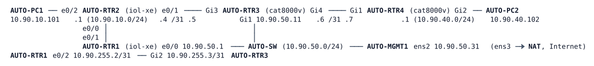

# LAB-066 — Remote capture: ERSPAN

**Module:** 09 Programmability and Automation · **Type:** F (Foundation) · **Guidance tier:** G2 (behaviour stated, you choose the commands) · **Estimated time:** 120 min · **Blueprint objectives:** 4.3:P, 2.2.b:R

## Scenario

The pod gains a second virtual router, AUTO-RTR4, with a small server LAN (AUTO-PC2). The NOC's analyser is the automation host AUTO-MGMT1, on the other side of a routed hop. A local SPAN session cannot reach it, and RSPAN would need a VLAN end to end. The team sets up remote capture over the routed network, learns to read what arrives, and measures what it costs and where it breaks.

## Objectives

- Build an ERSPAN source session on a router and prove the copies arrive at an analyser across a routed hop.
- Decode a mirrored packet by hand (outer IP, GRE, ERSPAN header, inner frame) and compute the per-packet overhead.
- Control what is copied: direction and an ACL filter.
- Measure what happens to copies of large frames, and explain it from the path and session MTU.
- Compare ERSPAN with local SPAN and RSPAN, and test what the source does when the analyser disappears.

## Available Information

| Item | Value |
|---|---|
| Links | RTR1-RTR2 10.90.255.0/31; RTR1-RTR3 10.90.255.2/31 (RTR1 e0/2 .2, RTR3 Gi2 .3); RTR2-RTR3 10.90.255.4/31 (RTR2 .4, RTR3 .5); RTR3-RTR4 10.90.255.6/31 (RTR3 .6, RTR4 .7) |
| Loopback0 | RTR1 10.255.90.1, RTR2 10.255.90.2, RTR3 10.255.90.11, RTR4 10.255.90.12; RTR3 also has Loopback101 10.255.90.101 (inherited from A3) |
| AUTO-RTR4 interfaces | Gi1 to RTR3, Gi2 to AUTO-PC2 (10.90.40.1/24) |
| Hosts | AUTO-PC1 10.90.10.101, AUTO-PC2 10.90.40.102 (gateway .1 on both). Both are Alpine Linux: busybox `ping`/`nc`, `tcpdump` is on AUTO-MGMT1 |
| Logins | routers `admin` / `Cisco123!` (console and SSH); AUTO-MGMT1 `cisco` / `cisco`; hosts console only |
| Analyser | AUTO-MGMT1 ens2 10.90.50.31. Internet through NAT on ens3: `apt-get install` works (tshark is optional) |

Notes for the tasks:

- **Wait for the routers.** CML shows AUTO-RTR3 and AUTO-RTR4 as BOOTED after about 6 minutes, but they apply their stored configuration only later: about 33 minutes after the start on a busy server (about 10-15 on an idle one). If the routers still answer nothing 45 minutes after the start, stop, wipe and start AUTO-RTR3 and AUTO-RTR4 (the stored configuration is kept): they were ready about 4 minutes later when this was tried. Do not open their consoles before the line `%CVAC-4-CONFIG_DONE` appears in the console log. A connection made while it is still applying can leave a stale user-mode session, after which the console asks for an enable password; clearing the line from an SSH session as `admin` (`clear line 0`) fixes it. A `%CVAC-3-CONFIG_ERROR` about `login local` under the VTY lines is a known harmless wart.
- The copies of one-hop traffic are tens of packets per second at most here; the pod's lab traffic is yours (pings from the hosts). AUTO-PC2 also sends an occasional DHCP discovery and runs an SSH daemon on TCP 22, so you will see a few frames you did not generate.
- Alpine's busybox `ping -s N` is the ICMP payload size: an IP packet of 1400, 1450 or 1500 bytes needs `-s 1372`, `-s 1422` or `-s 1472`. It has no don't-fragment option.
- IOS XE does not edit an erspan-source session in place for everything: if a `source` line or a filter will not change, remove the old one first, or rebuild the session.
- Failure method in this lab: the analyser side is taken down on AUTO-MGMT1 with `sudo ip link set ens2 down` (a one-ended failure; the switch side stays up). Packet counters per session do not exist on this platform; use the interface counters and the capture.
- Tcpdump cannot attach to an interface that is down: start the capture after the link is back.

## Starting State

Stage A4 (`environments/AUTO/A4/README.md`): all routers run OSPF area 0 and have converged; traffic between AUTO-PC1 and AUTO-PC2 flows PC1, RTR2, RTR3, RTR4, PC2. No monitor session exists. AUTO-MGMT1 has `tcpdump` but not `tshark`.

## Requirements / Change Requests

R1: On AUTO-RTR4 mirror both directions of the port that faces AUTO-PC2 to AUTO-MGMT1 (10.90.50.31) with ERSPAN session ID 66, sourced from RTR4's Loopback0. Prove the copies arrive on AUTO-MGMT1 by capturing protocol 47 there while AUTO-PC1 pings AUTO-PC2, and show on RTR4 that the session is active and that traffic toward RTR3 is being sent.

R2: Decode one mirrored ICMP echo from a hex capture (or tshark): outer IP (source, destination, protocol, DF bit), GRE (flag bits, protocol type, sequence number), ERSPAN header (version, VLAN, session ID, truncation flag), the inner Ethernet frame (which MAC addresses) and the inner IP. Compute the overhead the session adds to each copy and compare it with the wire size you captured.

R3: Show the effect of direction: with the same three pings, capture how many ICMP copies you get when the session mirrors both directions and when it mirrors only the receive direction of the PC2-facing port, and say which packets those are. Then copy only TCP port 22 traffic sent to AUTO-PC2 (generate it with `nc` or `telnet` from AUTO-PC1) and show that ping and other ports are no longer copied.

R4: From AUTO-PC1 ping AUTO-PC2 with IP packet sizes of 1400, 1450 and 1500 bytes, with the session restored to mirror everything. Record, for each size, the copy's wire size and whether it arrives whole, truncated, fragmented or not at all. Then raise the session MTU to 1500, repeat the 1500-byte ping and record the difference.

R5: Write a short comparison of ERSPAN with local SPAN and RSPAN (LAB-008): where the copy travels, what must exist end to end, what it costs on the way.

R6: Run the failure test: while a ping runs from AUTO-PC1 to AUTO-PC2 and the session is active, take the analyser link down for about 10 seconds, bring it back, and measure the time from link up to the first copy captured on AUTO-MGMT1. Do it three times.

## Verification Criteria

V1: A capture on AUTO-MGMT1 shows GRE packets (IP protocol 47) carrying ERSPAN from 10.255.90.12 to 10.90.50.31, with the PC1-PC2 pings inside, and the session on RTR4 shows as enabled with ID 66 and the origin address you configured.
V2: Your decoded packet shows the session ID 66, the version value of the ERSPAN header, and the MAC address of AUTO-PC2 as one of the inner addresses; your overhead figure agrees with the wire size of a small copy.
V3: Receive-only and both-direction captures give different ICMP copy counts for the same three pings, and your note says which packets are missing.
V4: With the filter in place a capture shows only TCP 22 frames toward AUTO-PC2.
V5: Your table lists a wire size and a state (whole / truncated / fragmented / absent) for each of 1400, 1450, 1500 and 1500 with the raised MTU.
V6: Toolkit: a capture made in the CML interface on the RTR3-RTR4 link shows the GRE copies next to the original ICMP traffic; the copy and the original have different IP addresses.
V7: Three measured values for the recovery, an AUTO-PC1 to AUTO-PC2 ping with no lost reply during the tests, and the session still enabled after the test.

## Analysis Questions

Q1: Why does ERSPAN need only IP reachability between source and analyser, when RSPAN needs a VLAN on every switch in the path?
Q2: Compare the GRE fields you decoded with the GRE tunnel of LAB-046: what is the same, and what is missing (interface, keepalive, state at the destination)? Does the destination send anything back, and what does the capture on AUTO-MGMT1 show?
Q3: What does R4 show about mirroring large frames? Name three design measures that avoid losing information.
Q4: What does a mirror session cost the source router and the links its copies cross?
Q5: Why must the analyser not be reachable by everyone?
Q6: What does the source router do when the destination is unreachable, and how does it learn about it? Compare with what AUTO-MGMT1 itself sends back while it is reachable: does that traffic matter to the session, and what would you do about it in production?
Q7: Which packets did the receive-only session in R3 copy and which did it miss, and why? What do you change to copy the others?
