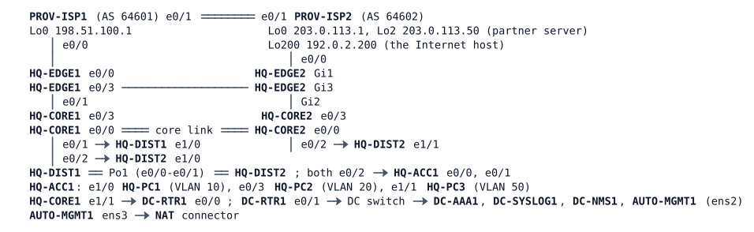

# MS-4 — Enterprise Operations

**Module:** 09 Programmability, automation and virtualization (closes modules 01–09) · **Type:** M (Milestone) · **Guidance tier:** G1 (business outcomes) · **Estimated time:** 300 min · **Blueprint domains:** 1, 3, 4, 5, 6

> Run this lab alone: it uses 18 of the server's 20 running nodes (the NAT connector counts as a 19th in the node budget). The router HQ-EDGE2 is a Catalyst 8000V and needs about 5 minutes after the other nodes before its configuration is active; wait for it (its console, or OSPF neighbours on HQ-CORE2 Ethernet0/3) before you start. The load recipes below use CPU on the Alpine hosts: generate one load at a time.

## Scenario

Veridian Logistics' headquarters, edge and data-centre operations are yours for the shift. HQ-CORE2 is back from repair and cabled in, and the second Internet edge router was migrated by a contractor to a new platform with an API for the automation team. The change manager has queued five change requests and the NOC and the automation team have opened three tickets. Work the queue inside the 300-minute maintenance window, record what you do with evidence, and prove at the end that the network survives the failures it is supposed to survive. Nothing in the queue says how to do the work: the constraints and acceptance criteria below are the contract.

## Objectives

- Close tickets across the campus, the Internet edge, the management plane and an API, with evidence from before and after each fix.
- Make the campus gateways, the edge defaults and the video service survive the loss of a core, an edge router or an ISP, and measure how fast.
- Mark and guarantee traffic on the core-to-edge links and prove it with counters under generated load.
- Use the router's API from a script to change an access list, check the result on both edges, and keep the script.
- Test an AI assistant's proposed change on a live edge, decide, and leave the network no worse than you found it.

## Available Information

### Documentation pack

**Topology** (all cables patched; HQ campus links are dot1q trunks with native VLAN 999; the NAT connector gives AUTO-MGMT1 an upstream path only):

| Link | A | B | Carries / addressing |
|---|---|---|---|
| Core link | HQ-CORE1 e0/0 | HQ-CORE2 e0/0 | 10.10.255.0/31 (CORE1 .0), OSPF 1 area 0 point-to-point, cost 10, hello 1 / dead 4; MGMT sub-interface .99 10.10.254.2/31 (CORE1 .2, CORE2 .3), OSPF 99 |
| CORE1–DIST1 | HQ-CORE1 e0/1 | HQ-DIST1 e1/0 | VLAN 901 (10.10.255.2/31), 20, 50, 99 |
| CORE1–DIST2 | HQ-CORE1 e0/2 | HQ-DIST2 e1/0 | VLAN 902 (10.10.255.4/31) |
| CORE2–DIST2 | HQ-CORE2 e0/2 | HQ-DIST2 e1/1 | VLAN 904 (10.10.255.8/31) + VLANs 20, 50, 99 |
| DIST interconnect | HQ-DIST1 e0/0-e0/1 | HQ-DIST2 e0/0-e0/1 | Po1 (LACP): VLANs 10, 20, 50, 99 |
| ACC1 uplinks | HQ-DIST1 e0/2, HQ-DIST2 e0/2 | HQ-ACC1 e0/0, e0/1 | user VLANs 10, 20, 50, 99 |
| Hosts | HQ-ACC1 e1/0, e0/3, e1/1 | HQ-PC1, HQ-PC2, HQ-PC3 | VLAN 10, 20, 50 |
| Core to edge 1 | HQ-CORE1 e0/3 | HQ-EDGE1 e0/1 | 10.10.255.64/31 (CORE1 .64, EDGE1 .65), OSPF area 0 p2p cost 10, hello 1 / dead 4; MGMT .99 10.10.254.4/31 (CORE1 .4, EDGE1 .5) |
| Core to edge 2 | HQ-CORE2 e0/3 | HQ-EDGE2 Gi2 | 10.10.255.66/31 (CORE2 .66, EDGE2 .67), same OSPF settings; MGMT .99 10.10.254.8/31 (CORE2 .8, EDGE2 .9) |
| Edge to edge | HQ-EDGE1 e0/3 | HQ-EDGE2 Gi3 | 10.10.255.68/31 (EDGE1 .68, EDGE2 .69), OSPF area 0 cost 10 and iBGP |
| EDGE1 to ISP-A | HQ-EDGE1 e0/0 | PROV-ISP1 e0/0 | 198.51.100.64/31 (ISP1 .64, EDGE1 .65), eBGP AS 65010 to AS 64601 |
| EDGE2 to ISP-B | HQ-EDGE2 Gi1 | PROV-ISP2 e0/0 | 203.0.113.64/31 (ISP2 .64, EDGE2 .65), eBGP AS 65010 to AS 64602 |
| ISP peering | PROV-ISP1 e0/1 | PROV-ISP2 e0/1 | 198.51.100.66/31 |
| Core to data centre | HQ-CORE1 e1/1 | DC-RTR1 e0/0 | 10.10.255.130/31 (CORE1 .130, DC-RTR1 .131), OSPF area 50; MGMT .99 10.10.254.6/31 (CORE1 .6, DC-RTR1 .7) |
| Data centre | DC-RTR1 e0/1 | DC switch | 10.50.50.0/24 in VRF MGMT (DC-RTR1 .1) |

Unused and shut: HQ-CORE1 e1/0 (no WAN in this lab), HQ-CORE2 e0/1 and e1/0, the DMZ interfaces of both edge routers (EDGE1 e0/2, EDGE2 Gi4; no DMZ server in this lab). The platform migration mapped EDGE2's interfaces: Gi1 to ISP-B, Gi2 to HQ-CORE2, Gi3 to HQ-EDGE1, Gi4 DMZ.

**VLANs and first-hop gateways (HQ).**

| VLAN | Subnet | Gateway (VIP .1) | Hosts |
|---|---|---|---|
| 10 (users) | 10.10.10.0/24 | HQ-DIST1 .2 / HQ-DIST2 .3, GLBP | HQ-PC1 .101 |
| 20 (OPS) | 10.10.20.0/24 | HQ-CORE1 .2 / HQ-CORE2 .3, VRRPv3 group 20, master HQ-CORE2 (priority 110) | HQ-PC2 .102 (video viewer) |
| 50 (servers) | 10.10.50.0/24 | HQ-CORE1 .2 / HQ-CORE2 .3, VRRPv3 group 50, master HQ-CORE1 (priority 110) | HQ-PC3 .103 (video encoder) |
| 99 (management) | 10.10.99.0/24, VRF MGMT | HQ-CORE1 .2 / HQ-CORE2 .3, VRRPv3 group 99 | HQ-DIST1 .11, HQ-DIST2 .12, HQ-ACC1 .21 |
| 999 | native VLAN, unused | | |

VLAN 20 spanning-tree root is HQ-DIST2 (24576), aligned with HQ-CORE2 as VLAN 20 master. IGMP snooping is off for VLANs 20 and 50 on HQ-DIST1/DIST2 (platform rule, documented). HQ-CORE1 is the multicast rendezvous point; the encoder on HQ-PC3 sends the OPS video to 239.10.20.1 from boot; no viewer runs at boot.

**Internet edge design (module standard).** HQ-EDGE1 (AS 65010) is the primary Internet edge: static default through ISP-A tracked by IP SLA 10 (probe to 198.51.100.1), originating a default into OSPF (metric 10 from EDGE1, 30 from EDGE2) while its track is Up. HQ-EDGE2 is the backup edge: the same design toward ISP-B, tracked by IP SLA 20 to ISP-B's probe address 203.0.113.1. Inside users are translated (PAT) at the edge they leave by: EDGE1 pool 192.0.2.1 (the 192.0.2.0/26 block announced to ISP-A), EDGE2 pool 192.0.2.65 (the 192.0.2.64/26 block announced to ISP-B). Both edges export flow records (flow exporter to DC-NMS1 10.50.50.60 UDP 2055 through VRF MGMT), keep the inbound edge ACL `EDGE-IN-V4` and the control-plane policy `PM-COPP` (monitoring and management classes ahead of the ICMP class). The Internet host is 192.0.2.200 (behind ISP-B, learned by ISP-A over the peering). 203.0.113.50 is a partner's monitoring server on ISP-B.

**Management design.** Every network device follows the management standard: local account `admin`; central accounts through DC-AAA1 (RADIUS 10.50.50.52, UDP 1812/1813, through VRF MGMT) with fallback to the local account when the server does not answer; syslog to DC-SYSLOG1 10.50.50.51 in VRF MGMT; SSH only, accepted from 10.10.99.0/24 and 10.50.50.0/24; SNMPv3 `nmsuser`; time from DC-RTR1. The automation host AUTO-MGMT1 (ens2 10.50.50.31/24, route 10.0.0.0/8 via 10.50.50.1; ens3 to the NAT connector) has Python 3 (a virtual environment with requests, ncclient, netmiko in `/home/cisco/venv` once its first-boot install finished, about 5 minutes after start), `curl`, `jq`, `openssl`, and the helpers in `/home/cisco/auto` (`rc_get.py`, `show_cmds.py`) and `/home/cisco/trust`.

**API conventions (from LAB-060/061).** HQ-EDGE2 runs RESTCONF and NETCONF for the automation team at its management address 10.10.254.9 (name `edge2.hq.veridian.example` on AUTO-MGMT1), API user `apiuser` / `Api#Pass2026` (local, privilege 15; the API does not use the central accounts), HTTPS only, limited to the automation host AUTO-MGMT1, certificate verified against a trusted copy of the router's certificate (`/home/cisco/trust/fetch-edge2-cert.sh` is the documented trust-on-first-use helper; run it by hand once the API answers). Response-code card: 200 read, 201 created, 204 deleted or updated, 400/404 bad path or body, 401 bad credentials, 403 refused by policy, 409 `data-exists`/lock. A CLI session or a script that holds the configuration lock can make the next API write fail with 409 for a few seconds.

**Credentials.**

| Item | Value |
|---|---|
| Local account / enable | `admin` / `Cisco123!` (privilege 15); enable secret `Cisco123!` |
| RADIUS (DC-AAA1) | shared key `RADKEY123`; `netadmin` / `netpass` (privilege 15), `netops` / `opspass` (privilege 1) |
| API | `apiuser` / `Api#Pass2026` on HQ-EDGE2 |
| Hosts | Alpine PCs and AUTO-MGMT1: `cisco` / `cisco` (the PCs have `iperf`, `nc`, `tcpdump` with `sudo`) |
| SNMPv3 / NTP | as the management standard; not needed for the work |

**Change log (neutral entries from the change manager).**

| Change | When | Note |
|---|---|---|
| CHG-4401 | last week | CORE2 returned to service after repair |
| CHG-4402 | last week | EDGE2 platform migration |
| CHG-4403 | last month | Management-network clean-up in the data centre, details not recorded |

**Monitoring excerpt (Monday 08:00).** Every device is green. The NMS flow dashboard shows traffic data for one edge router only. The log-source inventory expects eight network devices and DC-SYSLOG1 lists seven. The last failover drill (ISP-A disconnected) ended with the users offline until ISP-A was reconnected.

**Constraints (all work).**
- Window: 300 minutes. No reload or wipe of any node. Management through VRF MGMT must survive every change.
- No change on the provider devices (PROV-ISP1, PROV-ISP2) except `shutdown` / `no shutdown` of their edge access interfaces (PROV-ISP1 e0/0, PROV-ISP2 e0/0) as the cable-pull drill method for V2 and V3, restored afterwards; no change on the data-centre servers (DC-AAA1, DC-SYSLOG1, DC-NMS1).
- The edge ACL EDGE-IN-V4 may be changed on HQ-EDGE2 only through its API.
- Failure methods: a **cable pull** is `shutdown` on both ends of a link. A **silent failure** is `link stop` in CML on the named link (the interfaces stay up and drop traffic); for HQ-EDGE1 and other nodes except HQ-EDGE2 a node stop is also a silent failure. For HQ-EDGE2 the silent failure is always `link stop` of its link to HQ-CORE2, never a node stop of the router (see the next constraint). Restore with `link start` or node start. A one-ended `shutdown` is a third case: the peer port stays up. Say which one you used.
- Everything is recorded with evidence; configurations on HQ-CORE1 and HQ-CORE2 are saved before any core node stop and at the end (a core node stop clears its RAM `unix:` evidence files, so record each core's evidence before the stop; HQ-EDGE2 is a Catalyst 8000V: after a node stop and start it runs its stored day-0 again, so changes you made, including its API certificate trust, would be lost; that is why it is never node-stopped in this window).

## Starting State

- 18 nodes are running with the configurations above applied at boot; nothing has been saved or changed by you.
- HQ-CORE2 carries the OSPF, VRRPv3 and campus roles of the documented design; HQ-EDGE2 was migrated by the contractor, who also set up the API and the monitoring items described above.
- Test aids. (1) Video: on HQ-PC2 run `iperf -s -u -B 239.10.20.1 -i 1` as the viewer; a gap clock is `sudo tcpdump -tt -n -l -i eth0 dst 239.10.20.1` on HQ-PC2. (2) TCP load toward the Internet host: no TCP server runs beyond the edge routers, so a closed loop of connection attempts is the load, for example `while true; do nc -w 1 192.0.2.200 443 </dev/null; done` (use several loops). (3) ICMP burst at a router: `ping -q -i 0.01 -s 0 -w 25 <router address>` from HQ-PC1 (28-byte packets; larger ones do not stress a policer meant for small packets). (4) A router's flash file system for evidence is `unix:` (RAM); read a file with `more unix:/name`.
- The interface speed in CML is not a real bottleneck: a test of congestion needs a temporary constraint that you remove afterwards.
- VRRPv3 tracking on IOS XE can act on a tracked object in more than one way. Measure your design against V1 (the 10 s and 30 s figures) instead of assuming one behaviour.

## Requirements / Change Requests

R1. **Constraints.** All the constraints above hold throughout.

R2. **Tickets.** Close TK1, TK2 and TK3 (see Reported Problems), each with before-and-after evidence.

R3. **CR1: gateway resilience.** The OPS (20) and server (50) gateways move to the other core within 10 seconds when their master loses its path toward its Internet edge router, including a silent failure of that edge router, and move back 30 seconds after the core sees the path up again (its tracked object Up). Each core records evidence of every gateway state change (state, tracking, default route) in a local file and sends one syslog message to DC-SYSLOG1.

R4. **CR2: video survives a core.** The OPS video keeps playing when either core is lost: HQ-CORE2 joins the video design as the second rendezvous point (same anycast address as HQ-CORE1), and the PIM designated router (DR) on each video VLAN is the VRRP master of that VLAN in normal operation.

R5. **CR3: core-to-edge QoS.** On the core-to-edge links, OPS application traffic (VLAN 20 to the Internet, TCP 443) is marked AF21 and guaranteed 30 % of the link under congestion; bulk transfers from the server VLAN (TCP 20 and 21) are marked CS1 and guaranteed only 10 % under congestion (the first class to lose packets, not guaranteed more); nothing else changes. Prove it with counters under a generated load.

R6. **CR4: partner monitoring probe.** HQ-EDGE2 must be able to ping the partner's monitoring server 203.0.113.50 from its ISP-B-facing address for a planned SLA probe. Today the replies are dropped by the edge's inbound ACL. Make the narrowest change, in the right place in the ACL, through the API from AUTO-MGMT1 with a Python script that also checks the result on both edge routers (HQ-EDGE2 through the API, HQ-EDGE1 by SSH: it must show no change). Keep the script on AUTO-MGMT1.

R7. **CR5: AI review.** The AI assistant proposes: "Consolidate ICMP handling in the control-plane policy of both edges: move the ICMP class (8000 bps, exceed-action drop) to the top of the policy, ahead of the monitoring and management classes, because ICMP is the commonest flood." Test the proposal on one edge in the window, decide, and implement your verdict with evidence.

## Reported Problems

- **TK1 (NOC):** "Last night's ISP-A failover drill failed: with ISP-A disconnected, users had no Internet until it was reconnected. Also, the NMS has shown no flow records from the second edge router since its migration."
- **TK2 (NOC):** "Since CORE2 came back, DC-SYSLOG1 has received nothing from it, and NOC engineers cannot log in to it with their own accounts; the break-glass account works."
- **TK3 (automation team):** "The API on the migrated edge router does not answer at all: connection refused, although the contractor says RESTCONF is enabled."

## Verification Criteria

V1. With either Internet edge router failed silently (`link stop` of its link to its core; for HQ-EDGE1 a node stop is also allowed, for HQ-EDGE2 it is not), or that link pulled, the OPS and server VLAN users still reach the Internet host (192.0.2.200) and their gateway has moved to the other core within 10 seconds (counted from the moment the failure is triggered: the cable pulled, or the link-stop or node-stop call returns); after the edge returns, the gateway moves back after the 30-second delay. Test both edge routers and both failure methods (name the method used).

V2. With ISP-A disconnected (cable pull of the HQ-EDGE1 to PROV-ISP1 link), HQ-PC1 and HQ-PC2 reach 192.0.2.200 through ISP-B with translated sources, and back through ISP-A when it returns.

V3. With ISP-B also disconnected (cable pull of the HQ-EDGE2 Gi1 to PROV-ISP2 link), no device advertises or keeps a default route that it cannot use.

V4. The video plays on HQ-PC2 with at most 1 % loss over 60 seconds, and keeps playing when either core is stopped (longest gap measured, at most 10 seconds).

V5. Central logins work on every device, and the break-glass account works only as the fallback.

V6. Every device logs to DC-SYSLOG1, and both edge routers export flow records to DC-NMS1, through the management network.

V7. The edge API answers only the automation host, over HTTPS with certificate verification.

V8. HQ-EDGE2 pings 203.0.113.50 from its ISP-B-facing address (5/5); nothing else in the edge ACL changed (other echo-replies to HQ-EDGE2 are still denied); the change is in the device log as an API change; the script's check passes for both edge routers.

V9. Under the CR3 load, the OPS class counters show AF21 traffic within its guarantee and the bulk class drops first.

V10. The AI review verdict is stated with evidence from your test; after CR5 is implemented, every earlier acceptance check that depends on the edge (V1-V3, V6-V8) is re-run and passes.

V11. Toolkit: each core's evidence file shows an entry for each gateway change in the V1 runs (record each core's evidence file before V4, or repeat the V1 runs after V4).

## Analysis Questions

Q1. For each ticket, which evidence first ruled out the most obvious cause?
Q2. Where did you use a working peer device as a reference, and where could that comparison have misled you?
Q3. Which of your changes restored service and which only restored redundancy, and how did you prove the redundancy?
Q4. What did the API path give you for CR4 that a CLI change would not (validation, audit trail, repeatability)?
Q5. How did you test the AI proposal without leaving the network worse than you found it?
Q6. Which post-change checks belong to a platform migration, judging from today's evidence?
