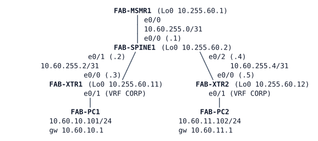

# LAB-067 — LISP: Pull, Not Push

**Module:** 10 Overlays and Fabric · **Type:** F (Foundation) · **Guidance tier:** G3 for R1 and R2 on the first edge and the first site (LISP skeleton below), G2 for the rest · **Estimated time:** 120 min · **Blueprint objectives:** 2.3.a:I (LISP, control and data plane)

## Scenario
Veridian has acquired Aster Warehousing, whose new warehouse network is being built as a fabric. Aster's fabric is an SD-Access *analog*: the same control and data plane ideas, configured by hand on IOS routers; no Catalyst Center or ISE. Before the fabric gets its border, Aster's engineers want to see how its control plane works: two edge routers, a mapping server in the middle, and endpoints that the routing protocol never learns. You build that control plane and study what it does on the wire.

## Objectives
- Configure a mapping system and two edge routers so that endpoint subnets are registered and looked up on demand, never advertised by the routing protocol.
- Read the registration table, the map-cache and a negative answer, and relate each to the message exchange that produced it.
- Decode a control message and a data packet from a capture and compute the encapsulation overhead.
- Compare this pull model with a push routing protocol and observe what survives when the mapping system is lost.

## Available Information
Topology (all links Ethernet; interface names as cabled):



| Item | Value |
|---|---|
| Underlay | OSPF process 1, area 0, on every router interface and loopback (point-to-point, hello 1 / dead 4) |
| RLOCs (Loopback0) | MSMR1 10.255.60.1, SPINE1 .2, XTR1 .11, XTR2 .12 (all /32) |
| Virtual network | CORP: VRF `CORP` on XTR1 and XTR2, LISP instance-ID 4097 |
| Endpoint subnets | XTR1: 10.60.10.0/24; XTR2: 10.60.11.0/24; gateway `.1` on each edge |
| Subnet nobody owns | 10.60.12.0/24 (inside the 10.60.10.0/23 range reserved for CORP, but not assigned to any edge) |
| LISP authentication key | `ROUTEKEY123` |
| Mapping-system site names | `AST-XTR1`, `AST-XTR2` |
| Device login | console: privilege 15, no login; SSH/enable: `admin` / `Cisco123!`; hosts: `cisco` / `cisco` |

Roles: FAB-MSMR1 is the planned map server and map resolver, FAB-XTR1 and FAB-XTR2 are the edges (ITR and ETR), FAB-SPINE1 is a plain underlay router that never takes part in the overlay. In CML, capture on the **FAB-SPINE1 e0/1 to FAB-XTR1 e0/0** link (right-click the link, Packet Capture) with the filter `udp port 4341 or udp port 4342`. Frame layout (byte offsets in an Ethernet frame with no VLAN tag, for hand decoding): Ethernet 0-13, outer IP header 14-33, UDP header 34-41, the encapsulation header after the UDP header (8 bytes, from offset 42), then the inner IP packet.

## Starting State
- The OSPF underlay is converged: every RLOC loopback is reachable from every router.
- On XTR1 and XTR2, VRF `CORP` holds the PC LAN and nothing else. `show ip route vrf CORP` on XTR1 shows only the connected /24 and its local /32.
- FAB-PC1 and FAB-PC2 are addressed with the gateway on their edge router. Each reaches its own gateway; PC1 and PC2 cannot reach each other because the underlay has never heard of the PC subnets.
- No `router lisp` configuration exists on any router.

## LISP in brief
LISP separates *who* an endpoint is from *where* it is attached. The **EID** (endpoint identifier) is the endpoint's address, here the PC subnets. The **RLOC** (routing locator) is the address of the edge router that currently serves it, here the Loopback0s, which the underlay does route. Only RLOCs are in the routing protocol; EIDs are looked up on demand.

| Role | What it does | Here |
|---|---|---|
| ITR (ingress tunnel router) | Looks up the destination EID, encapsulates the packet towards the destination's RLOC | the edges |
| ETR (egress tunnel router) | Registers the EIDs behind it, decapsulates arriving packets | the edges |
| Map server | Accepts and authenticates registrations from ETRs and keeps the EID-to-RLOC table | FAB-MSMR1 |
| Map resolver | Receives the ITR's requests and has them answered (it forwards the request to the registering ETR, or answers negatively) | FAB-MSMR1 |

Messages: the ETR sends a **Map-Register** (with the shared key) to the map server; the ITR sends a **Map-Request** to the map resolver when it has no cache entry; a **Map-Reply** returns the locator set, which the ITR keeps in its **map-cache** with a lifetime. A prefix that no site registers is answered with a **negative** Map-Reply, and the ITR caches that answer too. Control messages use UDP 4342, encapsulated data UDP 4341.

On IOS XE the pieces hang together as follows. A virtual network is an **instance-ID** inside `router lisp`; on an edge, `eid-table vrf <name>` binds that instance-ID to the VRF whose routes carry the EIDs; a `database-mapping <EID prefix> locator-set <name>` says which EIDs this ETR owns and which locators represent them; the `locator-set` names the RLOC interface. The edge points at the mapping system with `itr map-resolver` and `etr map-server <address> key <key>`. On the server, a `site <name>` holds the key and an `eid-record instance-id <id> <prefix>` for every prefix that site may register, and `service ipv4` enables `map-server` and `map-resolver`.

Skeleton for the first edge and the first site (placeholders in angle brackets; the second edge, the second site and every value are yours to work out):
```
! mapping system (FAB-MSMR1)
router lisp
 site <site-name>
  authentication-key <key>
  eid-record instance-id <id> <prefix>
 service ipv4
  map-server
  map-resolver

! edge (FAB-XTR1)
router lisp
 locator-set <name>
  IPv4-interface <loopback> priority <p> weight <w>
 service ipv4
  itr map-resolver <address>
  itr
  etr map-server <address> key <key>
  etr
 instance-id <id>
  service ipv4
   eid-table vrf <vrf-name>
   database-mapping <prefix> locator-set <name>
```
Entry `show` commands: `show lisp site` (on the server), `show lisp instance-id <id> ipv4 map-cache` (on an edge), `show lisp site detail`, `show lisp instance-id <id> ipv4 statistics`.

## Requirements / Change Requests

**R1.** Make FAB-MSMR1 the mapping system for virtual network CORP (instance-ID 4097). It accepts registrations only from the two edges, each for its own subnet only, authenticated with the documented key.

**R2.** Make both edges register their CORP subnet with the mapping system, and resolve remote CORP subnets through it, using their Loopback0 as locator. Neither the underlay routing table nor the RIB of VRF `CORP` may learn the other edge's subnet. PC1 and PC2 must reach each other.

**R3.** Clear the map-cache on XTR1 and ping from PC1 to PC2 (one packet per second, one-second timeout). Record the number of lost packets and the map-cache entry (prefix, locator, remaining lifetime, state). In a capture on the XTR1 to SPINE1 link find the control-plane request and reply that resolved PC2's subnet. Then capture a data packet and identify the outer IP header, the UDP ports, the LISP header (including the instance-ID) and the inner IP header; compute the encapsulation overhead.

**R4.** Ping an address in virtual network CORP that no edge registers (10.60.12.1) and read the resulting map-cache entry. Explain what the edge does with it.

**R5.** Compare the design with OSPF: how many routes would each edge carry for 100 sites with push routing versus this design; when does an edge learn about a remote subnet; what does the mapping server know that no edge knows.

## Verification Criteria

**V1.** On FAB-MSMR1 both sites are listed with the correct instance-ID and prefix, and show as registered (Up `yes`), with no registration errors.

**V2.** PC1 can ping PC2 and PC2 can ping PC1.

**V3.** `show ip route vrf CORP` on both edges contains only the connected and local routes, and the other edge's subnet is not in the global table of the edge either.

**V4.** After clearing the map-cache on XTR1, the first ping from PC1 to PC2 loses a documented number of packets, and the map-cache then holds one positive entry for PC2's subnet with the ETR's Loopback0 as locator.

**V5.** The capture shows at least one Map-Request and its Map-Reply on UDP 4342 (repeated requests and one reply per direction are normal), and PC1's ICMP echo carried inside UDP 4341, with the instance-ID visible in the encapsulation header.

**V6.** The ping to 10.60.12.1 fails and the map-cache entry it creates is recorded and explained.

**V7.** Toolkit: a ping from an end host and a capture on a named link back every claim in V4 to V6.

**V8.** Failure test (silent failure, see below): the effect on an established PC1 to PC2 ping and on a new flow while the mapping system is unreachable is recorded, and the time to recover after the link returns is recorded in three runs.

**Failure method for this lab.** The mapping-system failure is a *silent* failure: stop the CML link between FAB-SPINE1 e0/0 and FAB-MSMR1 (`link stop`). The interfaces stay up/up and drop traffic, as a dead hop or a cut that the routers cannot see. The recovery is `link start` on the same link. A `shutdown` on one side is not equivalent and is not used here. While the link is down, use the console of FAB-MSMR1 (it stays reachable) and, from the edges, watch the registration and map-cache state. Record: how long the registrations at the mapping server last; how long after `link start` they are back; and how long after `link start` until the first successful ping from PC1 to PC2 (start the ping loop before the link comes back).

## Analysis Questions

**Q1.** Why must the edges' endpoint subnets sit in a VRF that has no default route or covering route? What would an edge do with a packet for a remote endpoint if a covering route existed?

**Q2.** Pull versus push: compare control-plane state held on an edge, first-packet behaviour, entry lifetime, and why this model suits a campus with very many endpoints.

**Q3.** In the failure test, which traffic survived the loss of the mapping system and why? What did and did not happen after the map-cache was cleared on XTR1? Why can the first reply after recovery take longer than the re-registration?

**Q4.** Compare this overlay's data header with the GRE header of the tunnel lab: fields, overhead in bytes, and what tells the receiving edge which virtual network the inner packet belongs to.

**Q5.** If PC2 were moved to a port on XTR1, where in this design would that be noticed, and what would have to change for the move to work without manual configuration? (Awareness only: dynamic endpoints are not built here.)
