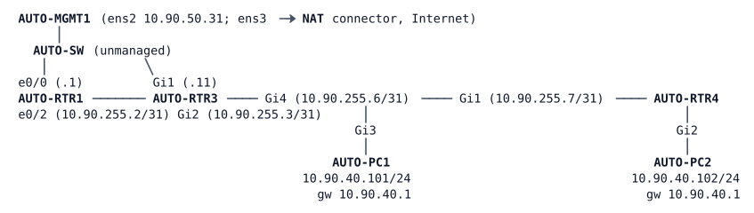

# LAB-068 — VXLAN Between Two VTEPs

**Module:** 10 Overlays and Fabric · **Type:** F (Foundation) · **Guidance tier:** G3 for the first VTEP (skeleton below), G2 for the rest · **Estimated time:** 120 min (excluding the boot, see Starting State) · **Blueprint objectives:** 2.3.b:I (VXLAN, control and data plane)

## Scenario
Veridian's automation pod runs an old inventory application that needs its two servers in one IP subnet. The servers now sit behind different routers: AUTO-PC1 behind AUTO-RTR3 and AUTO-PC2 behind AUTO-RTR4, and the pod between them is routed (OSPF). The team will not renumber either server and will not change the routed design. Instead, you stretch PC2's subnet across the pod so both servers share one Layer 2 segment, keep one default gateway for the segment, and then study what the stretch looks like on the wire and what it costs in packet size. This is the data plane that SD-Access uses between its edge nodes, built here by hand on two routers.

## Objectives
- Extend one subnet across a routed network so that two servers on different routers share a Layer 2 segment, without multicast in the underlay.
- Keep one gateway for the stretched subnet and reach a host outside it.
- Decode a captured encapsulated frame and compute its overhead; compare it with the LISP data packet of LAB-067.
- Work out what the overhead does to the underlay MTU and fix it with a justified value.
- Test what the overlay's health indicators show when the remote tunnel endpoint's address disappears from the underlay, and time the recovery.

## Available Information
Topology (all links Ethernet; interface names as cabled):



| Item | Value |
|---|---|
| Underlay | OSPF process 1, area 0; RTR3-RTR4 link 10.90.255.6/31 - .7/31 (point-to-point, cost 10) |
| Loopback0 (tunnel-endpoint candidates) | RTR3 10.255.90.11/32, RTR4 10.255.90.12/32, RTR1 10.255.90.1/32 |
| API segment | 10.90.50.0/24 (AUTO-MGMT1 .31, RTR1 .1, RTR3 .11) |
| Server subnet to stretch | 10.90.40.0/24: gateway 10.90.40.1, AUTO-PC1 .101, AUTO-PC2 .102 |
| Overlay identifier to use | 5040 (also the bridge-domain and service-instance number 40) |
| Device login | console: privilege 15, no login; SSH/enable: `admin` / `Cisco123!`; hosts: `cisco` / `cisco` |

AUTO-RTR3 and AUTO-RTR4 are Catalyst 8000V routers with the `network-advantage` / `dna-advantage` licence line already in their startup configuration (VXLAN needs it). AUTO-MGMT1 carries the automation toolkit of the pod (`/home/cisco/auto`, including `show_cmds.py`, which is written for RTR1 and RTR3 only (management addresses 10.90.50.x, user apiuser), so for R5 you adapt its device list or write your own netmiko loop for the two VTEPs. Reach RTR3 at 10.90.50.11 and RTR4 at its Loopback0 10.255.90.12 (reachable through the underlay), and log in with `admin` / `Cisco123!` on both; its Python virtual environment with netmiko is installed through the NAT node, so start the NAT node once and wait about 2 minutes if you want it; the NAT node counts as a running node, so the lab is 7 nodes without it and 8 with it). You can also SSH to the routers directly. In CML, capture on the **AUTO-RTR3 Gi4 to AUTO-RTR4 Gi1** link (right-click the link, Packet Capture) with the filter `udp port 4789`. Byte offsets in an Ethernet frame without a VLAN tag: Ethernet 0-13, outer IP 14-33, UDP 34-41, encapsulation header 42-49, inner Ethernet from 50.

## Starting State
- The two Catalyst 8000V routers need about 3.3 to 3.8 minutes from start to a usable CLI on a quiet server (five cold boots measured 3:19 to 3:45). Do not open their consoles before `%CVAC-4-CONFIG_DONE` appears in the console log. On a busy server the day-0 configuration has been seen to apply only after about 33 minutes, and once not at all: then `node stop`, `node wipe`, `node start` the router (about 4 minutes). The boot is not part of the estimated time.
- The OSPF underlay is converged: RTR3, RTR4 and RTR1 reach each other's Loopback0.
- AUTO-RTR4 Gi2 is a routed interface with 10.90.40.1/24; AUTO-PC2 reaches it and AUTO-MGMT1 reaches AUTO-PC2 and RTR4's loopback.
- AUTO-RTR3 Gi3 (towards AUTO-PC1) is administratively down and has no address. AUTO-PC1 (10.90.40.101, gateway 10.90.40.1) cannot reach anything.
- Neither router has any VXLAN or bridge-domain configuration. Every link carries a 1500-byte MTU.

## VXLAN in brief
A **VTEP** (VXLAN tunnel endpoint) wraps an Ethernet frame in a UDP packet (destination port 4789) and sends it across the IP underlay to the remote VTEP; the 24-bit **VNI** in the VXLAN header names the Layer 2 segment (a VLAN ID is only 12 bits). On IOS XE the pieces reference each other like this:

- `interface nve1` is the VTEP. `source-interface` names the loopback whose address is the tunnel endpoint; `member vni <n>` lists a VNI, and under it `ingress-replication <peer address>` is the static flood list: broadcast, unknown-unicast and multicast frames are copied to each listed peer, so the underlay needs no multicast.
- A **bridge-domain** is the Layer 2 segment on the router. `member vni <n>` ties the domain to the VNI; `member <interface> service-instance <m>` adds a local port.
- A **service instance** (an Ethernet flow point, EFP) is the per-port object that selects which frames of a physical port belong to a bridge domain: `service instance <m> ethernet` with `encapsulation untagged` (or a VLAN tag) under the interface.
- A routed gateway for a bridge domain is an `interface BDI<n>`, a Layer 3 interface that sits inside the bridge domain (`bridge-domain <n>`).

Skeleton for one VTEP (placeholders in angle brackets; the other VTEP, the gateway placement, the capture and the failure test are yours):
```
interface <access port>
 service instance <m> ethernet
  encapsulation untagged
  exit
 exit
bridge-domain <n>
 member vni <vni>
 member <access port> service-instance <m>
 exit
interface nve1
 no shutdown
 source-interface <loopback>
 member vni <vni>
  ingress-replication <peer VTEP address>
```
Leave the `service instance` submode with `exit` before you type the global `bridge-domain` line; otherwise IOS XE reads it as a subcommand of the service instance and the bridge domain is never created.

Entry `show` commands: `show nve interface nve1`, `show nve vni`, `show nve peers`, `show bridge-domain <n>`.

## Requirements / Change Requests

**R1.** Make 10.90.40.0/24 one Layer 2 segment between AUTO-PC1 (behind RTR3) and AUTO-PC2 (behind RTR4), using VXLAN with VNI **5040**. The tunnel endpoint address on each router is its Loopback0. The underlay must not use multicast: each router is told statically where the other one is. AUTO-PC1 must reach AUTO-PC2, and AUTO-PC1's MAC address must be learned on RTR4 through the overlay.

**R2.** Keep 10.90.40.1 as the gateway of the segment for both servers. AUTO-PC1 must reach AUTO-MGMT1 (10.90.50.31) through it, and AUTO-MGMT1 must reach AUTO-PC1.

**R3.** Capture on the RTR3-RTR4 link while AUTO-PC1 pings AUTO-PC2. Identify the outer IP header, the UDP ports (and how the source port behaves across flows), the VXLAN header (flags, VNI) and the inner Ethernet and IP headers. Compute the encapsulation overhead and compare it with LAB-067's LISP data packet.

**R4.** From AUTO-PC1 send pings to AUTO-PC2 with 1400 and with 1472 bytes of ICMP payload (`ping -s`, the underlay still at 1500) and record what crosses and what does not, with the evidence on the router that drops (some router counters update a few seconds late, so read them again before drawing a conclusion). Then make a full-size (1500-byte IP packet) server frame cross unfragmented, choose the value you change, and justify it. The final change must not alter any server or the OSPF adjacency.

**R5.** Collect the VNI state and the bridge-domain MAC table from both routers (`show nve vni 5040 detail`, `show bridge-domain 40`) with the toolkit on AUTO-MGMT1 or over SSH, before and after the failure test below.

**R6.** Failure test: make the address of RTR4's tunnel endpoint disappear from the underlay (a routing change on RTR4 only, not a link or interface failure). Record what the overlay's state indicators show on RTR3, the traffic result, and the time from the restoring change until AUTO-PC1 gets its first reply again (three runs).

## Verification Criteria

**V1.** AUTO-PC1 pings AUTO-PC2 and AUTO-PC2's MAC address shows as learned across the overlay on RTR3; AUTO-PC1's MAC address shows as learned across the overlay on RTR4.

**V2.** On each router the tunnel interface and VNI 5040 are up, and the VNI is attached to the correct bridge domain.

**V3.** AUTO-PC1 and AUTO-MGMT1 reach each other; the first ping to the gateway may lose one packet.

**V4.** The decoded capture shows the outer UDP destination port, a VXLAN header whose flags and VNI you have read, and your overhead figure matches the difference between the outer and inner frame lengths.

**V5.** Your R4 table lists, for each size, the result, the evidence and the final value; a 1472-byte ping between the servers succeeds without any change to the servers, and the underlay OSPF adjacency is up.

**V6.** The before and after outputs for R5 exist for both routers.

**V7.** During the failure test you have recorded the state of the VNI, the peer table and the byte counters on RTR3, and three restore times.

**V8.** Toolkit item: the R5 data was collected by a script run from AUTO-MGMT1 (a command list or a netmiko loop), not by typing on each router.

## Analysis Questions

**Q1.** How does a VTEP in this lab learn which remote VTEP a MAC address lives behind? What would a control plane (EVPN; LISP in SD-Access) change?

**Q2.** What happens to an ARP broadcast and to an unknown-unicast frame in this design? How does it scale with the number of VTEPs?

**Q3.** During R6, what did the peer table show, and is it a usable health check? What would you monitor instead?

**Q4.** Compare VNI and VLAN ID (header width and number space). Why does SD-Access map a virtual network to a VNI (or LISP instance-ID)?

**Q5.** State the MTU rule you derived in R4. Why does a fabric raise the underlay MTU rather than lower every host's? Where else in this course did an overlay need the same thing?

**Q6.** How does the outer UDP source port behave across flows, and why? What does a transit router do with it?
