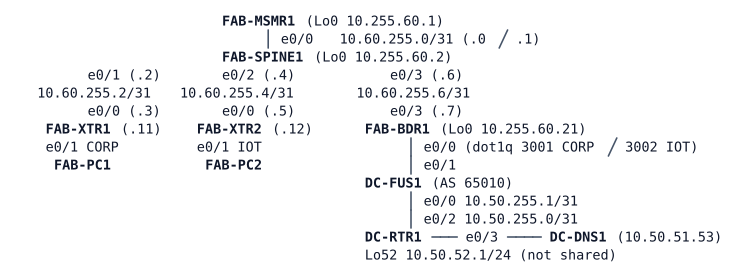

# LAB-069 — The Aster Fabric

**Module:** 10 Overlays and Fabric · **Type:** A/X (Analysis / Expansion) · **Guidance tier:** G2 · **Estimated time:** 180 min · **Blueprint objectives:** 1.3.a:I (SD-Access architecture), 1.3.b:P (traditional versus SD-Access interworking), 2.3.a:P (LISP), 2.2.a:R (VRF and route leaking), 2.3.b:R (VXLAN)

## Scenario
Aster Warehousing's new network is a fabric with two virtual networks: CORP (the warehouse office) and IOT (scanners and controllers). Aster's fabric is an SD-Access *analog*: the same control and data plane ideas, configured by hand on IOS routers; no Catalyst Center or ISE. Until today Aster reached Veridian's shared services over a plain VRF handoff (LAB-051). The fabric must now reach those services (the ERP server and its DNS name) through its own border and Veridian's fusion router, keeping the two virtual networks apart. Before the change window, the architecture board wants the fabric explained in SD-Access terms, and the packet it uses compared with the VXLAN packet of LAB-068.

## Objectives
- Explain the fabric as planes and roles (control, data, underlay, overlay; control plane node, edge, border, intermediate node, fusion) from live output.
- Give both virtual networks a path out of the fabric through the border without adding any route to a virtual network table on the edges.
- Make the fusion router learn each virtual network's address block from the border, and prove with captures that traffic is encapsulated in both directions.
- Compare the LISP data packet with the VXLAN packet and relate the handoff to LAB-051.

## Available Information
Topology (all links Ethernet; interface names as cabled). The upper part is Aster's fabric (10.60.0.0/16 space), the lower part is Veridian's data centre (AS 65010).

| Item | Value |
|---|---|
| Underlay | OSPF process 1, area 0 on every fabric router interface and loopback (point-to-point, hello 1 / dead 4) |
| RLOCs (Loopback0) | MSMR1 10.255.60.1, SPINE1 .2, XTR1 .11, XTR2 .12, BDR1 .21 (all /32) |
| Virtual networks | CORP = VRF `CORP`, LISP instance-ID 4097, address block 10.60.10.0/23; IOT = VRF `IOT`, instance-ID 4098, address block 10.60.20.0/23 |
| Endpoint subnets | CORP: XTR1 10.60.10.0/24 (FAB-PC1 10.60.10.101, gateway .1), XTR2 Loopback11 10.60.11.0/24 (an office printer); IOT: XTR1 Loopback20 10.60.20.0/24 (a badge-reader hub), XTR2 10.60.21.0/24 (FAB-PC2 10.60.21.102, gateway .1) |
| Handoff BDR1 to DC-FUS1 | CORP: 10.200.60.2/31 (FUS1) - .3 (BDR1), dot1q 3001; IOT: 10.200.60.4/31 (FUS1) - .5 (BDR1), dot1q 3002; eBGP AS 65060 (Aster) to AS 65010 (Veridian) per VRF |
| Veridian shared services | 10.50.51.0/24: DC-DNS1 10.50.51.53 resolves `erp.veridian.example` (to 10.50.51.53). VRF `SHARED` on DC-FUS1 holds them; each VN sees only SHARED, never the other VN. DC-RTR1 Loopback52 10.50.52.0/24 is not a shared service |
| LISP authentication key | `ROUTEKEY123`; mapping-system sites `AST-XTR1`, `AST-XTR2` |
| Device login | console: privilege 15, no login; SSH/enable: `admin` / `Cisco123!`; hosts: `cisco` / `cisco` |

Ownership: FAB-MSMR1, FAB-XTR1, FAB-XTR2, FAB-SPINE1 and FAB-BDR1 are Aster's fabric routers; DC-FUS1, DC-RTR1 and DC-DNS1 are Veridian's. Which role each fabric router plays is for R1 to prove. The server and the DNS name are reached by IP address 10.50.51.53 in this lab (the hosts have no resolver configured: query the server by address when you test a name). The busybox `nslookup` on the hosts prints a second, failing answer line after the real one; the first answer is the one that counts.

In CML, capture on the **FAB-SPINE1 e0/3 to FAB-BDR1 e0/3** link (right-click the link, Packet Capture) with the filter `udp port 4341 or udp port 4342`. Frame layout without a VLAN tag: Ethernet 0-13, outer IP 14-33, UDP 34-41, LISP header 42-49, inner IP from 50.

Reference material for R5: the folder holds `lab069-spine1-bdr1-lisp.pcap` (a LISP capture from this fabric) and LAB-068's `lab068-rtr3-rtr4-vxlan.pcap` (a VXLAN capture from the cat8000v pair); your own LAB-067 capture notes (R3) are the third reference. Open them in any packet analyser, or make your own captures. There is no packet decoder on the lab hosts.

## Primers and fabric handoff

**IS-IS in brief.** IS-IS is a link-state protocol like OSPF (each router floods link-state PDUs and runs SPF), but it runs directly over Layer 2 instead of over IP, so its adjacencies need no IP address and it carries IPv4 and IPv6 in one process. Routers are Level 1 (inside an area), Level 2 (between areas) or both. Fabrics use it as the underlay because it is simple to extend and carries only loopback and link reachability. This lab keeps OSPF; the Level-1/2 detail is not tested.

**802.1X / MAB in brief.** In 802.1X the endpoint (supplicant) authenticates through the switch port (authenticator) to a RADIUS server; MAC Authentication Bypass (MAB) does the same by presenting the endpoint's MAC address when it has no supplicant. In SD-Access the RADIUS server is ISE, and its authorisation result tells the edge which virtual network the port joins and which security group tag (SGT) the endpoint gets. The SGT is a 16-bit group label that a real fabric carries in the VXLAN header (VXLAN-GPO); LAB-070 introduces it.

**Leaving and entering a LISP fabric.** Edges only encapsulate for destinations the mapping system knows. For a destination outside the fabric, the mapping system answers with a negative Map-Reply, so an edge needs a way to hand such traffic, still encapsulated, to a border that decapsulates it (a proxy ETR) and routes it natively. In the other direction, native packets for fabric hosts arrive at the border, which must look the destination up in the mapping system and encapsulate towards the right edge (a proxy ITR). A border that advertises a virtual network's block to the fusion router needs a route for BGP to originate, yet it must still resolve fabric hosts through the mapping system rather than forward them along that route. Entry `show` commands: `show lisp instance-id <id> ipv4 map-cache`, `show lisp service ipv4`, `show ip cef vrf <name> <host> detail`.

When you replace an entry of a prefix-list, remove it with its full `permit` text; removing it by sequence number alone does nothing and the new entry is then refused.

## Starting State
- The fabric is stage F1: both virtual networks exist, both edges are registered, CORP-to-CORP and IOT-to-IOT traffic crosses the fabric, CORP-to-IOT does not.
- FAB-BDR1 is in the underlay (RLOC reachable from every fabric router) and holds VRFs CORP and IOT. Its two eBGP sessions to DC-FUS1 are Established, and DC-FUS1 accepts nothing from Aster.
- The border and the edges have no configuration for traffic leaving the fabric.
- DC-FUS1, DC-RTR1 and DC-DNS1 are as at the end of LAB-051: the fusion's incoming filters for each VN permit only that VN's single /24 as it was then (CORP 10.60.10.0/24, IOT 10.60.20.0/24).
- The fabric hosts cannot reach 10.50.51.53. The lab starts about 90 s after the last node boots; wait for both edges to be registered before you test. The first packet of any new flow, inside a virtual network or toward 10.50.51.53, can be lost while the mapping cache fills: repeat a ping that fails once before you suspect a fault.

## Requirements / Change Requests

**R1** (analysis, before any change). From live output, produce the fabric's plane and role map: which device is the control plane node, the edges, the intermediate node, the border and the fusion router; what is underlay and what is overlay; which LISP instance carries which virtual network and how you proved it; why CORP cannot reach IOT; and what would carry the security group tag and who would push this configuration in a real SD-Access fabric (derived reference, no device here does it).

**R2** Give both virtual networks a path out of the fabric through FAB-BDR1 without adding any route to a virtual network table on the edges. Prove with a capture on the SPINE1-BDR1 link that a fabric host's packet to 10.50.51.53 leaves the edge LISP-encapsulated toward the border, and record what the edge's mapping cache holds for the destination.

**R3** Make Veridian learn each virtual network's address block (the /23) from the border, with the fusion accepting those blocks and no other fabric space, and make the return traffic enter the fabric encapsulated at the border. The border must not hold a plain forwarding route toward either block that would send the return traffic back to the fusion. The capture must show both directions for each virtual network.

**R4** Both virtual networks reach DC-DNS1 and resolve `erp.veridian.example`. CORP and IOT still cannot reach each other, also not through the fusion. 10.50.52.0/24 stays unreachable from both.

**R5** Compare the LISP data packet (this lab and LAB-067) with the VXLAN packet from LAB-068: outer headers, what identifies the virtual network (instance-ID or VNI), whether the payload is Layer 3 or Layer 2, and the overhead per packet. Explain why SD-Access uses VXLAN with a LISP control plane and where the group tag rides (derived reference).

**R6** List what changed on Veridian's side between LAB-051's VRF-lite handoff and this fabric handoff, and explain why that is the point of a fusion router.

**R7** Failure test: pull the cable between FAB-SPINE1 and FAB-BDR1 (same method on both ends). Record what still works inside the fabric, what no longer works, and the time from restoring the cable until FAB-PC1 gets its first DNS answer (three runs).

## Verification Criteria

**V1** The plane and role map of R1 is written down with the show output that proves each entry; it names the instance-ID of each virtual network.

**V2** From FAB-PC1 and FAB-PC2, 10.50.51.53 answers ping (the first packet of a new flow may be lost, here and inside a virtual network) and `erp.veridian.example` resolves via that server.

**V3** The capture on the SPINE1-BDR1 link shows, for each virtual network, a packet toward the border and one back, each with its instance-ID, outer addresses and inner addresses recorded.

**V4** Neither edge has a route in a virtual network table that covers 10.50.51.0/24, yet its mapping cache holds an entry for the destination that sends the packet to the border; the border's forwarding entry for a fabric host address is a LISP entry, not a discard.

**V5** The fusion's routing tables show each virtual network's /23 in that VN's table and in SHARED, never in the other virtual network's table; DC-RTR1 knows both blocks; 10.50.52.0/24 is unreachable from FAB-PC1 and FAB-PC2; FAB-PC1 cannot reach FAB-PC2 or the IOT hub, FAB-PC2 cannot reach the CORP printer or FAB-PC1.

**V6** The R5 comparison table has numbers read from captures: outer header sizes, UDP destination ports, the VN identifier values (4097, 4098, 5040) and the byte overhead for each encapsulation.

**V7** The failure test records the state of the mapping system and the BGP sessions during the failure, intra-fabric reachability, and three restore times.

**V8** A toolkit item: the capture was taken on the named underlay link and the filter you used is stated.

## Analysis Questions

**Q1** SD-Access uses IS-IS as its underlay. Why, what must the underlay provide to the overlay (loopback reachability, MTU), and why is OSPF an acceptable stand-in here?

**Q2** How does an endpoint get its virtual network and its group tag in SD-Access (802.1X or MAB with ISE authorisation) compared with here?

**Q3** SD-Access uses an anycast gateway on every edge; here each edge has its own gateway address. What does that change for host mobility (compare LAB-067 Q5)?

**Q4** Why does the border need proxy roles? What happened to a fabric host's packet to the data centre before R2, and what happened to the data centre's reply before R3? What would a positive mapping toward the border (registering a default per virtual network) replace?

**Q5** Why does the fusion router sit outside the fabric, and what would change if the shared services lived in a virtual network?

**Q6** What is the overlay MTU requirement across the whole path (fabric and handoff), and where would you raise it?

**Q7** What would a second border change for the failure test of R7?
