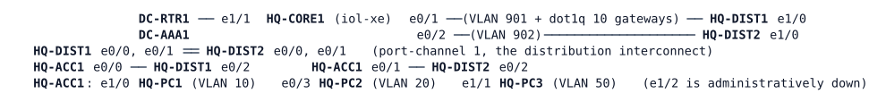

# LAB-070 — Group-based policy

**Module:** 10 Overlays and Fabric · **Type:** F (Foundation) · **Guidance tier:** G3 for the first use of each TrustSec building block (command card below), G2 for the choices in R3 and R4 · **Estimated time:** 120 min · **Blueprint objectives:** 5.4.d:I (TrustSec and MACsec), 1.3.a:R (SD-Access policy plane)

## Scenario

Veridian's security team wants HQ policy written by role instead of by subnet: office staff, operations and servers. ISE is not installed yet, so the network team tries the mechanism by hand on the HQ campus (the "lite" access block) and records what the platform can and cannot show. Separately, the board asks whether link encryption (MACsec) or IPsec should protect the campus uplinks. You build the group policy, test it flow by flow, and answer the board.

## Objectives

- Classify hosts into security groups, carry a group identity on the campus trunks, and enforce a group-to-group policy table with SGACLs.
- Show, with counters and traffic, what the enforcing device knows about the source of a packet, and what happens when it does not know.
- Replace the missing ISE with a static mechanism on the enforcement point, and prove every policy line.
- Compare the group policy with one IP ACL doing the same job.
- Decide between MACsec and IPsec for campus uplinks and for the WAN.

## Available Information



| Group | SGT | Host | Address | VLAN | Gateway |
|---|---|---|---|---|---|
| EMPLOYEES | 10 | HQ-PC1 | 10.10.10.101/24 | 10 | 10.10.10.1 (DIST SVIs) |
| OPERATIONS | 20 | HQ-PC2 | 10.10.20.102/24 | 20 | 10.10.20.1 (HQ-CORE1, VRRP) |
| SERVERS | 50 | HQ-PC3 | 10.10.50.103/24 | 50 | 10.10.50.1 (HQ-CORE1, VRRP) |
| NETWORK | 2 | the switch-to-switch links | - | - | - |

| Device | Platform | Role in this lab |
|---|---|---|
| HQ-ACC1 | ioll2-xe (Layer 2 only) | access switch, the hosts hang here |
| HQ-DIST1, HQ-DIST2 | ioll2-xe | distribution; VLAN 10 gateway; VLAN 20/50 are routed by HQ-CORE1 |
| HQ-CORE1 | iol-xe | routes every flow between VLANs 10, 20 and 50 |
| HQ-PC1/2/3 | Alpine hosts (`cisco` / `cisco`) | HQ-PC3 serves HTTP on TCP 80 (test with `wget -q -O - http://10.10.50.103/`) |

Network consoles need no login. Management addresses are on VLAN 99 (10.10.99.0/24). The multicast video traffic from HQ-PC3 and the DC-RTR1 / DC-AAA1 nodes are background; leave them alone.

**Policy table** (the security team's wording):

| From \ To | SERVERS (50) |
|---|---|
| EMPLOYEES (10) | web only (TCP 80) |
| OPERATIONS (20) | ping (ICMP) and web (TCP 80) |

EMPLOYEES and OPERATIONS may not talk to each other in either direction. Anything not in the table is permitted (the default).

**Platform facts (this is emulation, not a design flaw of yours):**

- The access and distribution switches (ioll2-xe) accept TrustSec configuration and report it with `show cts interface`, but they **never put a Cisco Meta Data (CMD, EtherType 0x8909) header on the wire**. No frame carries a group tag on any link in this lab.
- ioll2-xe **does not enforce SGACLs on switched traffic**: enforcement is accepted in configuration but filters nothing and counts nothing for frames that are switched at Layer 2.
- Enforcement works on a **routed hop**. HQ-CORE1 (iol-xe) enforces globally and sees every flow between the three VLANs, over either distribution switch.
- SXP is accepted in configuration but its connections stay `Off` on this platform. It cannot be used.
- SGACLs are stateless and per direction: a reply is its own group-to-group cell.
- Port-channel members and Port-channel interfaces: TrustSec commands are rejected on a Port-channel, and on a member while it is bundled.
- Link failure here: a cable pull means `shutdown` on both ends of the link.

## Starting State

- The HQ campus runs with full reachability among the three hosts; HQ-PC1 and HQ-PC2 can fetch the page on HQ-PC3. HQ-CORE1 is the VRRP master for VLANs 20, 50 and 99.
- HQ-DIST1 is the spanning-tree root for VLANs 10, 50 and 99, HQ-DIST2 for VLAN 20. HQ-ACC1 is dual-homed to both.
- No TrustSec configuration exists on any device. No role-based ACL, binding or policy is defined.

## TrustSec and MACsec in brief

**TrustSec** writes policy between *groups* instead of between addresses. A **security group tag (SGT)** is a 16-bit number that stands for a role. The pieces:

- **Classification** assigns a source to an SGT: statically with an IP-to-SGT binding, or dynamically through ISE at authentication.
- **Propagation** carries the SGT to the device that enforces: inside a Cisco Meta Data (CMD) header on a link between TrustSec devices (EtherType 0x8909), or as a binding table shared out of band (SXP).
- **Enforcement** happens at the destination side: a role-based ACL (SGACL) is attached to a *cell* of the permissions matrix (source group, destination group), and the device matches the packet's source group and its destination's group against the matrix. Traffic with no cell is permitted by default.

Command card (building blocks only; the groups, names and values are in the tables above and are yours to place):
```
interface <trunk or member>
 cts manual
  policy static sgt <n> trusted      ! group for the neighbour device; "trusted" accepts tags it sends
  propagate sgt                      ! tagging towards this neighbour (enabled by default)
cts role-based sgt-map <host-ip> sgt <n>
ip access-list role-based <name>
 permit|deny <protocol> [dst eq <port>]
cts role-based permissions from <src sgt> to <dst sgt> <name>
cts role-based enforcement [vlan-list <list>]
show cts interface [<interface>]
show cts role-based sgt-map all
show cts role-based counters
```
Which lines belong on which device, and which of them R3 and R4 want, you decide.

**MACsec in brief** (for R5 and Q5). MACsec is IEEE 802.1AE: it encrypts and authenticates Ethernet frames on one link, hop by hop, at line rate in hardware. Keys come from the MACsec Key Agreement protocol (MKA, 802.1X-2010) between the two ends. The MAC addresses stay visible so that switches can forward the frame, and each hop decrypts and re-encrypts.

## Requirements / Change Requests

R1. On HQ-ACC1, put each of the three hosts into its group (table above) by IP address, and display the binding table.

R2. Give every trunk between HQ-ACC1 and the two distribution switches, and the members of the DIST1-DIST2 port-channel, the infrastructure group (2) with group propagation enabled. The port-channel must stay up with both members bundled. Prove it per interface.

R3. Write the SGACLs and the policy matrix for the table above and enforce them on HQ-CORE1. Also enable the same enforcement on HQ-ACC1. Do **not** give HQ-CORE1 any way to learn host groups yet. Test PC1 -> PC3 (ping and web) and PC2 -> PC3 (ping and web) and read the role-based counters on both switches. Write down where the source group is known, where it is lost, and what the enforcing device has instead.

R4. Make HQ-CORE1 enforce the table with the mechanism you would use until ISE exists. Prove each policy line with traffic and the per-line counters, and show the result still holds over the backup path (see R6). Then work out what one IP ACL doing the same job would look like on HQ-CORE1, count its lines, and say what must change when HQ-PC2 gets a new address.

R5. (Analysis) Compare MACsec and IPsec for the campus uplinks and for the WAN (Q5).

R6. Pull the cable between HQ-ACC1 e0/0 and HQ-DIST1 e0/2 (`shutdown` on both ends) while a ping from HQ-PC3 to 10.10.50.2 (HQ-CORE1's own VLAN 50 address) runs one probe per second, three times, restoring each time. Count the probes lost. With the cable still pulled, repeat the R4 traffic tests and counters.

R7. Capture traffic on the link HQ-DIST1 e0/2 - HQ-ACC1 e0/0 (CML packet capture) while HQ-PC1 pulls the page from HQ-PC3, and list the EtherTypes you see (Q6).

## Verification Criteria

V1. HQ-ACC1 lists exactly three bindings: 10.10.10.101 in group 10, 10.10.20.102 in 20, 10.10.50.103 in 50.

V2. `show cts interface` on HQ-ACC1 (e0/0, e0/1) and on HQ-DIST1 and HQ-DIST2 (e0/0, e0/1, e0/2) reports each interface OPEN with peer group 2 and propagation enabled, and Port-channel 1 on both DIST switches shows both members bundled.

V3. Before R4, with enforcement on, the R3 test results (PC1 -> PC3, PC2 -> PC3 and PC1 <-> PC2) and the role-based counters on HQ-CORE1 and HQ-ACC1 are recorded.

V4. After R4, from cleared counters: PC1 -> PC3 web works and PC1 -> PC3 ping fails; PC2 -> PC3 ping and web work; PC1 -> PC2 and PC2 -> PC1 pings fail; the counters for 10->50, 20->50, 10->20 and 20->10 each move as the matching traffic would predict, and the HQ-ACC1 counters stay at 0.

V5. During R6 at most two probes are lost in each of the three runs, and with the cable still pulled V4 gives the same ping/web results and the same counter lines on HQ-CORE1.

V6. Toolkit: the R7 capture lists the EtherTypes present and states whether any frame carries 0x8909.

V7. Your IP ACL count and the answer to the address-change question are written down (R4).

## Analysis Questions

Q1. Why does enforcing at the egress (where the destination sits) scale better than filtering on every ingress port?

Q2. What would ISE add on top of what you built (classification, policy distribution, propagation between devices that cannot tag)? Which of your static steps does each one replace?

Q3. How does an SD-Access fabric carry the same group identity between fabric nodes, and what part of your trunk configuration does that replace?

Q4. With the cable pulled, which source group did HQ-CORE1 see for PC1's traffic, and how do the counters show it?

Q5. Give a table comparing MACsec and IPsec: layer, scope (hop-by-hop or end-to-end), key exchange, what each protects and what it leaves visible, and which fits a campus trunk and which the WAN.

Q6. What would the R7 capture show on real hardware with the trunk configuration from R2 (where in the frame is the group, how large is it)? Why does it show something different here, and why does that not mean your configuration is wrong?

Q7. What did HQ-ACC1's counters show, and why? Where would a real access switch enforce, and which of your findings in R3 would change on such hardware?
