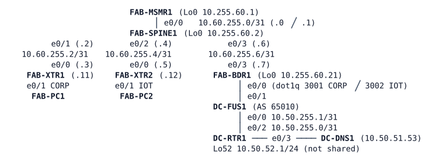

# LAB-071 — Aster Users Can't Reach Shared Services

**Module:** 10 Overlays and Fabric · **Type:** T (Troubleshooting) · **Guidance tier:** G1 · **Estimated time:** 150 min · **Blueprint domains:** 1, 2

## Scenario
It is Monday morning after a weekend maintenance window. Over the weekend Aster Warehousing's network team and Veridian's data-centre team each ran a configuration compare and clean-up on several devices, and the affected devices were reloaded at the end of the window. Aster's service desk has forwarded two tickets. Veridian's DC team says "nothing changed on our side that matters".

Aster's fabric is an SD-Access *analog*: the same control and data plane ideas, configured by hand on IOS routers; no Catalyst Center or ISE. You are the engineer on call. Find out why the two tickets happen, fix them without weakening the design, and prove it.

## Objectives
- Troubleshoot an overlay fabric plane by plane (underlay, mapping system, data plane, border, handoff, fusion, data-centre routing) from a user's complaint.
- Close both tickets while keeping the two virtual networks separate and the fabric's documented security settings unchanged.
- Explain what each fix changed in the tickets, and what check would have caught the problems right after the window.

## Available Information
Topology (all links Ethernet; interface names as cabled). The upper part is Aster's fabric (10.60.0.0/16 space), the lower part is Veridian's data centre (AS 65010).

| Item | Value |
|---|---|
| Fabric design standard | Underlay OSPF process 1, area 0 (point-to-point, hello 1 / dead 4). RLOCs (Loopback0): MSMR1 10.255.60.1, SPINE1 .2, XTR1 .11, XTR2 .12, BDR1 .21 (/32). Mapping-system sites `AST-XTR1`, `AST-XTR2`; registration authentication key `ROUTEKEY123` on both |
| Virtual networks | CORP = VRF `CORP`, LISP instance-ID 4097, address block 10.60.10.0/23; IOT = VRF `IOT`, instance-ID 4098, address block 10.60.20.0/23 |
| Endpoint subnets | CORP: XTR1 10.60.10.0/24 (FAB-PC1 10.60.10.101, gateway .1), XTR2 10.60.11.0/24 (the office printer on the other floor, 10.60.11.1); IOT: XTR1 10.60.20.0/24 (the badge-reader hub, 10.60.20.1), XTR2 10.60.21.0/24 (FAB-PC2, the scanner controller, 10.60.21.102, gateway .1) |
| Handoff BDR1 to DC-FUS1 | CORP: 10.200.60.2/31 (FUS1) - .3 (BDR1), dot1q 3001; IOT: 10.200.60.4/31 (FUS1) - .5 (BDR1), dot1q 3002; eBGP AS 65060 (Aster) to AS 65010 (Veridian), one session per VRF |
| Veridian shared services | 10.50.51.0/24: DC-DNS1 10.50.51.53 resolves `erp.veridian.example`. On DC-FUS1 they sit in VRF `SHARED`; each virtual network may see only SHARED, never the other virtual network. DC-RTR1 Loopback52 10.50.52.0/24 is not a shared service |
| Device login | console: privilege 15, no login; SSH/enable: `admin` / `Cisco123!`; hosts: `cisco` / `cisco` |

The hosts have no resolver configured: query the server by address (`nslookup erp.veridian.example 10.50.51.53`). The busybox `nslookup` prints a second, failing answer line after the real one; the first answer is the one that counts. The first packet of a new flow can be lost while a mapping cache fills: repeat a ping that fails once before drawing conclusions.

Capture: in CML, right-click the **FAB-SPINE1 e0/3 to FAB-BDR1 e0/3** link, Packet Capture, filter `udp port 4341 or udp port 4342` (4341 carries encapsulated data, 4342 carries mapping-system control messages). Capture while one host repeats a ping to 10.50.51.53, and record the outer and inner addresses of the packets you see.

The border (FAB-BDR1) was built in LAB-069 and keeps the design from that lab: it receives the fabric's traffic for the outside world, announces each virtual network's address block to Veridian, and takes the replies back into the fabric.

## Starting State
- The lab starts with every device already running its stored configuration after the maintenance window. Wait about 2 minutes after the last node boots before you test.
- FAB-PC1 (CORP) and FAB-PC2 (IOT) can ping their own gateways.
- Do not use `telnet` toward port 53 from DC-RTR1 (it can lock its console), and do not wipe DC-DNS1 (its link stays dead until the link is stopped and started).

## Requirements / Change Requests
**R1** Reproduce both tickets from the hosts, then find every cause. For each cause record the evidence that identifies it and the evidence that rules out each plausible alternative you examined.

**R2** Fix the causes with the smallest change that restores the documented design. Keep the documented design intact: no static workarounds, no change to the segmentation between virtual networks, and no change to the documented security settings.

**R3** After each single fix, re-test both tickets and note which ticket (if any) closes. Record the order in which you fixed things and why.

**R4** Record the time from your last fix until FAB-PC1 gets its first reply from 10.50.51.53 (poll the ping at 2 s intervals), and the time until any device you changed shows its new state.

**R5** Failure test, after both tickets are closed: stop the link between FAB-SPINE1 e0/0 and FAB-MSMR1 e0/0 (`link stop`, a silent failure: both interfaces stay up/up) while FAB-PC1 and FAB-PC2 ping 10.50.51.53 in the background. Record what keeps working, how long until the mapping system shows the registrations gone, whether a flow to a destination not yet in the map-cache works, and how long after you start the link again a new flow works.

## Reported Problems
**TK1** (Aster office, FAB-PC1): "Since this morning the ERP portal `erp.veridian.example` doesn't open; the name doesn't resolve. Printing to the office printer on the other floor (10.60.11.1) fails too."

**TK2** (Aster IOT team, FAB-PC2): "The scanner controller (10.60.21.102) can't reach the DNS service at 10.50.51.53 any more, so it can't find the ERP system either."

## Verification Criteria
**V1** From the Aster office user (FAB-PC1) `erp.veridian.example` resolves via 10.50.51.53 and 10.50.51.53 answers ping.

**V2** From the scanner controller (FAB-PC2) 10.50.51.53 answers ping and the same name resolves. The office user reaches the printer 10.60.11.1, and the scanner controller reaches the badge-reader hub 10.60.20.1.

**V3** The office and IOT networks still cannot reach each other (FAB-PC1 to 10.60.21.102 and 10.60.20.1; FAB-PC2 to 10.60.10.101 and 10.60.11.1), and neither can reach 10.50.52.1.

**V4** Every value in the fabric design standard above is unchanged, and all four endpoint subnets are reachable from both edges where the design intends it.

**V5** Toolkit: a capture on the SPINE1-BDR1 link shows FAB-PC1's traffic to 10.50.51.53 encapsulated, with the instance-ID and the inner addresses recorded.

**V6** Veridian still learns exactly one address block per Aster virtual network from the fabric, as in the design (state your evidence).

## Analysis Questions
**Q1** Which evidence separates a mapping-system problem from an underlay or a data-plane problem in an overlay?

**Q2** After each fix, which ticket changed, and what did that tell you about the remaining causes?

**Q3** Which single check, run right after the maintenance window, would have shown the problems at once?

**Q4** Which part of SD-Access (Catalyst Center) reports symptoms like these, and how would it show them? (Reference answer only, no device here does it.)

**Q5** In an overlay, which tables besides the routing table decide where a packet goes on an edge and on a border, and in which order are they consulted? Show the entries you used for FAB-PC1's traffic to 10.50.51.53 and for the return traffic.
