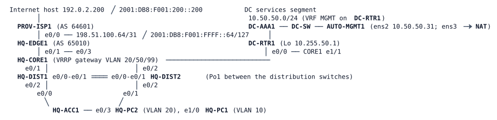

# LAB-072 — Operations Shift 3

**Module:** 10 Overlays and Fabric · **Type:** T/N (Troubleshooting / Integration) · **Guidance tier:** G1 · **Estimated time:** 165 min · **Blueprint domains:** 3, 4, 5, 6

## Scenario
You are the night-shift network engineer for Veridian Logistics. A weekend maintenance window changed several devices at the head office (HQ), and nobody wrote down exactly which. Monday's shift log has three tickets from users, the partner and the automation team, and a standing instruction: every finding on this shift must be backed by evidence collected from the devices, not by what someone remembers. The automation team's evidence job runs from the host AUTO-MGMT1 and is your first tool.

Find out why each ticket happens, fix it with the smallest change that is consistent with the documented design, prove that the fix holds when a link is lost, and write a shift note for each ticket.

## Objectives
- Work three tickets from the user's symptom to the device evidence that explains it, and tell a cause from a consequence in the logs.
- Restore service without weakening the documented Layer 2, IPv6 edge and management standards.
- Show that the repaired campus survives the loss of either uplink of an access switch.
- Collect before and after evidence from every device with a script or playbook, and read what an unreachable device in that evidence tells you.

## Available Information
All links are Ethernet; interface names as cabled. The head office (AS 65010, public IPv4 192.0.2.0/24 block, IPv6 2001:DB8:10::/48) connects to the provider ISP-A (AS 64601) and to the Veridian data centre.

| Item | Value |
|---|---|
| VLAN 10 Staff | 10.10.10.0/24 gateway .1 (distribution pair); IPv6 2001:DB8:10:10::/64 by router advertisement. HQ-PC1 10.10.10.101 |
| VLAN 20 Operations (OPS) | 10.10.20.0/24 gateway .1 (VRRP, HQ-CORE1 .2); IPv6 2001:DB8:10:20::/64. HQ-PC2 10.10.20.102 |
| VLAN 50 | 10.10.50.0/24 gateway .1 (VRRP, CORE1 .2) |
| VLAN 99 Management | 10.10.99.0/24 gateway .1 (VRRP, CORE1 .2); HQ-DIST1 .11, HQ-DIST2 .12, HQ-ACC1 .21 (global, default gateway 10.10.99.1); CORE1, DIST and EDGE1 management addresses are reached from the automation host through VRF MGMT |
| Other management | HQ-EDGE1 10.10.254.5; DC-RTR1 10.50.50.1 (Loopback 10.255.50.1 is the DC service address that user VLANs may reach; DC-AAA1 10.50.50.52 is not reachable from user VLANs by design) |
| Public prefixes | Veridian announces to ISP-A only 192.0.2.0/26, 192.0.2.128/26 and 2001:DB8:10::/48 |
| Logins | console: privilege 15, no login; SSH/enable: `admin` / `Cisco123!` (RADIUS first, local fallback); hosts `cisco` / `cisco`; the automation job uses its own account `netadmin` / `netpass` |
| Automation host | AUTO-MGMT1: `~/auto/show_cmds.py` (run with `/home/cisco/venv/bin/python`; Python venv with netmiko; `--out DIR` saves one file per device), and Ansible (same venv) with `inventory.ini` and `evidence.yml` in the same directory. Allow about 4 minutes after lab start for the host to finish installing its tools |
| Group policy | Until ISE arrives, group policy (the mechanism of LAB-070) is enforced on HQ-CORE1 from static IP-to-group mappings: group 10 EMPLOYEES = VLAN 10, group 20 OPERATIONS = VLAN 20, group 50 SERVERS = the DC service address 10.255.50.1. Documented policy: EMPLOYEES to SERVERS ICMP only; OPERATIONS to SERVERS any IP; no other group pair has a policy. Enforcement is on. The CTS lines are on HQ-CORE1 only; the switches carry none. Management traffic in VRF MGMT carries no group mapping |
| Failure method | A cable pull in this lab means `shutdown` on **both** ends of the link. A one-sided `shutdown` leaves the far port up/up and tells you nothing reliable |

**Documented design standards (HQ):**

| Item | Standard |
|---|---|
| Inter-switch links | 802.1Q trunks, native VLAN 999 |
| Link aggregation | Where two links join the same pair of switches they are bundled; bundle negotiation uses an open standard protocol, not a static setting |
| STP mode | Rapid PVST+ on all switches |
| STP roots | VLAN 10, 50 and 99 rooted on HQ-DIST1 (priority 24576), VLAN 20 on HQ-DIST2 (priority 24576), 28672 on the other switch of the pair |
| STP guards | Root guard on the distribution downlinks to the access switch; loop guard on the access uplinks |
| Change policy | STP priorities and guards are not changed to fix problems |
| Routing | OSPF area 0 between HQ-CORE1 and the distribution pair; HQ-DIST1 is the primary path for VLAN 10 (HQ-DIST2's VLAN 10 interface has OSPF cost 20 against the default 1 elsewhere), so HQ-CORE1 reaches the VLAN 10 subnets through HQ-DIST1 only; this is the documented design, not a finding |
| Provider edge | HQ-EDGE1 announces nothing to the provider beyond the public prefixes above; the provider is not ours to change |

## Starting State
HQ lite (head office), EDGE (HQ-EDGE1 with PROV-ISP1), DC-RTR1, DC-AAA1 and AUTO-MGMT1 are running with the management standard of the HQ environment (RADIUS with local fallback, VRF MGMT, SNMPv3, logging, authenticated NTP). The weekend changes are already in place. HQ-CORE1 carries the group policy above. The lab needs 12 nodes plus the NAT connector (13 running nodes) and about 2.5 minutes to settle; AUTO-MGMT1 needs about 4 minutes before its tools are ready. Nothing is saved to NVRAM by you: to return to this state, wipe and start the changed nodes.

## Requirements / Change Requests
**R1** Before changing anything, collect the job's full evidence set from every device the automation host can reach (`show_cmds.py` or `evidence.yml`; their command lists are in `~/auto`). Save it as the "before" set and record which device or devices the job could not reach, and why that is itself evidence.

**R2** Resolve each ticket with the smallest change that is consistent with the documented design standards above.

**R3** Re-run the job after the fixes, save the "after" set and diff it against the "before" set.

**R4** Write a shift note per ticket: symptom, evidence, cause, fix, and the risk you left or removed.

## Reported Problems
- **TK1 (Operations floor, from HQ-PC2):** "Since the weekend nobody in Operations can reach anything outside our own PCs. The office staff next to us are fine."
- **TK2 (office staff and the partner's monitoring):** "Our partner's site works over IPv4, but anything that tries IPv6 hangs. The partner's monitoring shows our IPv6 checks failing since the weekend."
- **TK3 (automation team):** "Since the maintenance the nightly inventory job reports two switches unreachable, one in the distribution layer and one access switch. All other devices answer."

## Verification Criteria
**V1** Every host reaches its gateway, the DC service address 10.255.50.1 and the Internet host 192.0.2.200 over IPv4.

**V2** Both hosts reach the Internet host 2001:DB8:F001:200::200 over IPv6.

**V3** The provider receives exactly Veridian's documented public prefixes, IPv4 and IPv6, and nothing else.

**V4** The automation job reaches all six devices (CORE1, DIST1, DIST2, ACC1, EDGE1, DC-RTR1), and keeps reaching every switch, with no lost user or management pings at a 0.2 s interval, when each inter-switch link of HQ-ACC1 is cable-pulled in turn (one at a time), then restored.

**V5** Every inter-switch link and every switch's STP configuration conforms to the documented design standards table, and no switch reports inconsistent ports.

**V6** Toolkit: the "before" and "after" evidence sets exist, were produced on the automation host by script or playbook, and the diff shows the changes you made.

**V7** The group policy in force on HQ-CORE1 is identical to the documented one: the mappings and policies listed in this lab, with enforcement on.

## Analysis Questions
**Q1** In what order did you work the tickets, and what evidence from the "before" set decided that order?

**Q2** After your last fix, which tests did you run to confirm the whole network, not only the three tickets, was healthy, and what did each show?

**Q3** For a problem you could only see from your side of a link, which local evidence did you rely on, and how did you decide it was enough?

**Q4** What did the automation job's failure teach you about out-of-band paths for management?

**Q5** For each flow you repaired, where along its path did packets stop, in which direction, and which evidence showed it?
