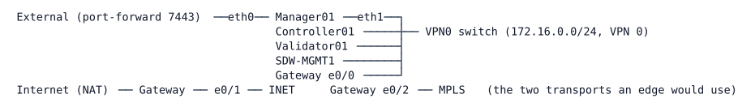

# LAB-073 — The SD-WAN Pilot

**Module:** 11 Controllers and Architecture · **Type:** A/F (Analysis/Foundation, live component) · **Guidance tier:** G2 · **Estimated time:** 150 min (the deployment, about 40–55 min, is done before the session from BUILD.md) · **Blueprint objectives:** 1.2.a:I, 6.4:I, 5.3:P

## Scenario

Veridian's WAN modernisation project has stood up a Catalyst SD-WAN control plane in the lab for evaluation. No depot routers are migrated yet: the pilot has controllers only, and the edge side is the subject of LAB-074. You are the pilot's network engineer. Document what each controller does, how the controllers trust each other and how a depot router would join, and prove the team can automate against the Manager from inside the pilot network.

Wait times on this pilot are long (a real-time API call can take a minute or two; the Manager needs minutes to notice some changes). Record what you actually see, with the time it took.

## Objectives

- Identify each SD-WAN controller's role and plane.
- Read control connections, certificates and the authorised-device list from the Manager GUI and API.
- Describe the order and the checks by which a new depot router would be onboarded.
- Show how the Manager API authenticates a session and what it returns when authentication is missing.
- Automate the controller inventory with a Python script.
- Observe what the control plane shows when the Controller is lost and recovers.

## Available Information

### Pilot topology (as deployed by the `csdwan` tool, names and addresses unchanged)

| Node | Role (Cisco name) | System IP | Site |
|---|---|---|---|
| Manager01 | Manager | 100.0.0.1 | 100 |
| Controller01 | Controller | 100.0.0.101 | 100 |
| Validator01 | Validator | 100.0.0.201 | 100 |
| SDW-MGMT1 | API host (Ubuntu), 172.16.0.50/24 on VPN 0, no default gateway, no NAT | n/a | n/a |

- Manager GUI/API from your workstation: `https://<CML host>:7443`. From SDW-MGMT1: `https://172.16.0.1`. Self-signed certificate.
- Manager login: `admin` / `EncorSdwan#2026`. SDW-MGMT1 console login: `cisco` / `cisco`.
- SDW-MGMT1 holds `/home/cisco/sdwan/README.txt` and an empty `/home/cisco/sdwan/report/`. python3 with `requests` and `curl` are installed. Nothing else is provided.
- The Manager API base is `/dataservice`. Session login is a form POST to `/j_security_check` (`j_username`, `j_password`); the token endpoint is `/dataservice/client/token`; real-time endpoints are under `/dataservice/device/...`.
- Use a client timeout of 180 s on every call.
- CML note: the Controller is a CML node. "Controller lost" in this lab means stopping that node in CML (a silent failure for its peers: no goodbye message is sent). It is the only change you may make to the pilot, and you must start the node again afterwards.

## Starting State

Controllers deployed and all three reachable; certificates installed on all three; the authorised WAN edge serial file uploaded; basic configuration and the `edge_basic` configuration group imported; the controller template attached. There are no WAN edges and no OMP routes, TLOCs or BFD sessions to see: edge behaviour is taught in LAB-074. SDW-MGMT1 is clean (no scripts, no report).

## SD-WAN in brief

Catalyst SD-WAN splits a WAN into planes, and each plane has its own controller (Cisco's current names first, the older names in brackets):

- **Validator (vBond), orchestration plane.** The first device a router talks to. It authenticates joining devices and tells them where the other controllers are; it also helps devices behind NAT find their usable addresses. It holds no routing state.
- **Controller (vSmart), control plane.** Runs OMP (Overlay Management Protocol) with the routers. OMP carries routes, TLOCs (transport locators: where a router can be reached over each transport) and the policies the controller applies.
- **Manager (vManage), management plane.** Configuration templates and groups, monitoring, the GUI and the REST API (`/dataservice`). It talks to devices over NETCONF.
- **WAN edge routers** forward user traffic over IPsec tunnels they build between themselves (the data plane). They hold control connections (DTLS or TLS) to the Validator, Controller and Manager.

How they trust each other: every device carries a certificate; all of them belong to one **organisation name**; a router joins only if its serial or chassis number is in the **authorised device list** (the "WAN edge list"), which the Manager holds and shares with the Validator. A router that is configured with the wrong organisation name, or that is not on the list, is refused. R3 and Q1 ask you to work out, from these roles, the order in which a new router meets the controllers and what is checked at each step.

The API in R4 and R5 is a session API: you log in with a form POST, you receive a session cookie, and a state-changing call also needs a token that the Manager hands out (sent back as the `X-XSRF-TOKEN` header). An XSRF (CSRF) token exists because a browser attaches cookies to requests made by any web page; a header that only your own client can set stops a foreign page from riding on your logged-in session.

Entry points: on the Manager, `Monitor > Devices` and `Configuration > Certificates`; in the API, `/dataservice/device`, `device/control/connections?deviceId=<system IP>`, `device/orchestrator/connections?deviceId=<system IP>`, `certificate/vsmart/list`, `system/device/vedges`, `settings/configuration/organization`.

## Requirements / Change Requests

**R1. Inventory.** From the Manager GUI and from the API, list every controller with personality, system IP, site ID, software version and reachability. Map each to its role and plane (orchestration, control, management).

**R2. Control plane between controllers.** Read the control connections of the Controller and of the Manager, and the Validator's orchestrator view. Record peer type, protocol, port and state for each. Explain why the Validator must be reachable from every transport, what it checks when an edge joins, and why it holds no routing state.

**R3. Trust and onboarding.** Read the organisation name, the Validator address setting, the controllers' certificate records (state, serial, expiry) and the WAN edge list (serial or chassis number, UUID, validity, certificate state). Write the onboarding sequence a new depot router would follow, say what each step checks, and say where the authorised serial list is held.

**R4. API security.** With `curl` and a cookie jar on SDW-MGMT1, show the session flow. Then show what the Manager returns (status code, content type, any redirect, body start) for: a data call with no session; a state-changing call with a session but without the token header; a data call after logout. Compare with HTTP Basic authentication to the same Manager and with RESTCONF over HTTPS (LAB-060).

**R5. Script.** A Python script on SDW-MGMT1 using `requests.Session` that logs in, fetches the token, writes `/home/cisco/sdwan/report/controllers.json` (device, personality, system IP, reachability, certificate state, control-connection count), uses 180 s timeouts, states how it handles the Manager certificate, and logs out. It must stop with a clear message if the login did not succeed.

**R6. Controller loss.** Stop the Controller node in CML. Record the time until the Manager's control-connection view loses it and the time until the Validator's view loses it; record what each still shows in between. Start the node and record when both views list it up again. Leave the pilot as you found it.

## Verification Criteria

**V1.** `report/controllers.json` exists with three entries whose values match the Manager GUI, and the script exited cleanly after logging out.
**V2.** Your R2 record contains the peer type, protocol, port and state of every control connection the Controller and the Manager have, and the Validator's orchestrator view.
**V3.** Your R3 record states the organisation name, the Validator address, three certificate records and the number of rows in the authorised list.
**V4.** Your R4 evidence shows, for each of the three unauthenticated cases, the status code, the content type and the first characters of the body, and states how a script can tell that the call failed.
**V5.** Your R6 record gives times with the clock you used and the trigger and end condition of each, from at least three runs, and the final state has all three controllers up in the Manager and Validator views.
**V6.** The pilot's configuration is unchanged except for sessions you created (logged out) and the Controller node stop/start.

## Analysis Questions

**Q1.** Which controller would a new edge contact first, with what information, and what fails if the organisation name differs?
**Q2.** What does the control plane carry (OMP from the Controller) compared with the management plane (NETCONF from the Manager), and what does the data plane need from neither once established?
**Q3.** Why does the API use a session plus an XSRF token, and what does each protect against? What did you observe about HTTP Basic against this Manager, and what follows for a script?
**Q4.** Why are the real-time endpoints slow, and how should a script cope?
**Q5.** What did you see when the Controller was stopped, which of your observers was reliable, and what would real edges have kept doing meanwhile?
**Q6.** Your three unauthenticated calls: which status codes did you expect, which did you get, and what should a script check instead of the code alone?
