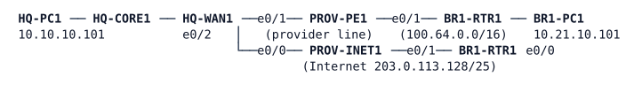

# LAB-074 — SD-WAN Design Review

**Module:** 11 Controllers and Architecture · **Type:** A (Analysis) · **Guidance tier:** G1 · **Estimated time:** 150 min · **Blueprint objectives:** 1.2.b:A, 1.2.a:P, 3.2.d:R, 4.4:R

## Scenario

The board asks whether Veridian should migrate its depots to SD-WAN. You are the network team's reviewer. You will compare today's WAN with the pilot's design from two kinds of evidence:

- **Vendor reference outputs (derived).** The SD-WAN edges cannot run on this CML server, so the SD-WAN side is a pack of reference outputs built from Cisco's published command references and configuration guides (see Available Information). They are not captured from a live edge. Treat them as the vendor's documented behaviour, not as a measurement.
- **Measurements on a lab copy of today's WAN.** This part is live: a bench with the provider line, the Internet tunnel, and the voice policy routing with its availability probe.

You finish with a short memo for the board.

## Objectives

- Read SD-WAN control-plane and data-plane outputs well enough to say which path a voice flow takes and why.
- Measure how today's WAN steers voice and what its probe can and cannot see.
- Extend today's design so that voice leaves the provider line when the line is slow, and measure how fast it moves and returns.
- Compare the two designs honestly and recommend.

## Available Information

### Today's WAN (live bench, 7 nodes)



| Device | Interface | Address | Connects to |
|---|---|---|---|
| BR1-RTR1 | e0/1 | 100.64.21.1/31 | PROV-PE1 e0/1 (provider line) |
| BR1-RTR1 | e0/0 | 203.0.113.131/31 | PROV-INET1 e0/1 (Internet) |
| BR1-RTR1 | e0/2.10 | 10.21.10.1/24 | BR1-PC1 |
| HQ-WAN1 | e0/1 | 100.64.10.1/31 | PROV-PE1 e0/0 (provider line) |
| HQ-WAN1 | e0/0 | 203.0.113.129/31 | PROV-INET1 e0/0 (Internet) |
| HQ-WAN1 | e0/2 | 10.10.255.97/31 | HQ-CORE1 e1/0 |
| Tunnel21 (GRE over IPsec, Internet) | BR1 / HQ-WAN1 | 10.250.21.21 / 10.250.21.1 | BR1-RTR1 to HQ-WAN1 |

Hosts: BR1-PC1 10.21.10.101/24, HQ-PC1 10.10.10.101/24 (user `cisco`, password `cisco`; `iperf` v2 and `traceroute` are installed, BR1-PC1 also). Routers: user `admin`, password `Cisco123!`. The Internet link of BR1 is shaped to 2 Mb/s and carries 30 ms delay and 0.2 % loss from CML link conditioning.

The WAN carries OSPF over the tunnels, plus a voice policy on each router: EF traffic between the depot and HQ is policy-routed over the provider line and uses an availability probe (an IP SLA operation tracked by an object) to decide whether the provider line is usable. Everything else follows OSPF over the tunnel.

Tools worth knowing: `iperf -c <ip> -u -S 0xB8 -l 160 -b 64k -t <s>` (EF UDP stream, about 50 packets per second) with `iperf -s -u` on the far host; `traceroute -n -t 184 <ip>` on a host (EF-marked probes, ToS 184); `show route-map`, `show ip sla statistics`, `show track` on the routers. Plain ping and unmarked traceroute are not policy-routed and show the tunnel path. In an EF traceroute only the EF-marked probes follow the provider line; the replies of the hosts and of the router beyond the line are not EF and come back over the tunnel, so per-hop times jump at the third hop. Use end-to-end measurements (probe statistics, iperf) for round-trip times, and traceroute for the path only.

### CML link conditioning

Set it on a link in the CML UI (select the link, Conditioning) or through the API, and remove it when you finish each case. The delay you enter is applied **to each direction** of the link, so a probe or a ping crossing the link both ways sees twice the value you set. Quote RTTs as measured, not as configured.

The link to condition is `BR1-RTR1-Ethernet0/1<->PROV-PE1-Ethernet0/1`.

### SD-WAN pilot design: reference pack (all `(derived)`)

Two depots on two transports. Sites: 10 (HQ), 21 (depot DEP21), 22 (depot DEP22). Colours: `mpls` (provider line) and `biz-internet`. Encapsulation IPsec. Credentials and controller addressing are as in LAB-073. Outputs are as shown on DEP21-EDGE1 (system IP 10.255.121.1).

**Application-aware routing policy, as sent by the controller** (`show sdwan policy from-vsmart`):

```
DEP21-EDGE1# show sdwan policy from-vsmart
from-vsmart sla-class VOICE-SLA
 loss    2
 latency 150
 jitter  30
from-vsmart app-route-policy VOICE-AAR
 vpn-list ALL-VPNS
  sequence 10
   match
    dscp 46
   action
    sla-class VOICE-SLA
     preferred-color mpls
     no strict
from-vsmart lists
 site-list DEPOTS  site-id 21-22
 vpn-list ALL-VPNS vpn 1
```

**TLOCs known to DEP21-EDGE1** (`show sdwan omp tlocs`, trimmed):

```
ADDRESS FAMILY  TLOC IP         COLOR         ENCAP  FROM PEER   STATUS
ipv4            10.255.10.1     mpls          ipsec  10.255.0.3  C,I,R
ipv4            10.255.10.1     biz-internet  ipsec  10.255.0.3  C,I,R
ipv4            10.255.121.1    mpls          ipsec  0.0.0.0     C,Red,R
ipv4            10.255.121.1    biz-internet  ipsec  0.0.0.0     C,Red,R
ipv4            10.255.122.1    mpls          ipsec  10.255.0.3  C,I,R
ipv4            10.255.122.1    biz-internet  ipsec  10.255.0.3  C,I,R
```

**OMP routes received by DEP21-EDGE1** (`show sdwan omp routes`, trimmed):

```
VPN  PREFIX          FROM PEER   STATUS  ATTRIBUTE  LABEL  TLOC IP      COLOR         ENCAP  PREF
1    10.10.0.0/16    10.255.0.3  C,I,R   installed  1002   10.255.10.1  mpls          ipsec  -
                     10.255.0.3  C,I,R   installed  1002   10.255.10.1  biz-internet  ipsec  -
1    10.22.10.0/24   10.255.0.3  C,I,R   installed  1002   10.255.122.1 mpls          ipsec  -
                     10.255.0.3  C,I,R   installed  1002   10.255.122.1 biz-internet  ipsec  -
```

**BFD sessions** (`show sdwan bfd sessions`; detect multiplier 7, tx interval 1000 ms):

```
SYSTEM IP     SITE ID  STATE  SOURCE TLOC COLOR  REMOTE TLOC COLOR  SOURCE IP     DST PUBLIC IP   DST PORT  ENCAP  UPTIME        TRANSITIONS
10.255.10.1   10       up     mpls               mpls               100.64.21.1   100.64.10.1     12366     ipsec  12:03:41:05   0
10.255.10.1   10       up     biz-internet       biz-internet       203.0.113.131 203.0.113.129   12366     ipsec  12:03:41:07   0
10.255.122.1  22       up     mpls               mpls               100.64.21.1   100.64.22.1     12366     ipsec  12:03:40:58   0
10.255.122.1  22       up     biz-internet       biz-internet       203.0.113.131 203.0.113.133   12366     ipsec  12:03:41:02   0
```

**Application-aware routing statistics, normal conditions** (`show sdwan app-route stats`, 10-minute poll, the HQ sessions; averages per 10-minute bucket):

```
remote-system-ip 10.255.10.1  local-color mpls          remote-color mpls
 total-packets 600  loss 0  average-latency 22  average-jitter 2   sla-class VOICE-SLA (meets)
remote-system-ip 10.255.10.1  local-color biz-internet  remote-color biz-internet
 total-packets 600  loss 0  average-latency 48  average-jitter 6   sla-class VOICE-SLA (meets)
```

**Reference capture "provider degradation"** (same command, next buckets after the provider line degrades):

```
remote-system-ip 10.255.10.1  local-color mpls          remote-color mpls
 total-packets 600  loss 6  average-latency 310  average-jitter 45
remote-system-ip 10.255.10.1  local-color biz-internet  remote-color biz-internet
 total-packets 600  loss 0  average-latency 52  average-jitter 7   sla-class VOICE-SLA (meets)
```

Latency and jitter are in milliseconds, loss in percent. BFD echoes at one-second intervals measure the loss, latency and jitter on every tunnel whether or not user traffic uses it.

## SD-WAN in brief

You met the controllers in LAB-073. The reference pack below shows what a WAN edge sees once it has joined. Terms you need to read it:

- **Colour:** a label for a transport (`mpls`, `biz-internet`). A router with two transports has two colours.
- **TLOC (transport locator):** where a router can be reached over one transport: the router's system IP, a colour and an encapsulation (here IPsec). Two transports on two routers give four TLOCs between them.
- **OMP (Overlay Management Protocol):** how edges and the Controller exchange routes. An OMP route says "this prefix is reachable via this TLOC". The Controller sends every route with its next-hop TLOC(s); a prefix with two TLOCs has two possible paths.
- **OMP status flags** (`show sdwan omp ...`): `C` chosen, `I` installed, `R` resolved (the next hop is reachable), `Red` redistributed (the router's own route or TLOC, sent out). `C,I,R` is a route or TLOC learned from a peer and in use; `C,Red,R` is the router's own.
- **BFD per tunnel:** every IPsec tunnel between two TLOCs runs BFD echoes at a fixed interval. This is the SD-WAN probe: it measures loss, latency and jitter of each path continuously, whether or not user traffic uses it, and declares a tunnel down after a number of missed echoes (the detect multiplier).
- **Application-aware routing (AAR):** a policy from the Controller that matches traffic (here DSCP 46 = EF) and names an **SLA class** (limits for loss, latency and jitter) and a `preferred-color`. If the preferred colour's BFD measurements meet the SLA class, the traffic uses it; if they do not, it moves to a tunnel that does (`no strict` means: if none meets it, stay on the preferred one). The edge decides, from its own measurements; the Controller only distributes the policy.

Entry commands on a real edge: `show sdwan omp tlocs`, `show sdwan omp routes`, `show sdwan bfd sessions`, `show sdwan app-route stats`, `show sdwan policy from-vsmart`.

## Starting State

The bench is booted with W4-style WAN content collapsed to one depot: provider line and Internet tunnel up, OSPF adjacencies up over the three tunnels (Tunnel21 data, Tunnel91 MGMT, Tunnel41 OT), voice policy on BR1-RTR1 and HQ-WAN1, probes on both routers running, no conditioning on the provider line, and no student changes. The SD-WAN pack above is paper only.

## Requirements / Change Requests


**R1. Interpret the pack.** For DEP21: list its TLOCs; list the OMP routes it receives for the HQ prefix with their next-hop TLOCs; list the BFD sessions that are up and the measured loss, latency and jitter of each path; state on which colour the policy puts voice now and after the provider degradation capture, and which values cause the change.

**R2. Measure today's WAN.**
  1. With EF voice traffic from BR1-PC1 to HQ-PC1, record the path in each direction and the voice route-map counters.
  2. Apply 200 ms of delay to the BR1 to PE1 link, then remove it. Record the probe's measured round-trip time, its track state, and the voice path.
  3. Apply 5 % loss to the same link (one impairment at a time, each removed afterwards). For a fixed 5-minute window record the voice packet loss, the track state changes of both routers, and which path the voice used.
  Keep a table of raw values for each case.

**R3. Extend today's design.** In both directions, voice must leave the provider line when the round-trip time of the provider line exceeds 150 ms and must return when it has recovered. Prove it in both directions, and measure the time to move and the time to return (at least three runs each, with the trigger, the end condition and the clock stated). Afterwards list what this design still cannot do compared with the AAR policy of R1. Your changes on the two routers stay in place; remove the conditioning.

**R4. Memo.** One page for the board: benefits and limitations of SD-WAN for Veridian, covering transport independence, central policy, per-application SLA steering, visibility, zero-touch onboarding against dependence on the controllers (use what you saw in LAB-073's controller failure test), licensing, skills and migration effort. End with a recommendation. Back every claim with evidence from R1 to R3 or from LAB-073.

## Verification Criteria


**V1.** Your R1 answers match the pack: the TLOC list, the next-hop TLOCs of the HQ prefix, the four BFD sessions and the colour in force before and after the degradation, with the figures that decide it.

**V2.** Your R2 table has raw values for the delay case and for three loss windows (or a stated number of windows), each with route-map counters, track state changes and voice loss.

**V3.** With 200 ms applied to the provider link (after R3), EF traffic in both directions takes the tunnel (traceroute to the far host with ToS 184 and the route-map counters) and both tracks report Down; with the conditioning removed both are Up and EF is back on the provider line.

**V4.** Move and return times: at least three runs each, raw values, documented range, consistent with the timers you configured.

**V5.** The bench is back to normal otherwise: no conditioning on any link except the shaped Internet link of the start state, OSPF neighbours Full on Tunnel21, Tunnel91 and Tunnel41, ping BR1-PC1 to HQ-PC1 clean.

**V6.** The memo makes a recommendation and each claim cites a measurement or output.

## Analysis Questions


**Q1.** What did the probe see under delay, and what under loss? Where did the voice go in each of your loss windows? Explain it from the probe's interval and the loss rate (use your own measured transition counts and voice loss; the result of a loss run can differ from run to run, so record what your runs show).

**Q2.** What does BFD on every SD-WAN tunnel measure that one ICMP probe per router does not?

**Q3.** Where is the path decision made in each design? What does that mean for fifty depots?

**Q4.** What happens to forwarding in each design when its decision-making part fails (a controller stop in the pilot, as in LAB-073, against a dead probe target in today's WAN)?

**Q5.** Build a comparison table of policy-based routing with a tracked probe against application-aware routing: what each measures, how often, per what, where it acts, and what each costs to run. Include what your threshold probe measures against BFD per tunnel.
