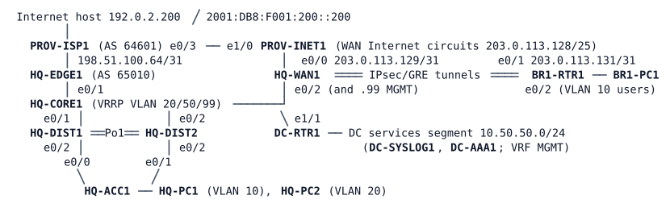

# LAB-075 — Operations Shift 4

**Module:** 11 Controllers and Architecture · **Type:** T/N (Troubleshooting / Integration) · **Guidance tier:** G1 · **Estimated time:** 150 min · **Blueprint domains:** 2, 3, 4, 5

## Scenario
You are the Saturday day-shift network engineer for Veridian Logistics after a busy week. The change log for the week reads:

- "BR2 depot decommissioned (week 1)."
- "Weekend maintenance: configuration compare and alignment with the standards on several campus and WAN devices."

Three tickets are open. The NOC pasted an AI assistant's analysis into one of them and asks you to test it on the live network before anyone applies it. Every finding on this shift must be backed by evidence from the devices and from the log collector, not by what someone remembers.

Resolve each ticket with the smallest change that is consistent with the documented design, prove that the repaired network keeps working when a distribution switch is lost, and write a shift note per ticket.

## Objectives
- Work three tickets from the user's symptom to the device evidence that explains it, and tell a cause from a consequence.
- Test an automated analysis against the live network and decide whether to accept, amend or reject it.
- Restore service without weakening any documented design standard.
- Use the central log collector and a targeted, conditional debug as evidence.

## Available Information
All links are Ethernet; interface names as cabled. Head office HQ (AS 65010, IPv6 2001:DB8:10::/48), the depot BR1 (reached over the Internet circuits), the data centre DC, and the provider PROV-ISP1 / PROV-INET1.

| Item | Value |
|---|---|
| VLAN 10 Staff ("main floor") | 10.10.10.0/24, gateway .1 (GLBP group 10, HQ-DIST1 .2 and HQ-DIST2 .3); IPv6 2001:DB8:10:10::/64 by router advertisement. HQ-PC1 10.10.10.101 |
| VLAN 20 Operations ("OPS floor") | 10.10.20.0/24, gateway .1 (VRRP, HQ-CORE1 .2). HQ-PC2 10.10.20.102 |
| VLAN 99 Management | 10.10.99.0/24 (VRF MGMT on routers and distribution switches); DIST1 .11, DIST2 .12, ACC1 .21 |
| Campus uplinks | DIST1 to CORE1 VLAN 901 (10.10.255.2/31 and .3), DIST2 to CORE1 VLAN 902 (10.10.255.4/31 and .5); OSPF 1 area 0, OSPFv3 for IPv6 |
| WAN | HQ-WAN1 Tunnel21 10.250.21.1/24, BR1-RTR1 Tunnel21 10.250.21.21/24 (data); Tunnel91 (MGMT) and Tunnel41 (OT) between the /29 loopbacks. OSPF 1: HQ backbone area 0, the depot tunnel area 21 |
| Depot | BR1 users 10.21.10.0/24 (gateway BR1-RTR1 .1, BR1-PC1 .101). The Internet circuit is 203.0.113.131/31 |
| Data centre | DC-RTR1 Loopback 10.255.50.1 is the DC service address users may reach; DC-SYSLOG1 10.50.50.51 (log collector), DC-AAA1 10.50.50.52 (RADIUS), NTP 10.50.50.1; the services segment is in VRF MGMT and not reachable from user VLANs by design |
| Logins | console: privilege 15, no login; SSH/enable: local `admin` / `Cisco123!` (break-glass, fallback only); NOC accounts on RADIUS: `netadmin` / `netpass` (privilege 15), `netops` / `opspass` (privilege 1); hosts `cisco` / `cisco` |
| Log collector | DC-SYSLOG1 receives syslog from every router and switch; read it in the CML console log of DC-SYSLOG1. DC-AAA1's console log shows each RADIUS request it receives |
| Failure method | Losing a distribution switch is a **silent** failure: stop all four of its CML links (to CORE1, to the other distribution switch twice, to ACC1). Restore them afterwards. Do not stop or wipe a DIST node |

**Platform note (CML switch image).** On this image the switch that is STP root for a VLAN routes the frames addressed to either GLBP forwarder MAC. On hardware each GLBP forwarder routes only the frames addressed to its own virtual MAC. Keep the difference in mind when you compare what you see with what hardware would show.

**Documented design standards:**

| Item | Standard |
|---|---|
| Routing | Every campus routed link runs OSPF to FULL with the same interface parameters on both ends; no static routes for reachability |
| First-hop redundancy | VLAN 10 uses GLBP on both distribution switches; both stay members |
| WAN security | The Internet-facing ACL admits only the documented peers' IKE/NAT-T, ESP, NTP and ICMP, host to host. No `any` permits |
| AAA | NOC accounts authenticate on RADIUS through VRF MGMT with their server-assigned privilege; local accounts are for fallback only; the server must show every request |
| Change policy | Standards are not relaxed or widened to hide a problem |

## Starting State
HQ lite (campus with GLBP on the distribution pair), EDGE (HQ-EDGE1 with PROV-ISP1), the integrated WAN (W3 lite: HQ-WAN1, BR1-RTR1, BR1-PC1, PROV-INET1), and the DC services (DC-RTR1, DC-AAA1, DC-SYSLOG1) are running with the management standard of the environment (RADIUS with local fallback, VRF MGMT, SNMPv3, logging to the collector, authenticated NTP). The weekend changes are already in place. The lab has 16 running nodes and needs about 4 minutes after start to settle; NTP synchronisation takes 25-35 minutes and is not needed. Nothing is saved to NVRAM by you: to return to this state, wipe and start the changed nodes (never a DIST node).

## Requirements / Change Requests
**R1** Resolve each ticket with the smallest change consistent with the documented design standards.

**R2** Test the assistant's proposal in TK2 on the live network before accepting it. Record the verdict (accept / amend / reject) with the test evidence and the change you finally made.

**R3** For each ticket, collect the evidence lines from the log collector (DC-SYSLOG1) that bracket the problem, and for at least one ticket run a targeted debug restricted by a condition. Not every debug prints output on these images: note which one you used and what it showed.

**R4** Write a shift note per ticket: symptom, evidence, cause, fix, and the risk you left or removed.

## Reported Problems
- **TK1 (HQ helpdesk):** "Since Wednesday the main floor (VLAN 10) reaches nothing outside the floor over IPv4: not the Internet, not the depot, not the data centre. The OPS floor has no problems."
- **TK2 (depot manager):** "Since the weekend the depot cannot reach any HQ or DC system. The Internet works from the depot, and the NOC can still log in to the depot router." Attached by the NOC: *AI assistant: the problem is an OSPF area mismatch on the depot's tunnel to HQ introduced by the weekend alignment. Fix: on BR1-RTR1 `interface Tunnel21`, `ip ospf 1 area 21`. Verify with `show ip ospf neighbor`.*
- **TK3 (NOC):** "Since Thursday our own accounts are refused on the WAN hub and on the depot router; the break-glass account works on both. Logins on the HQ campus devices are fine."

## Verification Criteria
**V1** Every user host (HQ-PC1, HQ-PC2, BR1-PC1) reaches its gateway, the DC service address 10.255.50.1, the Internet host 192.0.2.200 and the other site's user hosts over IPv4, and over IPv6 where the site is dual-stack, reliably: 10 of 10 neighbour-cache flushes on each host (`sudo ip neigh flush dev eth0`, then the ping tests) succeed.

**V2** Every campus routing adjacency is FULL and the campus matches the documented design standards. Office users (VLAN 10) keep IPv4 and IPv6 reachability of the Internet host when either distribution switch is lost (silent failure of all its links), and regain it within 30 s in each of three runs per switch; record the measured outage.

**V3** The depot reaches HQ and the DC over the encrypted path with dynamic routing (no static routes); the WAN hub's Internet-facing policy admits only the documented peers and protocols.

**V4** `netadmin` and `netops` log in on HQ-WAN1 and BR1-RTR1 with their server-assigned privilege (15 and 1); DC-AAA1 shows the successful requests.

**V5** The AI review verdict is recorded with test evidence from before and after the proposed change.

**V6** The shift note contains log-collector excerpts and the output of one conditional debug.

## Analysis Questions
**Q1** How did you prove which device was responsible when one VLAN's IPv4 failed and its IPv6, the other VLAN and the gateway protocol looked healthy?

**Q2** How did you test the assistant's proposal, and what evidence made you accept, amend or reject it?

**Q3** Which evidence showed where along a path the traffic stopped, and how did you confirm it?

**Q4** Which evidence on the server and on the client showed what happened to a failed login, and how did it separate the cases you found?

**Q5** Which pre- or post-change check would have caught each of this week's changes?
