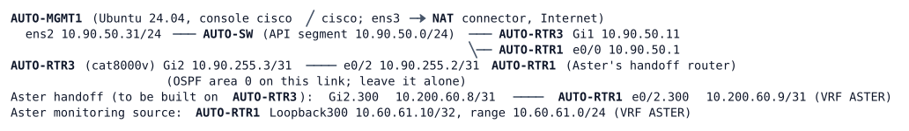

# LAB-078 — Aster's service by API

**Module:** 11 Controllers and Architecture · **Type:** X/T (Expansion/Troubleshooting) · **Guidance tier:** G1 · **Estimated time:** 120 min · **Blueprint domains:** 2, 4, 5, 6

## Scenario

Veridian will offer Aster Warehousing a shared service over a dedicated handoff. Before the production rollout, the automation team trials the change in the automation pod under its new change standard AUTO-CS-3. AUTO-RTR3 (the Catalyst 8000V) may be changed **only through its APIs**. AUTO-RTR1 plays Aster's handoff router; its side is already configured and you must not touch it, except for read-only tests.

You build the service from the change record, prove it from both sides, and then run the automation team's job that publishes a second service address. Aster's NOC then raises a ticket. After you have worked the ticket, the job has to be made safe to hand back to the automation team.

## Objectives

- Build a VRF, loopback, ACL, handoff subinterface and return route on a router using only NETCONF and RESTCONF.
- Choose the right API and the right body for each object, and read every change back instead of trusting the response code.
- Prove a service from the customer's side and from the device's operational data.
- Troubleshoot a "successful" automation job from evidence on the device and over the API.
- Make an automation job idempotent and make it check its own result.

## Available Information

| Item | Value |
|---|---|
| AUTO-RTR3 API address | `rtr3.auto.veridian.example` (10.90.50.11), RESTCONF on 443, NETCONF on 830 |
| API account | `apiuser` / `Api#Pass2026` (privilege 15) |
| API certificate (pinned) | `/home/cisco/trust/rtr3.pem` on AUTO-MGMT1 |
| Console accounts (read-only use on AUTO-RTR3) | `admin` / `Cisco123!` |
| Service range (Veridian) | 10.90.60.96/28: first service address 10.90.60.100, second 10.90.60.110 |
| Change record and the automation team's job | `/home/cisco/aster/CHANGE-AST-2.md`, `/home/cisco/aster/aster_svc.py` |
| Your working directory | `/home/cisco/aster/work/` |
| Python | `~/venv/bin/python` (ncclient, requests, netmiko, Ansible); earlier helpers in `/home/cisco/auto/` |

The change record states the intent and the AUTO-CS-3 rules. Read it first. AUTO-RTR3's console is for `show` commands only; AUTO-RTR1's console is for the tests from Aster's side.

## Starting State

The automation pod (AUTO-MGMT1, AUTO-RTR1, AUTO-RTR3 and the unmanaged AUTO-SW) is up. AUTO-RTR3 has OSPF with AUTO-RTR1 on the routed link, RESTCONF and NETCONF enabled, the API account and a trusted API certificate, and none of the Aster objects. AUTO-RTR1 already carries Aster's side: its monitoring source and its half of the handoff. AUTO-MGMT1 holds the change record and the job. Aster's pings to the service range fail at the start because AUTO-RTR3 has nothing for them yet.

Allow about 8 minutes after the nodes show BOOTED before the first API call: AUTO-RTR3 starts its model-driven services late and AUTO-MGMT1 fetches the API certificate at boot. A first call that fails with a connection error or a 502 is not a lab fault; retry.

## Requirements / Change Requests

**R1.** From the change record, write the NETCONF payload that creates the VRF (route distinguisher, IPv4, import and export route-targets), Loopback100 in the VRF with its address, and the extended ACL `ASTER-IN` (entries and sequences per AUTO-CS-3, for the service address 10.90.60.100 only). Apply everything as one transaction under a lock on the running datastore, and release the lock. Read the result back with a filtered `<get-config>`.

**R2.** With RESTCONF and JSON bodies, create the handoff subinterface (encapsulation, VRF, address, `ASTER-IN` inbound) and the return route for Aster's monitoring range in the VRF. Read both back with GET. A 409 whose `error-tag` is `lock-denied` right after another write is transient (retry after a few seconds, up to twice if needed); any other 409 is not.

**R3.** Prove the outcome from both sides. From AUTO-MGMT1, read operational data over the API: the subinterface's VRF, address and status, and the VRF's membership. From Aster's side (AUTO-RTR1, source Loopback300): ping 10.90.60.100, open an SSH connection to it (the SSH banner appears), and show that the policy refuses a Telnet connection to it and that the refusal is logged. Then confirm with the read-only toolkit on AUTO-RTR3 (`show ip route vrf ASTER`, `show access-lists ASTER-IN`, the `%DMI-5-CONFIG_I` log lines) that CLI and API tell the same story. R3 passing is the precondition for the ticket.

**R4.** Run the automation team's job once, as the change record says, and work the ticket below. Then produce `aster_svc_fixed.py` in your working directory so that the job is safe to hand back: a run on a clean pod leaves the change record's intent in place; a second run succeeds and changes nothing; and the job exits non-zero when what it reads back does not match the intent. Fix what the ticket found on AUTO-RTR3 through the API as well.

## Reported Problems

**TK1 (from Aster's NOC):** "Your change AST-2 was reported complete at 10:02. Our monitoring (10.60.61.10) still can't open SSH to the new service address 10.90.60.110. The first address works. Your job log says every step succeeded."

## Verification Criteria

V1: Every change made to AUTO-RTR3 after the start appears in its log as a `%DMI-5-CONFIG_I ... by apiuser` line; no change was made from the console.
V2: A filtered `<get-config>` shows the VRF with its route distinguisher and route-targets, Loopback100 with its VRF and address, and `ASTER-IN` as AUTO-CS-3 requires.
V3: GET requests show the subinterface (VRF, address, inbound ACL) and the return route in the VRF.
V4: From 10.60.61.10 on AUTO-RTR1: ping and the SSH banner work for 10.90.60.100; a Telnet attempt to it is refused and appears in the ACL log of AUTO-RTR3.
V5: The API reads from AUTO-MGMT1 and the `show` output on AUTO-RTR3 agree on the subinterface's VRF and address and on the VRF's members and routes.
V6: From 10.60.61.10, ping and the SSH banner work for 10.90.60.110 as well as for 10.90.60.100.
V7: `ASTER-IN` ends up with one host entry per service address and port, the service permits in sequences 10-89, the ICMP range permit, and the logged deny as the last entry at 900.
V8: `aster_svc_fixed.py`, run on a clean pod (remove the job's objects through the API first), exits 0 and leaves V6 and V7 true.
V9: A second run of `aster_svc_fixed.py` exits 0 and changes nothing: the relevant running configuration is identical before and after and no new `%DMI-5-CONFIG_I` line is logged.
V10: A deliberately broken variant of `aster_svc_fixed.py` (for example one that drops part of the object) exits non-zero and prints what did not match.

## Analysis Questions

Q1: What does a 2xx response promise for a configuration write, and what does it not promise? Use the ticket to illustrate.
Q2: Which single write (one body or one NETCONF transaction) or which read would have prevented or caught what you found in TK1, and why could the job's individual results not show it?
Q3: What did the NETCONF lock protect during R1 that the RESTCONF writes in R2 did not have? What happens to RESTCONF writes while a NETCONF session still holds the lock?
Q4: Why do the route-targets change nothing on this router today, and what would make them matter?
Q5: What read-back does the job need so that "success" means "the intent holds", and where should it read (configuration or operational data)?
