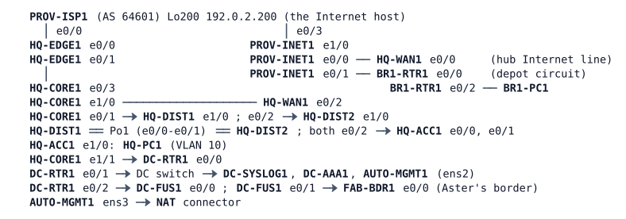

# MS-5 — Final Challenge

**Module:** 11 Controllers and architecture (closes the course) · **Type:** M (Milestone) · **Guidance tier:** G1 (business outcomes) · **Estimated time:** 325 min · **Blueprint domains:** 1, 2, 3, 4, 5, 6

> Run this lab alone: it uses 18 of the server's 20 running nodes (the NAT connector counts as a 19th in the node budget). All nodes are IOL images or Linux hosts and boot in about 2 minutes, but the network needs about 5 minutes more to settle (routing, BGP, the NTP source) and AUTO-MGMT1 installs its Python environment in the background for about 5 minutes after start: wait for both before you start. The load recipes below use CPU on the Alpine hosts: generate one load at a time.

## Scenario

Veridian Logistics is the host of a new customer, Aster Systems, whose network joins Veridian's data centre through a fusion router. You are the operations engineer on call for the whole Veridian network: the HQ campus, the Internet edge, the WAN hub and the depot, the data centre and the handoff to Aster. The helpdesk, Aster's IT and the NOC have opened three tickets, and the change manager has queued four change requests for the same 325-minute maintenance window. Nothing in the queue says how to do the work: the documentation pack, the constraints and the acceptance criteria below are the contract, and the pack is not complete. Close the tickets, deliver the change requests, prove at the end that the network survives the failures it is supposed to survive, and leave scripted evidence of the state of the management standard before and after.

## Objectives

- Close three tickets in an integrated network, finding causes that show only when you test the right path.
- Rebuild missing facts from the live network when the documentation is incomplete.
- Deliver four changes that interact with one another and with the tickets: a restricted inter-VRF leak, a backup Internet path with tracked origination, protection of a WAN hub's control plane and a guaranteed share of a shaped depot circuit in the direction toward the depot.
- Prove resilience by measurement: failure of an Internet edge path, of a link between the core and the edge and of a distribution switch, each with a named failure method.
- Produce before-and-after evidence with a script that audits the management standard on every Veridian device.

## Available Information

### Documentation pack

**Topology** (all cables patched; HQ campus links are dot1q trunks with native VLAN 999; the NAT connector gives AUTO-MGMT1 an upstream path only):

| Link | A | B | Carries / addressing |
|---|---|---|---|
| CORE1–DIST1 | HQ-CORE1 e0/1 | HQ-DIST1 e1/0 | VLAN 901 (10.10.255.2/31), 20, 50, 99 |
| CORE1–DIST2 | HQ-CORE1 e0/2 | HQ-DIST2 e1/0 | VLAN 902 (10.10.255.4/31) |
| DIST interconnect | HQ-DIST1 e0/0-e0/1 | HQ-DIST2 e0/0-e0/1 | Po1 (LACP): VLANs 10, 20, 50, 99 |
| ACC1 uplinks | HQ-DIST1 e0/2, HQ-DIST2 e0/2 | HQ-ACC1 e0/0, e0/1 | user VLANs 10, 20, 50, 99 |
| Host | HQ-ACC1 e1/0 | HQ-PC1 | VLAN 10 |
| Core to edge | HQ-CORE1 e0/3 | HQ-EDGE1 e0/1 | 10.10.255.64/31 (CORE1 .64, EDGE1 .65), OSPF area 0 point-to-point cost 10, hello 1 / dead 4; MGMT sub-interface .99 10.10.254.4/31 (CORE1 .4, EDGE1 .5) |
| EDGE1 to ISP-A | HQ-EDGE1 e0/0 | PROV-ISP1 e0/0 | 198.51.100.64/31 (ISP1 .64, EDGE1 .65), eBGP AS 65010 to AS 64601 |
| Core to WAN hub | HQ-CORE1 e1/0 | HQ-WAN1 e0/2 | 10.10.255.96/31 (CORE1 .96, WAN1 .97), OSPF area 0 p2p cost 10; MGMT .99 10.10.254.10/31 (CORE1 .10, WAN1 .11), OSPF 99 |
| Hub Internet line | HQ-WAN1 e0/0 | PROV-INET1 e0/0 | 203.0.113.128/31 (INET1 .128, hub .129) |
| Depot circuit | BR1-RTR1 e0/0 | PROV-INET1 e0/1 | 203.0.113.130/31 (INET1 .130, BR1 .131); provider-shaped to 2 Mb/s in each direction (link conditioning: 2000 kb/s, 30 ms, 0.2 % loss); the depot router's uplink policy (voice EF priority 25 %, scanner class AF31 25 %, the rest fair-queued, shaped to the circuit) was deployed with the circuit and is in force |
| Depot LAN | BR1-RTR1 e0/2 | BR1-PC1 | 10.21.10.0/24 (.1 / .101), native dot1q 10; OT is Loopback40 10.21.40.1/24 (VRF OT, no host); MGMT is Loopback99 10.21.99.1/24 (VRF MGMT) |
| Provider interconnect | PROV-INET1 e1/0 | PROV-ISP1 e0/3 | 198.51.100.128/31 (provider statics) |
| HQ campus IPv6 | HQ-DIST1 / HQ-DIST2 Vlan10 | HQ-PC1 | 2001:db8:10:10::/64, gateways learned from router advertisements |
| Core to data centre | HQ-CORE1 e1/1 | DC-RTR1 e0/0 | 10.10.255.130/31 (CORE1 .130, DC-RTR1 .131), OSPF area 50; MGMT .99 10.10.254.6/31 (CORE1 .6, DC-RTR1 .7) |
| Data centre | DC-RTR1 e0/1 | DC switch | 10.50.50.0/24 in VRF MGMT (DC-RTR1 .1) |
| Fusion | DC-RTR1 e0/2 | DC-FUS1 e0/0 | the shared-services side of the fusion router (OSPF 50, area 50) |
| Aster handoff | DC-FUS1 e0/1 | FAB-BDR1 e0/0 | per-VN eBGP (AS 65010 to Aster's AS 65060) with VRF-lite fusion on DC-FUS1; FAB-BDR1 is Aster's border router |

The WAN: the depot BR1-RTR1 reaches the hub HQ-WAN1 through an IPsec-protected GRE tunnel over the Internet (Tunnel21 for the routed network, Tunnel91 for management, Tunnel41 for OT), OSPF over the tunnels. The depot's Internet access leaves through its own PAT. The unused interfaces are shut, except HQ-EDGE1 e0/2 (10.10.60.2, uncabled, left up and not used by any service). HQ-PC2 and the second core of the HQ design are not part of this network (VLAN 20 is configured and has no host).

**VLANs and first-hop gateways (HQ).**

| VLAN | Subnet | Gateway (VIP .1) | Hosts |
|---|---|---|---|
| 10 (users) | 10.10.10.0/24 | HQ-DIST1 .2 / HQ-DIST2 .3, GLBP | HQ-PC1 .101 |
| 20 (OPS) | 10.10.20.0/24 | HQ-CORE1 .2, VRRPv3 group 20 (only member) | none |
| 50 (servers) | 10.10.50.0/24 | HQ-CORE1 .2, VRRPv3 group 50 (only member) | none |
| 99 (management) | 10.10.99.0/24, VRF MGMT on the core and the DISTs | HQ-CORE1 .2, VRRPv3 group 99 | HQ-DIST1 .11, HQ-DIST2 .12, HQ-ACC1 .21 |
| 999 | native VLAN, unused | | |

The core is a single router since the second core was removed: VRRP shows Master with no peer by design. The HQ-DIST switches are the VLAN 10 and 99 spanning-tree roots (priority 24576); the root-guard on their access downlinks is part of the design. The NOC keeps a record of edge-link events on the core as a file in its `unix:` file system (`more unix:/gw-evidence.txt`).

**Internet edge design (module standard).** HQ-EDGE1 (AS 65010) is the primary Internet edge: a static default through ISP-A tracked by IP SLA 10 (probe to 198.51.100.1, track `delay up 30` s), originating a default into OSPF (metric 10) while its track is Up. Inside users are translated (PAT) to 192.0.2.1 on the way out. The Internet host is 192.0.2.200 (behind PROV-ISP1). The edge keeps the control-plane policy `PM-COPP`. The WAN hub HQ-WAN1 (10.255.10.41) terminates the depot tunnels; its public address is 203.0.113.129 (the depot tunnel endpoints on the depot circuit are 203.0.113.131, .153 and .154) and its inbound circuit ACL `WAN1-INET-IN` admits the depot's IKE, ESP, NTP and ICMP.

**Shared services and the Aster handoff.** The data centre hosts a shared service for Aster at 10.50.51.1 (a loopback standing for the shared-services segment, 10.50.51.0/24) and a second, unused service prefix 10.50.52.0/24. Aster's two virtual networks (office CORP and scanner IOT) are separate VRFs on DC-FUS1 and on Aster's border; shared services are leaked between them through the fusion router by route targets. Aster's prefixes are not listed here: discover them. DC-FUS1 is managed from its console (local account only). FAB-BDR1 belongs to Aster's team. For your tests it may be used (console, local `admin`) for show commands and sourced ping/telnet tests, with no configuration change; its Loopback10 is the CORP user prefix and Loopback20 the IOT prefix (discover their addresses).

**Management standard.** Every Veridian IOS device follows it: local account `admin` (break-glass); central accounts through DC-AAA1 (RADIUS 10.50.50.52, UDP 1812/1813, through VRF MGMT; HQ-ACC1 reaches it from its global table) for login and for exec authorization (the server assigns the privilege), with fallback to the local account when the server does not answer; syslog to DC-SYSLOG1 10.50.50.51; time from DC-RTR1 (10.50.50.1, authenticated, key 1); SSH only, accepted from the management networks (10.10.99.0/24, 10.50.50.0/24) and enforced by an access class on the WAN routers. Management addresses: HQ-CORE1 10.10.99.2, HQ-DIST1 .11, HQ-DIST2 .12, HQ-ACC1 .21, HQ-EDGE1 10.10.254.5, HQ-WAN1 10.10.254.11, BR1-RTR1 10.21.99.1, DC-RTR1 10.50.50.1; AUTO-MGMT1 is 10.50.50.31 (ens2; route 10.0.0.0/8 via 10.50.50.1; ens3 to the NAT connector) with Python 3, a virtual environment `/home/cisco/venv` (requests, ncclient, netmiko, once its first-boot install has finished) and `curl`, `jq`.

**HQ dual-stack.** HQ uses 2001:db8:10::/48 (VLAN 10 is 2001:db8:10:10::/64; HQ-DIST1 ::2, HQ-DIST2 ::3). Hosts learn their IPv6 gateways from the distribution switches' router advertisements (sent every 4 s, router lifetime 12 s; HQ-DIST1 preferred). IPv6 Internet access is through HQ-EDGE1's eBGP with ISP-A; the Internet host is also 2001:db8:f001:200::200. Access-switch standard: every access port drops IPv6 router advertisements arriving from hosts (RA guard policy `HOST-RA-BLOCK`, device role host). OSPFv3 runs on the campus links.

**Aster group policy at the fusion.** Aster's SD-Access group policy is extended to the shared services on DC-FUS1. The handoff carries no group tag on these images, so DC-FUS1 classifies Aster's office and scanner subnets by static IP-to-group mappings in each Aster VRF (office CORP = group 10, scanners IOT = group 20, shared services = group 50) and enforces the policy on the traffic it routes: the office may use any shared service, the scanners only ICMP (health checks), traffic to the shared services from an unclassified source is refused, every other pair keeps the default.

**Credentials.**

| Item | Value |
|---|---|
| Local account / enable | `admin` / `Cisco123!` (privilege 15); enable secret `Cisco123!` |
| RADIUS (DC-AAA1) | shared key `RADKEY123`; NOC account `netadmin` / `netpass` (the server assigns privilege 15), `netops` / `opspass` (privilege 1) |
| Hosts | Alpine PCs and AUTO-MGMT1: `cisco` / `cisco` (the PCs have `iperf`, `nc`, `tcpdump` with `sudo`) |

**Change log (neutral entries from the change manager).**

| Change | When | Note |
|---|---|---|
| CHG-5101 | Friday | HQ access switch replaced (main floor) |
| CHG-5102 | last night | Shared-service onboarding for Aster, DC and fusion, details not recorded |
| CHG-5103 | last week | Depot router configuration clean-up |
| CHG-5104 | last month | Core configuration tidied after the second core's removal |

**Monitoring excerpts.**
- DC-SYSLOG1 (last night, 02:14-02:15): `%TRACK-6-STATE: 11 ip sla reachability Up -> Down` from the core, then `Down -> Up` 20 seconds later (an edge-link flap during the maintenance).
- The core's IP SLA table lists two operations: one reports Up, the other has reported a timeout since the cleanup.
- Every HQ device is green in the NMS except the main-floor access switch, which is reachable on its management address.

**Constraints (all work).**
- Window: 325 minutes. No reload or wipe of any node. Management through VRF MGMT must survive every change.
- No change on the provider devices (PROV-ISP1, PROV-INET1), on Aster's border FAB-BDR1 (Aster's team) or on the data-centre servers (DC-AAA1, DC-SYSLOG1).
- Failure methods: a **cable pull** is `shutdown` on both ends of a link. A **silent failure** is `link stop` in CML on the named link (the interfaces stay up and drop traffic) or a node stop; restore with `link start` or node start. A one-ended `shutdown` is a third case: the peer port stays up. Say which one you used. To fail a distribution switch without restarting it, stop every link of that switch (a silent total loss).
- Everything is recorded with evidence.
- Platform note (CML images): an ACL applied outbound on an interface also filters the router's own traffic (for example its BGP session), which differs from IOS on hardware. Allow for it when you restrict traffic, and re-check sessions after the hold time (3 minutes for BGP).

## Starting State

- 18 nodes are running with the configurations above applied at boot; nothing has been saved or changed by you. The recent changes are in the change log.
- The depot circuit is shaped by the provider to 2 Mb/s in each direction. Time services start about 5 minutes after boot; `Clock is synchronized` on the routers can take 25-35 minutes (the NTP server is selected earlier), which does not matter for the work.
- Test aids. (1) A gap clock on a path: `ping -i 1 <address>` on a host (the sequence number is the clock). (2) Load and class marking, in either direction: `iperf -c <host> -u -S <tos> -b <rate> -l <len> -t <seconds>` on the sending host (EF is TOS 0xb8, AF31 is 0x68; EF flow 300 kb/s with `-l 200`, AF31 400 kb/s and bulk 3 Mb/s with `-l 1200`: larger datagrams exceed the tunnel MTU) with one `iperf -s -u -p <port> -i <seconds>` per flow on the receiver; run the three flows in parallel on different ports. (3) ICMP burst at a router: `ping -q -i 0.01 -s 0 -w 40 <address>` from a host. (4) IPv6 from a host: `ip -6 route`, `ping -6 <address>`, `sudo tcpdump -i eth0 <filter>`. TCP reachability from a host: `nc -z -w 3 <address> <port> && echo OPEN || echo CLOSED`. (5) Per-policy hit counters are read on the device that enforces the policy. Files for evidence on a router are in `unix:`; read one with `more unix:/name`. (6) `clear crypto session` and `clear logging` ask for confirmation, which blocks scripted sessions; shutting a tunnel interface also renegotiates it.
- The interface speed in CML is not a real bottleneck except on the depot circuit; a congestion test elsewhere needs a temporary constraint that you remove afterwards.

## Requirements / Change Requests

R1. **Constraints.** All the constraints above hold throughout, except the DC-AAA1 stop/start of V8.

R2. **Tickets.** Close TK1, TK2 and TK3 (see Reported Problems), each with before-and-after evidence.

R3. **CR1: Aster integration, phase 2.** Veridian's helpdesk (VLAN 10, 10.10.10.0/24) must reach Aster's office network (CORP) by ping and SSH only. Aster's scanner network (IOT) stays unreachable from Veridian and Veridian from it. Aster CORP learns no further Veridian prefix than the shared service and 10.10.10.0/24. Aster's border is not touched. Your notes from LAB-051 and LAB-069 (route-target leaking between VRFs) apply.

R4. **CR2: backup Internet through the WAN hub.** When the edge's provider path fails (including silently), HQ users reach the Internet host through HQ-WAN1 within 30 seconds and return to the edge when it recovers. The hub must not attract Internet traffic while the edge path is healthy, and offers the backup only while its own Internet path answers. The hub sends one syslog message to DC-SYSLOG1 each time it starts or stops offering the backup.

R5. **CR3: protect the hub's control plane.** Under an ICMP flood toward the hub's public address, IKE, OSPF over the tunnels, NTP and SSH from the management networks keep working; ICMP to the hub is limited to 8 kb/s; other traffic to the hub is unaffected.

R6. **CR4: depot voice and scanner traffic toward the depot.** The depot circuit is shaped by the provider to 2 Mb/s in each direction, and the depot router's uplink policy already protects calls toward HQ. Calls from HQ to the depot break up whenever HQ sends bulk data to the depot (the nightly restore job). Give the depot's voice (EF, priority up to 25 %) and scanner class (AF31, 25 %) the same treatment toward the depot, bulk takes the rest, without limiting anything else the hub's Internet line carries (after CR2 it is also HQ's Internet backup). The flows are tunnelled, so a policy counts each packet with its tunnel overhead. Prove it with generated loads in both directions (one EF, one AF31 and one unmarked flow each way between HQ-PC1 and BR1-PC1). In this collapsed depot OT has no host: its marking is represented by the flows. The provider's conditioning and the provider devices are not yours to change.

R7. **Scripted evidence.** From AUTO-MGMT1, with a Python script (netmiko through VRF MGMT), produce a JSON compliance report of the management standard (AAA lists and server group VRF, logging host, NTP server and key, VTY access class and transport) for every Veridian IOS device that can be reached from AUTO-MGMT1, with each deviation. Run it before you change anything and after your last change; the script logs in as the NOC RADIUS account `netadmin`, no enable fallback.

## Reported Problems

- **TK1 (helpdesk):** "Since the main-floor access switch was replaced on Friday, the office PCs on it have no network at all. The NOC can still reach the switch itself."
- **TK2 (Aster IT):** "Since Veridian's DC maintenance last night, both our office network and our scanner network have lost the shared services you host for us (10.50.51.1). Inside Aster everything works."
- **TK3 (NOC):** "(1) Since last week, NOC engineers' sessions on the depot router open without configuration rights; DC-AAA1 shows their logins as accepted. (2) The core's failover evidence file has no entry for last night's edge-link flap, which DC-SYSLOG1 recorded."

## Verification Criteria

V1. Every Veridian host reaches its gateway, the DC services it is entitled to, the depot or HQ and the Internet host (192.0.2.200), over IPv6 as well (2001:db8:f001:200::200) where its site is dual-stack, with the IPv6 gateways learned as designed.

V2. The campus Layer 2 design is as documented (including the access-switch standard), with no error or warning messages in the campus switching logs newer than your last fix (check before the V10 tests, or clear the buffer interactively on the console; fault-period and test-restore lines stay in the buffer).

V3. Both Aster networks reach the shared service 10.50.51.1 and never each other, within the documented group policy: the office with any protocol, the scanners with ICMP only (a scanner TCP probe is refused at the fusion, shown by the policy counters), unclassified sources refused.

V4. CR1: the helpdesk subnet reaches Aster's office devices by ping and SSH; nothing else of Veridian reaches Aster; Aster's scanner network stays unreachable from Veridian; Aster CORP's routing table holds only the shared service and the helpdesk subnet from Veridian.

V5. CR2: with the edge's provider path failed silently (link stop), HQ users reach the Internet host within 30 seconds through the hub, and return after recovery (3 runs each way, raw values); with the hub's own Internet path also failed, no device offers a default it cannot use; one syslog message per change of the hub's own offer on DC-SYSLOG1.

V6. CR3: under the flood, IKE, OSPF, NTP and SSH stay up and the ICMP class drops.

V7. CR4: (a) under a load in each direction (EF, AF31 and bulk flows from BR1-PC1 to HQ-PC1 and from HQ-PC1 to BR1-PC1, 60 seconds), voice loss is at most 1 %, the class counters show the guarantee, and bulk and scanner traffic receive at least their share (receiver-side measurement: bulk about 0.9 Mb/s or more of payload at the receiver, about 1 Mb/s on the wire; AF31 within 1 % of 400 kb/s; EF at most 1 % loss), with no anti-replay drops on either tunnel end; (b) with V5's edge-path failure active and the load toward the depot running, HQ's Internet traffic through the hub is not held to the depot's rate (state your evidence: counters and HQ-PC1's pings to the Internet host); the cause of any other loss is explained with a router log or counter.

V8. Central logins with server-assigned privilege work on the eight devices R7 audits (not DC-FUS1); the break-glass account works only as the fallback (stop DC-AAA1 to prove the fallback, then start it).

V9. An edge-link failure (cable pull of the core-to-edge link) writes evidence on the core, one entry per state change.

V10. Office users survive the loss of either distribution switch (silent total loss of all its links) in both IP stacks, timed (3 runs per switch and stack). Platform note: on this image the switch that is STP root for VLAN 10 routes frames addressed to either GLBP forwarder MAC, which hardware does not do; state which switch is the root when you read your times.

V11. The before and after compliance reports exist, with every deviation explained and the after report clean.

## Analysis Questions

Q1. For each ticket, which evidence first ruled out the most obvious cause?
Q2. Where did the incomplete documentation mislead you, and how did you rebuild the facts (which commands or scripts)?
Q3. Which change requests interacted with tickets or with each other, and what order did you choose?
Q4. Which of your fixes changed what users experience, and how did you prove each?
Q5. Which pre- and post-change checks would you add to Veridian's change process?
